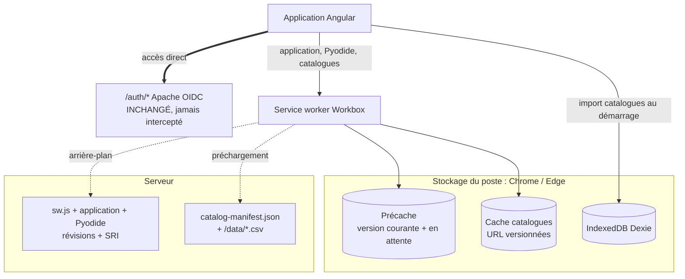
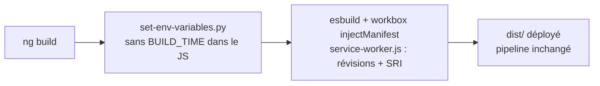
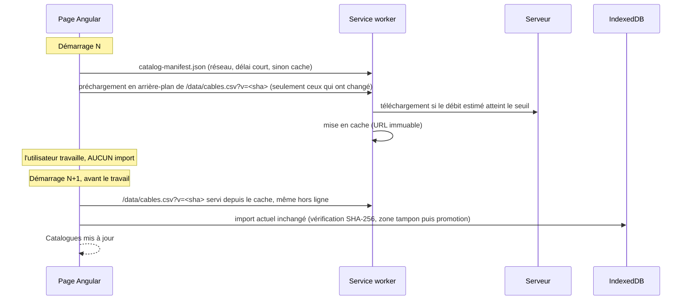
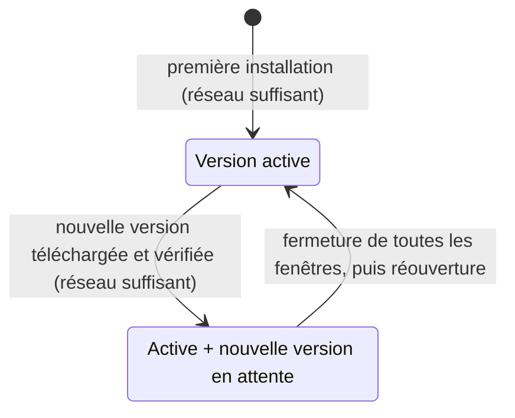
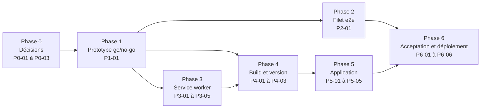

# Stellar : migration vers une PWA standard (Workbox)

Proposition détaillée, schémas de fonctionnement, coûts, risques et bénéfices.

- **Application** : phlowers-stellar-app (Angular 21, Pyodide, Dexie)
- **Date** : 8 octobre 2026
- **Version du document** : 3 (règle réseau par débit `downlink`, pas de bouton « Appliquer », plan d'action détaillé)
- **Navigateurs cibles** : Chrome / Edge
- **Contrainte** : **aucune modification du système d'authentification**

---

## Révisions de la version 3

| Changement | Conséquence |
|---|---|
| **Règle réseau** : approximation par le débit `downlink` avec un seuil de vitesse (au lieu de « wifi ou filaire ») | `navigator.connection.type` n'est pas exposé sous Windows ; `downlink` l'est dans Chrome et Edge. Voir section 2 |
| **Pas de bouton « Appliquer maintenant »** : seulement une notification « mise à jour au prochain démarrage » | La nouvelle version s'active **uniquement** quand toutes les fenêtres de l'application sont fermées, puis rouvertes. Plus de `skipWaiting`, de rechargement, de `BroadcastChannel`, de contrôle « travail en cours » ni de bandeau multi-onglets |
| Tous les onglets exécutent toujours la même version | Disparition des risques « onglet resté sur l'ancienne version » (fichiers JS supprimés, schéma Dexie) : la gestion de `versionchange` sort du périmètre |
| **Garde d'espace de stockage** avant tout téléchargement | La mise à jour ne s'appliquant qu'à la fermeture puis au redémarrage, la version en attente occupe de la place **en plus** de la version active jusqu'à l'activation : le service worker vérifie que le delta plus une réserve tient dans le quota (partagé avec IndexedDB). Voir section 2 |
| **Plan d'action détaillé** (section 11) | 24 tâches au format `gemini-taskfile`, avec prototype et décision go/no-go avant la migration |
| **Bascule par configuration (`legacy` / `workbox`) non retenue** | Elle obligerait à garder deux systèmes de mise à jour dans la même application. Remplacée par un déploiement progressif par environnement, le kill-switch et le retour par redéploiement. **À confirmer** (hypothèse H6) |

---

## Contraintes et décisions prises

| Contrainte exprimée | Réponse apportée |
|---|---|
| 1. Utilisable à tout moment, sans latence, en ligne ou hors ligne | Ouverture toujours depuis le cache ; la session est vérifiée en arrière-plan par `AuthService`, sans changement |
| 2. Jamais de mise à jour pendant le travail | Aucun bouton, aucun rechargement : la nouvelle version ne devient active qu'après **fermeture de toutes les fenêtres** de l'application, puis réouverture |
| 3. Ne pas saturer un réseau faible (3G) | Téléchargements en arrière-plan **uniquement si le débit estimé (`downlink`) atteint un seuil** ; seuls les fichiers modifiés |
| 4. Version complète et vérifiée avant bascule | Installation atomique standard + contrôle d'intégrité SRI de chaque fichier |
| 5. Informer l'utilisateur | Indicateur permanent, **notification « mise à jour au prochain démarrage »**, page admin complète |

| Question | Décision |
|---|---|
| Ouverture et session expirée | Ouverture immédiate depuis le cache ; la session expirée est détectée par la vérification `/auth/userinfo` qu'`AuthService` fait déjà en arrière-plan |
| Moment de la bascule | **À la fermeture de toutes les fenêtres, au prochain démarrage** (comportement PWA standard) ; pas de bouton « Appliquer », juste une notification |
| Retour arrière local | **Non** : en cas de problème, redéploiement du commit précédent côté serveur ; kill-switch en urgence |
| Catalogues | Téléchargement en arrière-plan, import au démarrage suivant, avant le travail |
| Règle réseau | Approximation par le débit `downlink` : téléchargement en arrière-plan seulement au-dessus d'un seuil de vitesse (pas d'interrupteur manuel) |
| Espace de stockage | Contrôle **avant** tout téléchargement : fichiers manquants + réserve pour les données utilisateur ≤ espace libre ; sinon refus propre et information de l'utilisateur |
| Postes | Chrome / Edge uniquement (PC portables, tablettes Windows ou Android) |
| Pipeline de build réel | Lance `npm run build`, déploie `dist/` et écrit `assets/config/app-config.json` |
| Dépendance Workbox (Google, licence MIT) | Acceptée |

> **Le fonctionnement en 6 points**
>
> 1. **Le navigateur et Workbox gèrent les mises à jour selon le cycle standard** : nouvelle version détectée, téléchargée en arrière-plan fichier par fichier, vérifiée (SRI sur chaque fichier), puis mise en attente.
> 2. **Aucun bouton, aucun rechargement** : la version téléchargée et vérifiée reste en attente et ne devient active qu'après **fermeture de toutes les fenêtres**, puis réouverture. L'utilisateur est seulement prévenu par une notification : « mise à jour au prochain démarrage ». Jamais pendant le travail.
> 3. **L'application s'ouvre toujours instantanément depuis le cache**, en ligne comme hors ligne. La session expirée est détectée par la vérification qu'`AuthService` fait déjà, sans modification de l'authentification.
> 4. **Seuls les fichiers modifiés sont téléchargés, et uniquement si le débit estimé (`downlink`) atteint un seuil** : Pyodide inchangé ne repasse jamais sur le réseau, et rien n'est téléchargé en arrière-plan sur un réseau lent.
> 5. **Les catalogues** sont téléchargés en arrière-plan et importés au démarrage suivant, avant le travail, avec le contrôle SHA-256 actuel.
> 6. **Pas de retour arrière local** : en cas de problème, on redéploie le commit précédent, que les postes reçoivent comme une mise à jour normale ; le kill-switch reste disponible en urgence. Le fonctionnement est ainsi **entièrement standard**.

---

## 1. Architecture



*Vue d'ensemble : le service worker sert l'application et les catalogues depuis le cache ; `/auth/*` n'est jamais intercepté.*



*Build : toujours lancé par `npm run build` ; une étape de génération du service worker (esbuild + `injectManifest`) est ajoutée.*

| Élément | Standard ? | Rôle |
|---|---|---|
| `workbox-precaching` (`PrecacheController`) | Oui | Téléchargement, révisions, différentiel, reprise, SRI |
| `workbox-routing` + `NavigationRoute` | Oui | Shell servi depuis le cache ; `/auth`, `/docs`, `/data` hors navigation |
| `workbox-strategies` (CacheFirst) + `workbox-expiration` | Oui | Catalogues avec des URL versionnées par hash |
| `workbox-window` dans un service Angular | Oui | Événement `waiting` : notification « mise à jour au prochain démarrage » (aucune activation forcée) |
| **Règle réseau** (`navigator.connection.downlink`) | API standard | Ne télécharger en arrière-plan qu'au-dessus d'un seuil de débit (règle propre au projet) |

En dehors de la règle réseau, tout est standard : aucune personnalisation du cycle de vie ni du nettoyage de Workbox.

---

## 2. Cycle de mise à jour de l'application

```mermaid
sequenceDiagram
    participant U as Utilisateur
    participant P as Page Angular
    participant SW as Service worker
    participant S as Serveur
    P->>SW: ouverture : shell et fichiers servis depuis le cache (instantané)
    P->>S: /auth/userinfo en arrière-plan (AuthService, inchangé)
    SW->>S: le navigateur vérifie sw.js (une petite requête)
    alt sw.js identique (même commit, ex. déploiement quotidien de dev)
        Note over SW: rien à faire
    else nouvelle version
        SW->>SW: règle réseau : downlink ≥ seuil ?
        SW->>SW: espace : fichiers manquants + réserve ≤ espace libre ?
        alt réseau ou espace insuffisant
            Note over SW: installation refusée avant tout téléchargement ; nouvel essai au prochain contrôle
        else réseau et espace suffisants
            SW->>S: seuls les fichiers modifiés, un à la fois
            Note over SW: SRI vérifié pour chaque fichier, reprise si interruption
            SW-->>P: version en attente (waiting)
            P-->>U: notification : mise à jour au prochain démarrage
            Note over U,SW: l'utilisateur continue de travailler sur la version actuelle
            U->>P: ferme toutes les fenêtres de l'application
            U->>P: rouvre l'application
            SW->>SW: activation de la nouvelle version, anciens fichiers supprimés
        end
    end
```

*La nouvelle version est entièrement téléchargée et vérifiée avant d'être mise en attente ; elle ne devient active qu'au prochain démarrage.*

### Règles pour ne jamais perdre le travail (contrainte 2)

- **La nouvelle version devient active uniquement quand toutes les fenêtres et onglets de l'application sont fermés, puis rouverts** (cycle standard du navigateur). Le service worker n'appelle ni `skipWaiting()` ni de rechargement : rien ne peut se produire pendant une session de travail.
- **Tous les onglets ouverts exécutent la même version**, y compris ceux ouverts après le téléchargement : la version en attente ne contrôle aucune page. Plus de fichiers manquants ni de schéma IndexedDB divergent entre onglets.
- **Un rechargement (F5) n'applique pas la mise à jour** : c'est le comportement standard du navigateur. La notification demande de fermer toutes les fenêtres puis de rouvrir l'application.
- **Notification, pas de bouton** : « Mise à jour téléchargée : elle sera appliquée au prochain démarrage de l'application (fermez toutes les fenêtres de Stellar, puis rouvrez-la). » Elle est répétée à chaque démarrage tant que la version n'est pas appliquée.
- **Limites** : un utilisateur qui laisse l'application ouverte plusieurs jours reste sur l'ancienne version (relance en backlog). Cas marginal : un rechargement sans cache (Ctrl+Maj+R) charge la version du serveur pour cet onglet, hors service worker.

### Règle réseau (contrainte 3) : approximation par le débit `downlink`

Chrome et Edge exposent `navigator.connection.downlink` : le **débit effectif estimé en Mbit/s**, calculé à partir du trafic récent. Il est disponible sous Windows (contrairement au type de connexion), arrondi à 25 kbit/s et **plafonné à 10 Mbit/s** (à confirmer au prototype) : le seuil doit donc rester inférieur ou égal à 10.

| Mesure | Téléchargement en arrière-plan |
|---|---|
| `downlink` ≥ seuil | **Autorisé** : seuls les fichiers modifiés, un à la fois |
| `downlink` < seuil | **Refusé** : report à la prochaine vérification ; l'indicateur le signale |
| `downlink` inconnu, ou API indisponible | **Refusé** (prudence) |
| `saveData` activé par l'utilisateur | **Refusé** (ajout sans coût : c'est un choix explicite de l'utilisateur) |
| Hors ligne | Rien |

- **Valeur proposée du seuil : 5 Mbit/s** (constante unique `BACKGROUND_DOWNLOAD_MIN_DOWNLINK_MBPS`), à calibrer au prototype avec des mesures sur wifi RTE, filaire, VPN et partage de connexion 4G.
- **Où la règle s'applique** : installation du service worker (premier lancement compris), mises à jour, préchargement des catalogues. Le service worker **refuse l'installation** quand la règle n'est pas satisfaite : rien n'est téléchargé, l'ancienne version reste active, le navigateur réessaiera au contrôle suivant. La page applique la même règle (code partagé) pour décider quand demander une vérification : au démarrage, à chaque événement `change` de `navigator.connection`, au retour en ligne et à intervalle régulier.
- **Premier lancement sur un réseau insuffisant** : pas de service worker installé, l'application fonctionne en ligne comme un site classique ; l'indicateur affiche « hors ligne non préparé : en attente d'un réseau suffisant ».
- **Ce que la règle ne bloque pas** : ce qui est nécessaire à l'usage immédiat en ligne (chargement des écrans, de Pyodide au premier calcul).

> **Limites connues de l'approximation**
>
> - Une 4G rapide peut dépasser le seuil (téléchargement autorisé) ; un wifi saturé peut passer en dessous (téléchargement reporté, sans gravité).
> - L'estimation dépend du trafic récent : sa fiabilité **dans le service worker** (sans page active) est à confirmer au prototype ; repli possible : la page transmet sa mesure.
> - **Premier usage sans catalogues** (hypothèse H4) : si IndexedDB ne contient encore aucun catalogue, l'application est inutilisable ; proposition : télécharger les catalogues absents quel que soit le réseau.

### Règle d'espace de stockage (contrôle avant téléchargement)

Aucun contrôle n'existe aujourd'hui : seule l'erreur de quota est traitée après coup. Or, comme il n'y a ni bouton ni bascule immédiate, **la version en attente occupe de la place EN PLUS de la version active pendant toute la période qui précède la fermeture et le redémarrage de l'application** : l'espace n'est libéré qu'à l'activation, qui supprime les anciens fichiers. Si plusieurs versions se succèdent sans redémarrage, les fichiers de chacune s'accumulent jusqu'à cette activation.

| Mesure | Décision |
|---|---|
| Espace libre = quota − usage (`navigator.storage.estimate()`) | Référence |
| Besoin = taille des fichiers du manifeste **absents du cache** (le delta, pas la version entière, donc cumul des versions en attente inclus) + réserve pour les données utilisateur | Référence |
| Libre ≥ besoin | Installation autorisée |
| Libre < besoin | Installation refusée avant tout téléchargement, indicateur « espace insuffisant », notification d'information, nouvel essai au contrôle suivant |
| `estimate()` indisponible | Autorisé (l'erreur de quota reste traitée, voir ci-dessous) |

- **Pourquoi une réserve** : le quota est partagé avec IndexedDB (études, catalogues). Un précache qui remplit le quota peut faire échouer l'enregistrement d'une étude, c'est-à-dire faire perdre du travail. Réserve proposée : 100 Mo (hypothèse H9), à ajuster d'après l'usage réel d'IndexedDB en pilote.
- **Tailles** : le build ajoute la taille de chaque fichier au manifeste.
- **Ordres de grandeur** : première installation ≈ 75 Mo (Pyodide 54 Mo + application 19,5 Mo, hors `.map`) plus la réserve ; mise à jour courante : uniquement les fichiers de code modifiés, Pyodide inchangé (à mesurer sur des commits réels).
- **Même règle** pour la première installation et le préchargement des catalogues.
- **Si l'erreur de quota survient malgré le contrôle** (`estimate()` est approximatif) : les entrées écrites pendant la tentative sont supprimées (comparaison des clés avant et après) pour rendre l'espace, et l'état « espace insuffisant » est signalé.
- **Message dédié** (distinct de la notification « au prochain démarrage », car rien n'a été téléchargé) : « Espace de stockage insuffisant pour télécharger la mise à jour : libérez de l'espace sur l'appareil. »

---

## 3. Catalogues gérés de façon standard



*Les catalogues ne sont jamais importés pendant le travail de l'utilisateur.*

- **Ce qui change** :
  - `assets_list.json` devient un simple `catalog-manifest.json` (`data_hashes`) ;
  - les catalogues sont lus par une URL versionnée (`?v=<sha>`) ;
  - l'import est déplacé au démarrage.
- **Ce qui ne change pas** : les importeurs, le Web Worker CSV, le contrôle SHA-256 et la promotion atomique.
- **Entrée en cache corrompue** : l'URL versionnée étant immuable, un fichier en cache dont le SHA-256 ne correspond pas est supprimé du cache, puis téléchargé une fois depuis le réseau.

---

## 4. Cycle de vie des versions et retour arrière



*Cycle 100 % standard : la version en attente remplace la version active au prochain démarrage ; les anciens fichiers sont alors supprimés.*

- **Pas de retour arrière local.** En cas de version défectueuse, on **redéploie le commit précédent** côté serveur. Les postes le reçoivent comme une mise à jour normale : seuls les fichiers modifiés sont téléchargés si le réseau est suffisant, puis la version s'applique au prochain démarrage.
- **En urgence** (service worker défectueux), le **kill-switch** désactive le service worker sur tous les postes à leur prochaine connexion, sans recharger les pages ouvertes.

> **Garde-fou** : un retour arrière par redéploiement est **impossible si la version annulée a modifié le schéma Dexie**. L'ancien code ne sait pas ouvrir une base de version supérieure (`VersionError`), et le projet en est à la version 10 ([app-database.versions.ts](src/app/infrastructure/database/app-database.versions.ts)). Dans ce cas, il faut livrer un correctif vers l'avant : les migrations de schéma doivent être relues avec ce risque en tête.

---

## 5. Informer l'utilisateur (contrainte 5)

| État | Affichage |
|---|---|
| À jour, prêt hors ligne | Indicateur discret dans la barre du haut |
| Pas encore disponible hors ligne (Pyodide incomplet) | Indicateur orange : « préparation hors ligne en cours » ou « en attente d'un réseau suffisant » |
| Mise à jour en téléchargement | Indicateur discret, sans modale |
| Mise à jour reportée (débit sous le seuil) | Info-bulle sur l'indicateur |
| Espace de stockage insuffisant | Indicateur orange et notification « Espace de stockage insuffisant pour télécharger la mise à jour : libérez de l'espace sur l'appareil » |
| **Nouvelle version téléchargée** | **Bandeau de notification standard** (toast `NotificationService.info`, comme les autres messages de l'application) : « Mise à jour téléchargée : elle sera appliquée au prochain démarrage de l'application (fermez toutes les fenêtres, puis rouvrez-la) », répété à chaque démarrage tant qu'elle est en attente. **Même message dans la carte « Actualités » de l'écran d'accueil** tant que la version attend. Aucun bouton, aucune modale, aucun blocage de la saisie |
| Catalogues importés | Message court au démarrage |
| Actualités éditoriales (notes de version) | Restent dans `public/data/news.md`, rédigées à la main par l'équipe ; elles ne servent **pas** à signaler la mise à jour en attente (fichier identique pour tous les postes, lu en ligne seulement : il ne sait pas quelle version un poste a téléchargée) |
| Page admin | Version courante, version en attente, état « prêt hors ligne », mesure `downlink` et seuil, bouton « Vérifier les mises à jour » (sans bouton d'application) |

---

## 6. Authentification : ce qui ne change pas

- `AuthService`, `AuthResyncService`, Apache / mod_auth_openidc, `/auth/userinfo` et `/auth/relogin` : **aucune modification**.
- **`/auth/*` n'est jamais intercepté** : aucune route Workbox ne correspond, le navigateur traite seul ces requêtes, comme le fait aujourd'hui le contournement du service worker.

**Seul changement de comportement**, choisi lors des décisions : à l'ouverture, plus de passage par le réseau pour qu'Apache redirige. La session expirée est détectée par la vérification existante d'`AuthService`. C'est à couvrir par un test e2e dédié.

---

## 7. Coût de la migration (en volume, pas en durée)

| Chantier | Volume | Risque |
|---|---|---|
| **Build** : bundle du service worker (esbuild) + `injectManifest` avec révisions et SRI calculés sur les fichiers finaux (après `set-env-variables.py`) ; retirer `BUILD_TIME` du bundle | 1 nouveau script, `package.json`, 2 fichiers d'environnement | **Moyen**. Pièges identifiés : la limite par défaut de 2 Mio de Workbox exclurait Pyodide ; `version.json` doit être exclu du manifeste (sinon chaque build change `service-worker.js`) ; ne pas considérer les fichiers au nom hashé comme immuables (leur contenu change après le build) |
| **Service worker Workbox** : précache, navigation, catalogues, règle réseau, garde d'espace, nettoyage des anciens caches `app-assets*` | ~180 lignes au lieu de ~930 | **Faible à moyen** |
| **Côté page** : service basé sur `workbox-window` (notification, vérifications, règle réseau), indicateurs, page admin | ~200 lignes au lieu de ~660 | **Faible à moyen** |
| **Catalogues** : `catalog-manifest.json`, URL versionnées, import au démarrage | Changements ciblés dans `CatalogUpdateService` et le script Python | **Faible** (pipeline d'import inchangé) |
| **Tests unitaires** : réécriture des tests du service worker et de `UpdateService` | ~2 800 lignes remplacées par des tests plus courts | **Moyen** (volume) |
| **Tests e2e** : le serveur de simulation sert un `service-worker.js` par scénario ; scénarios repris et complétés | 4 fichiers e2e + serveur de simulation | **Élevé** (c'est le filet anti-régression) |
| **Kill-switch, documentation fr/en, procédure d'exploitation** | Petit | **Faible** |
| **Ponctuel** : chaque poste retélécharge l'application une fois | — | **À planifier** (téléchargement uniquement si le débit atteint le seuil ; double téléchargement ponctuel pendant la transition, voir P6-04) |

**Code retiré** : l'actuel `service-worker.ts`, les keepalive, watchdogs et la barre de progression bloquante, la modale « Appliquer » et son contrôle de travail en cours, la liste `files` d'`assets_list.json` (côté service worker), et le script `build:service-worker`.

---

## 8. Risques et parades

| Risque | Parade |
|---|---|
| Régression fonctionnelle | **Tests d'acceptation d'abord** : les 17 scénarios e2e actuels sont réécrits indépendamment du service worker, validés sur le service worker actuel, puis rejoués sur Workbox |
| Problème découvert en production | **Déploiement progressif** (dev, recette, pilotes, production) avec critères de passage ; **kill-switch** ; **retour par redéploiement** du commit précédent, testé en P6-04. La bascule par configuration est écartée (deux systèmes dans l'application) |
| Premier téléchargement de Pyodide | Reprise fichier par fichier (les fichiers déjà en cache ne sont pas retéléchargés). Chrome limite la durée d'un événement d'installation (environ 5 minutes, à confirmer) : **à mesurer dans le prototype (P1-01)** |
| Approximation par `downlink` imprécise (4G rapide jugée suffisante, wifi saturé jugé insuffisant) | Seuil calibré au prototype et modifiable par une constante ; l'effet d'une erreur est limité à un téléchargement en trop ou reporté |
| La version en attente et la version active occupent le stockage jusqu'au redémarrage ; quota partagé avec IndexedDB (risque pour l'enregistrement des études) | Garde d'espace avant téléchargement (delta + réserve) ; nettoyage des entrées de l'essai en cas d'erreur de quota ; usage et quota affichés en page admin (P3-05 et P5-03) |
| Utilisateur qui ne ferme jamais l'application (reste plusieurs jours sur l'ancienne version) | Notification répétée à chaque démarrage ; page admin ; relance après N jours et version obligatoire en backlog (BL-02, BL-03) |
| Installation lancée avant authentification ou avec une session expirée (les fichiers répondent par la page de login) | SRI : un fichier dont le contenu diffère est rejeté ; réponses redirigées refusées ; la toute première installation est déclenchée après l'authentification (lecture seule de `AuthService.currentUser()`) |
| Retour arrière par redéploiement impossible après un changement de schéma Dexie | Correctif vers l'avant ; relecture des migrations Dexie avant chaque livraison |
| Session expirée moins visible à l'ouverture | Test e2e dédié ; comportement d'`AuthService` déjà en place et inchangé |
| Transition depuis le service worker actuel | `assets_list.json` conservé pour les postes encore sur l'ancien système ; nettoyage des caches `app-assets*` à l'activation ; double téléchargement ponctuel accepté ; testé en P6-04 |
| Décalage de nom de wheel (`stellar_engine` en `cp313` dans [python-packages.json](src/app/core/services/worker_python/python-packages.json), `py3` dans `public/pyodide/`) | À vérifier **avant** la migration : indépendant de celle-ci, mais bloquant pour Pyodide |

---

## 9. Bénéfices

| Contrainte | Aujourd'hui | Après |
|---|---|---|
| 1. Sans latence, en ligne et hors ligne | Jusqu'à 13 s d'attente réseau à l'ouverture | **Ouverture instantanée** depuis le cache |
| 2. Jamais pendant le travail | Modale bloquante pendant le téléchargement ; autres onglets rechargés d'office ; catalogues importés en cours de travail | Téléchargement invisible ; **aucune activation avant la fermeture de toutes les fenêtres** ; catalogues importés au démarrage |
| 3. Réseau faible | 5 téléchargements en parallèle, tout est retéléchargé, quel que soit le réseau | **Aucun téléchargement en arrière-plan sous le seuil de débit `downlink`** ; seuls les fichiers modifiés |
| 4. Version complète avant bascule | Marqueur `/app_version`, sans contrôle d'intégrité | Installation atomique **et SRI sur chaque fichier** |
| 5. Informer | Modale, notifications | Indicateur permanent, **notification « mise à jour au prochain démarrage »**, page admin complète |
| Maintenance | ~930 + ~660 lignes de mécanique maison | ~350 lignes, quasi entièrement standard et documentées publiquement |

---

## 10. Démarche recommandée

1. **Merger la branche actuelle** (`fixbug/error-update-app-pwa`) : elle corrige les bugs en production et sert de référence pour les tests d'acceptation (P0-01).
2. **Figer les décisions ouvertes** : seuil de débit, cas sans API réseau, exception des catalogues (P0-02).
3. **Prototype jetable avec décision go/no-go** : cinq mesures, dont le seuil `downlink`, la durée du premier téléchargement de Pyodide, la fenêtre d'installation et le comportement « version en attente » (P1-01).
4. **Filet de non-régression d'abord** : les scénarios e2e actuels sont rendus indépendants du service worker et validés sur le système actuel (P2-01).
5. **Migration** par phases (service worker, build, application), puis **acceptation, transition et déploiement progressif** : dev, recette, pilotes, production (phases 3 à 6).

---

## 11. Plan d'action détaillé

> Format : norme `gemini-taskfile` (skill `rte-taskfile`), un bloc YAML par tâche. Les statuts partent à `todo` ; la date de référence est le 8 octobre 2026. **24 tâches : 3 XS, 5 S, 12 M, 4 L, aucune XL.** Les tâches s'exécutent dans l'ordre des dépendances ; le graphe est acyclique.

### Vue d'ensemble

| Phase | Objectif | Tâches | Sortie |
|---|---|---|---|
| 0 - Décisions et prérequis | Merge de la branche actuelle, hypothèses validées, wheels vérifiées | P0-01 à P0-03 | Baseline verte, décisions H1 à H10 |
| 1 - Prototype et go/no-go | Trancher par la mesure les points « à confirmer » | P1-01 | Rapport de mesures et décision |
| 2 - Filet de non-régression | E2E indépendants de l'implémentation du service worker | P2-01 | Matrice des scénarios, helpers neutres |
| 3 - Service worker | Précache, navigation, règle réseau, garde d'espace, catalogues, kill-switch | P3-01 à P3-05 | `src/sw/` testé |
| 4 - Build et version | Version à l'exécution, génération du service worker, manifeste des catalogues | P4-01 à P4-03 | `dist/service-worker.js` déterministe |
| 5 - Application Angular | Service de mise à jour, câblage, indicateurs, catalogues, retrait de l'ancien système | P5-01 à P5-05 | Application sur Workbox |
| 6 - Acceptation, transition, déploiement | E2E des nouveaux comportements, transition, documentation, déploiement progressif | P6-01 à P6-06 | Production sur Workbox |



### Contrat qualité (non négociable)

```yaml
quality_contract:
  depth:         "MAX — un sizing S/M n'autorise jamais à bâcler"
  sources:       "Toute affirmation factuelle est sourcée et vérifiée ; les comportements de Workbox et de Chrome marqués « à confirmer » sont mesurés au prototype (P1-01), jamais supposés"
  self_review:   "Auto-revue adversariale avant de marquer une tâche done"
  no_stub:       "Zéro stub, zéro mock, zéro TODO sur la logique cœur"
  human_in_loop: "L'intention reste humaine ; aucun commit ni push par l'agent"
  hard_constraint: "AUCUNE modification de AuthService, AuthResyncService, Apache / OIDC, /auth/* (lecture seule de AuthService.currentUser() autorisée)"
  repo_rules:    "Alias d'import (@services/*, @core/*), standalone + OnPush + signals, LoggerService (jamais console.*), NotificationService, textes via Transloco fr/en, code mort consigné dans deadcode.md avant toute suppression, wheels Pyodide et python-packages.json jamais modifiés"
```

### Conventions

```yaml
sizing_guide:
  XS: "< 5min augmenté / < 30min humain"
  S:  "< 10min augmenté / < 1h humain"
  M:  "< 20min augmenté / < 2h humain"
  L:  "< 30min augmenté / < 4h humain (maximum autorisé)"
naming_convention:
  phases:  "P0 à P6"
  tasks:   "P{phase}-{sequence}"
  backlog: "BL-{sequence}"
```

### Hypothèses à valider (P0-02)

> **Décision (2026-10-08)** : H1 à H10 validées telles quelles par l'utilisateur (tech lead / PO).

```yaml
hypotheses:
  H1: "Seuil initial : downlink >= 5 Mbit/s (plafond Chrome : 10), constante unique, calibrée en P1-01."
  H2: "navigator.connection indisponible ou downlink inconnu : pas de téléchargement en arrière-plan."
  H3: "saveData actif : pas de téléchargement en arrière-plan (ajout à la règle demandée, sans coût)."
  H4: "Catalogues absents d'IndexedDB (premier usage) : téléchargés quel que soit le réseau, sinon l'application est inutilisable."
  H5: "La règle s'applique aussi à la toute première installation du service worker ; sans réseau suffisant, l'application fonctionne en ligne, sans service worker."
  H6: "Pas de bascule par configuration legacy/workbox : déploiement progressif par environnement, kill-switch, retour par redéploiement."
  H7: "Notification répétée à chaque démarrage tant qu'une version attend ; aucune relance forcée (BL-03)."
  H8: "assets_list.json (format actuel) conservé pendant la transition pour les postes encore sur l'ancien système (retrait : BL-01)."
  H9: "Réserve d'espace pour les données utilisateur : 100 Mo (constante unique), à ajuster d'après l'usage IndexedDB réel observé en pilote (P6-06)."
  H10: "navigator.storage.estimate() indisponible : téléchargement autorisé (contrairement à la règle réseau, l'erreur de quota est de toute façon traitée après coup)."
```

---

### Phase 0 - Décisions et prérequis

#### P0-01: Merger la branche fixbug/error-update-app-pwa et figer la baseline
```yaml
id: P0-01
title: "Merger la branche fixbug/error-update-app-pwa et figer la baseline"
phase: "Phase 0 - Décisions et prérequis"
priority: critical
status: done
completion: 100%
last_update: "2026-10-08"
progress_notes: |
  Baseline vérifiée sur HEAD 9ce92482 (= fixbug/error-update-app-pwa), après reconstruction de dist/ (l'ancien dist/
  datait du commit 195370e et faisait échouer « a deleted active cache is reinstalled… » de façon déterministe) :
  vitest 200 fichiers / 4 884 tests verts ; e2e update-flow + update-faults 19/19 verts sans retry (3,3 min).
  Merge dans dev confirmé par l'utilisateur le 2026-10-08 ; le travail continue sur POC/update-system.
responsible: { lead: "tech-lead", support: [] }
sizing: { estimate: XS, human_effort: "~30min", augmented_effort: "~5min" }
description: |
  La branche corrige les bugs de mise à jour en production (garde-fous, identité par git hash) et sert de
  référence de comportement pour les tests d'acceptation (P2-01). Merge manuel : aucun commit ni push par l'agent.
dependencies: []
toolings_used: { stack: ["git", "Vitest", "Playwright"], mcp_servers: [], skills: [], agents: [], external_tools: ["GitHub (PR)"] }
definition_of_ready:
  - "PR relue par un second développeur"
  - "Critère d'acceptation non ambigu : « dev contient la branche et les suites sont vertes »"
success_criteria:
  - description: "Branche mergée dans dev"
    validated: true
  - description: "Baseline enregistrée : 4 884 tests unitaires et 19 e2e (update-flow et update-faults) verts sur dev"
    validated: true
tests:
  - name: "baseline-verte"
    type: "manual"
    assertion: "npm run e2e:prepare (dist/ à jour), puis npm run test, npm run e2e:update et npm run e2e:update-faults retournent le code 0 sur dev après le merge"
    validated: true
definition_of_done:
  - "success_criteria et tests validés ; contrat qualité respecté ; relu par l'humain pilote"
  - "Résultat de la baseline noté dans la PR"
files: { create: [], modify: [], reference: ["plan-update-hash.md"] }
```

#### P0-02: Figer les décisions ouvertes (hypothèses H1 à H10)
```yaml
id: P0-02
title: "Figer les décisions ouvertes (hypothèses H1 à H10)"
phase: "Phase 0 - Décisions et prérequis"
priority: critical
status: done
completion: 100%
last_update: "2026-10-08"
progress_notes: "H1 à H10 validées telles quelles par l'utilisateur (tech lead / PO) le 2026-10-08 ; seuil downlink initial : 5 Mbit/s ; réserve : 100 Mo."
responsible: { lead: "tech-lead", support: ["po"] }
sizing: { estimate: XS, human_effort: "~30min", augmented_effort: "~5min" }
description: |
  Faire valider par le PO et le tech lead les hypothèses H1 à H10 ci-dessus, en particulier la valeur initiale du
  seuil de débit (H1), le cas sans API réseau (H2), l'exception des catalogues (H4), le comportement du premier
  lancement (H5), l'abandon de la bascule par configuration (H6) et la réserve d'espace de stockage (H9). Sans ces
  décisions, P3-02, P3-05, P5-04 et P6-06 ne sont pas testables.
dependencies: []
toolings_used: { stack: [], mcp_servers: [], skills: [], agents: [], external_tools: [] }
definition_of_ready:
  - "Analyse (sections 2 à 4) relue par le PO et le tech lead"
success_criteria:
  - description: "Chaque hypothèse H1 à H10 est marquée « validée » ou remplacée par une valeur décidée"
    validated: true
  - description: "La valeur initiale du seuil downlink est notée (proposition : 5 Mbit/s)"
    validated: true
tests:
  - name: "hypotheses-tranchees"
    type: "review"
    assertion: "Le bloc des hypothèses porte, pour chacune des dix, la décision, le nom du validateur et la date"
    validated: true
definition_of_done:
  - "success_criteria et tests validés ; contrat qualité respecté ; relu par l'humain pilote"
  - "Analyse mise à jour avec les décisions"
files: { create: [], modify: ["analyse-migration-pwa-workbox.md"], reference: [] }
```

#### P0-03: Vérifier la cohérence des wheels Pyodide (lecture seule)
```yaml
id: P0-03
title: "Vérifier la cohérence des wheels Pyodide (lecture seule)"
phase: "Phase 0 - Décisions et prérequis"
priority: high
status: done
completion: 100%
last_update: "2026-10-08"
progress_notes: |
  Écart confirmé, UNIQUE : stellar_engine (python-packages.json : stellar_engine-0.3.0-cp313-none-any.whl ;
  public/pyodide/ et dist/pyodide/ : stellar_engine-0.3.0-py3-none-any.whl). Les 28 autres wheels concordent (29/29/29).
  Cause identifiée dans scripts/set_up_mechaphlowers_v2.py : le mode complet passe les wheels locales par
  « pyodide py-compile » (compile_wheels), qui renomme py3 en cp313, puis écrit python-packages.json (finalize) ;
  le mode --engine-only (engine_only) copie la wheel stellar_engine NON compilée (py3) sans appeler compile_wheels.
  Le dépôt local a reçu une wheel py3 (engine-only ou wheel externe) alors que le JSON versionné vient d'un mode complet.
  Build déployé : le pipeline est hors dépôt (Dockerfile sans appel au script), non vérifiable ici.
  À remonter au PO : soit relancer le mode complet, soit faire compiler la wheel en mode engine-only.
  git diff vide sur public/pyodide/ et python-packages.json.
responsible: { lead: "dev-front", support: [] }
sizing: { estimate: XS, human_effort: "~30min", augmented_effort: "~5min" }
description: |
  python-packages.json référence stellar_engine-0.3.0-cp313-none-any.whl alors que public/pyodide/ contient
  stellar_engine-0.3.0-py3-none-any.whl (29 wheels de chaque côté). Vérifier si l'écart existe aussi sur le build
  déployé (génération du fichier par scripts/set_up_mechaphlowers_v2.py). LECTURE SEULE : les instructions Pyodide du
  projet interdisent de modifier les wheels, python-packages.json et les versions mechaphlowers / thermohl sans
  instruction explicite. Un écart confirmé est remonté au PO ; il bloque Pyodide avec ou sans migration.
dependencies: []
toolings_used: { stack: ["Python", "Pyodide"], mcp_servers: [], skills: [], agents: ["Explore"], external_tools: [] }
definition_of_ready:
  - "Accès au build déployé ou à son artefact dist/"
success_criteria:
  - description: "Liste exhaustive des écarts de nom entre python-packages.json et les fichiers réellement servis"
    validated: true
tests:
  - name: "rapport-ecarts"
    type: "review"
    assertion: "Le rapport compare les 29 entrées à public/pyodide/*.whl et à dist/pyodide/ ; git diff est vide sur public/pyodide/ et sur python-packages.json"
    validated: true
definition_of_done:
  - "success_criteria et tests validés ; contrat qualité respecté ; relu par l'humain pilote"
  - "Écart éventuel transmis au PO avec la cause identifiée"
files:
  create: []
  modify: []
  reference: ["src/app/core/services/worker_python/python-packages.json", "public/pyodide/", "scripts/set_up_mechaphlowers_v2.py"]
```

---

### Phase 1 - Prototype et go/no-go

#### P1-01: Prototype jetable Workbox et mesures
```yaml
id: P1-01
title: "Prototype jetable Workbox et mesures"
phase: "Phase 1 - Prototype et go/no-go"
priority: critical
status: done
completion: 100%
last_update: "2026-10-08"
progress_notes: |
  GO prononcé par l'utilisateur le 2026-10-08 SANS exécution du prototype ni des mesures (réseaux et postes réels
  indisponibles pour l'agent). RISQUE ACCEPTÉ : les points « à confirmer » (plafond et fiabilité de downlink dans le
  service worker, fenêtre d'installation d'environ 5 min, durée du premier téléchargement de Pyodide) restent à
  mesurer en recette et en pilote (P6-06). Seuil retenu par défaut : 5 Mbit/s (H1). Le déterminisme du build et le
  comportement « version en attente » sont couverts par P4-02 et P6-02.
responsible: { lead: "dev-front", support: ["qa", "devops"] }
sizing: { estimate: L, human_effort: "~4h", augmented_effort: "~30min" }
description: |
  Prototype jetable (branche dédiée, jamais mergée) : service worker Workbox minimal (PrecacheController, garde réseau,
  ni skipWaiting ni rechargement) branché sur un build réel. Il tranche par la mesure les points « à confirmer » :
  précache séquentiel et reprise, plafond et fiabilité de downlink dans le service worker, limite d'environ 5 minutes
  d'un événement d'installation, activation d'une version en attente, déterminisme du build.
  Livrable : rapport de mesures et décision go/no-go. Aucune ligne du prototype n'est reprise telle quelle.
dependencies: [P0-01, P0-02, P0-03]
toolings_used: { stack: ["Workbox 7", "esbuild", "Chrome / Edge DevTools"], mcp_servers: [], skills: [], agents: ["Explore"], external_tools: ["Playwright", "poste Windows et poste Android", "wifi RTE, filaire, VPN, partage 4G"] }
definition_of_ready:
  - "P0-01, P0-02 et P0-03 en statut done"
  - "Accès aux postes et aux réseaux de mesure"
success_criteria:
  - description: "Premier téléchargement complet de Pyodide : durée mesurée à 5 et 10 Mbit/s simulés ; après coupure à 50 %, les fichiers déjà en cache ne sont pas retéléchargés"
    validated: false
  - description: "Seuil downlink calibré à partir de mesures sur wifi RTE, filaire, VPN et partage 4G, dans la page ET dans le service worker ; plafond à 10 Mbit/s confirmé ; méthode de simulation du débit en e2e retenue (émulation CDP ou injection par le serveur de simulation)"
    validated: false
  - description: "Version en attente : F5 n'active pas, la fermeture de toutes les fenêtres puis la réouverture active (onglet navigateur et PWA installée) ; une installation de plus de 5 minutes aboutit ou reprend à l'essai suivant"
    validated: false
  - description: "Session OIDC expirée : l'application s'ouvre depuis le cache et aucun fichier du précache n'est remplacé par la page de login"
    validated: false
  - description: "Rebuild du même commit : service-worker.js identique octet pour octet, donc aucune nouvelle version"
    validated: false
tests:
  - name: "mesure-pyodide"
    type: "manual"
    assertion: "Tableau durée / reprise du premier téléchargement à 5 et 10 Mbit/s ; journal serveur : 0 requête pour les fichiers déjà en cache après reprise"
    validated: false
  - name: "mesure-downlink"
    type: "manual"
    assertion: "Tableau des valeurs downlink observées (page et service worker) par réseau et par système ; seuil retenu documenté"
    validated: false
  - name: "version-en-attente"
    type: "manual"
    assertion: "Après F5 la version exécutée est inchangée ; après fermeture de toutes les fenêtres et réouverture elle est la nouvelle"
    validated: false
  - name: "session-expiree"
    type: "manual"
    assertion: "Avec /auth/userinfo répondant 401, l'application s'ouvre ; le contenu du cache de précache est identique avant et après"
    validated: false
  - name: "rebuild-identique"
    type: "manual"
    assertion: "sha256sum dist/service-worker.js identique après deux builds du même commit"
    validated: false
definition_of_done:
  - "success_criteria et tests validés ; contrat qualité respecté ; relu par l'humain pilote"
  - "Rapport go/no-go signé par le tech lead. No-go : le plan est revu et la branche actuelle reste la solution"
files: { create: ["prototype-workbox-report.md"], modify: [], reference: ["src/app/core/services/worker_update/service-worker.ts", "package.json"] }
```

---

### Phase 2 - Filet de non-régression

#### P2-01: Rendre les e2e indépendants de l'implémentation du service worker
```yaml
id: P2-01
title: "Rendre les e2e indépendants de l'implémentation du service worker"
phase: "Phase 2 - Filet de non-régression"
priority: critical
status: done
completion: 100%
last_update: "2026-10-08"
progress_notes: |
  Snapshot réduit à des observables de comportement : appVersion = version estampillée par le serveur de simulation
  dans le JS réellement chargé par le document (scan de performance.getEntriesByType('resource'), mémorisé par
  document) ; offlineReady = caches.match('/index.html', { ignoreSearch: true }) ; journal des requêtes du serveur.
  Écarts au plan : (1) /e2e-app-vN.js n'est pas utilisable comme « version servie » (non référencé par le shell et
  servi aussi par le réseau en repli) ; la version de la barre latérale non plus (les tests restent sur /login) ;
  (2) un /index.html en cache n'est pas un signal atomique de fin d'installation (ni dans l'ancien système, ni dans
  Workbox) : ajout de waitForDownloadsToSettle (journal du serveur stable pendant 2 s) dans waitForFirstInstall.
  Il y a 19 scénarios (et non 17). Aucune modification de update-sim-server.mjs.
  Validation : 19/19 verts sans retry sur le service worker actuel (4,3 min) ; 0 occurrence de app-assets-control,
  app-assets-v-, /app_version dans e2e/ ; eslint propre.
  Matrice des scénarios (C = conserver, R = réécrire, A = abandonner ; R/A exécutés jusqu'à P6-02) :
    update-flow · first install + auth .......................... C (offlineReady remplace le nombre de caches)
    update-flow · never installs unauthenticated ................. C
    update-flow · popup refusé + catalogues indépendants ......... R P6-02/P6-03 (plus de modale ; import catalogues au démarrage suivant)
    update-flow · accepting the popup activates the new version .. R P6-02 (activation à la fermeture de toutes les fenêtres) ; assertions de rétention de la version précédente retirées (A : pas de retour arrière local)
    update-flow · two successive updates (ex-« prunes ») ........ R P6-02 ; comptage des caches versionnés retiré (A)
    update-flow · admin force update ............................. R P5-03 (bouton « Vérifier » seul, plus de force-update-btn)
    update-flow · candidate asset fails to precache .............. C (équivalent Workbox : installation atomique échoue)
    update-flow · catalog bad hash ............................... C (assertions neutres ; moment de l'import revu en P6-03)
    update-flow · only the changed catalog is requested .......... C
    update-flow · offline root and deep link ..................... C
    update-faults · RC1 SW stoppé en téléchargement ............ R P6-02 (reprise, sans modale)
    update-faults · D2 reprise sans tout retélécharger ........... R P6-02 (lit assets_list.json, spécifique)
    update-faults · RC2 fichier bloqué ........................... R P6-02 (échec d'installation, version inchangée)
    update-faults · RC2 502 transitoire .......................... R P6-02 (pas de retry intra-installation dans Workbox : réussite au contrôle suivant)
    update-faults · RC3 rebuild du même commit ................... C (+ aucun téléchargement après le rechargement)
    update-faults · RC7 manifeste qui ne répond jamais ........... A (plus de manifeste assets_list.json côté SW)
    update-faults · A -> B -> A sans retéléchargement ............ A (Workbox supprime les anciennes révisions à l'activation)
    update-faults · caches supprimés réinstallés sans boucle ..... C (suppression de tous les caches, plus d'un cache nommé)
    update-faults · RC6 autre onglet rechargé .................... A (plus aucun rechargement forcé)
responsible: { lead: "qa", support: ["dev-front"] }
sizing: { estimate: M, human_effort: "~2h", augmented_effort: "~15min" }
description: |
  Les helpers e2e (e2e/update-flow.helpers.ts, interface Snapshot) lisent les caches internes du système actuel
  (app-assets-control, app-assets-v-*, /app_version). Les remplacer par des observables de comportement : « prêt hors
  ligne » (une entrée /index.html existe dans un cache), « version servie » (réponse de /e2e-app-vN.js servie par le
  service worker) et journal des requêtes du serveur de simulation. Classer chacun des 17 scénarios : conserver,
  réécrire ou abandonner (spécifique à l'ancien système : conservation de la version précédente, nombre de caches
  versionnés, keepalive, modale « Appliquer »). Tout est validé sur le service worker ACTUEL avant la migration.
dependencies: [P0-01, P1-01]
toolings_used: { stack: ["Playwright", "TypeScript"], mcp_servers: [], skills: ["skill-test"], agents: [], external_tools: ["Playwright 1.61"] }
definition_of_ready:
  - "P1-01 en statut done avec décision go"
  - "Baseline de P0-01 verte"
success_criteria:
  - description: "Matrice des 17 scénarios : conserver, réécrire ou abandonner, avec la justification de chaque ligne"
    validated: true
  - description: "Helpers sans référence aux noms internes de caches de l'ancien système"
    validated: true
  - description: "Tous les scénarios conservés passent sur le service worker actuel"
    validated: true
tests:
  - name: "helpers-neutres"
    type: "review"
    assertion: "Recherche dans e2e/ : 0 occurrence de app-assets-control, app-assets-v- et /app_version dans les helpers et les scénarios conservés"
    validated: true
  - name: "e2e-actuels-verts"
    type: "e2e"
    assertion: "npm run e2e:update et npm run e2e:update-faults retournent le code 0 sur le service worker actuel après le refactor"
    validated: true
definition_of_done:
  - "success_criteria et tests validés ; contrat qualité respecté ; relu par l'humain pilote"
  - "Matrice des scénarios jointe à la PR"
files:
  create: []
  modify: ["e2e/update-flow.helpers.ts", "e2e/update-flow.interfaces.ts", "e2e/update-flow.spec.ts", "e2e/update-faults.spec.ts"]
  reference: ["e2e/update-sim-server.mjs"]
```

---

### Phase 3 - Service worker

#### P3-01: Service worker Workbox : précache, navigation et nettoyage
```yaml
id: P3-01
title: "Service worker Workbox : précache, navigation et nettoyage"
phase: "Phase 3 - Service worker"
priority: critical
status: done
completion: 100%
last_update: "2026-10-12"
progress_notes: |
  src/sw/service-worker.ts (câblage seul) + service-worker.helpers.ts (createSafeResponsePlugin, NavigationRoute
  avec denylist, deleteLegacyCaches, runActivation) + specs. Aucun skipWaiting (un seul commentaire). Logger du SW
  relayé à la page (message SW_LOG -> LoggerService). Revalidé le 2026-10-12 : vitest 208 fichiers / 4832 tests verts.
  Écart : le précache Workbox ne se reconstitue pas entièrement après un effacement manuel des seuls caches (seules
  les entrées redemandées sont réécrites) ; un effacement complet des données du site (caches + désenregistrement)
  réinstalle tout (e2e update-faults).
responsible: { lead: "dev-front", support: [] }
sizing: { estimate: M, human_effort: "~2h", augmented_effort: "~15min" }
description: |
  Nouveau service worker dans src/sw/ (TypeScript, bundlé par P4-02) : PrecacheController alimenté par le manifeste
  injecté (self.__WB_MANIFEST) ; navigation (pages et liens profonds) servie depuis le shell en cache, sans attente
  réseau ; routes exclues ; à l'activation, nettoyage du précache standard et suppression des caches app-assets* de
  l'ancien système. Ni skipWaiting() ni rechargement : la version en attente ne s'active qu'à la fermeture de toutes
  les fenêtres. clients.claim() n'est appelé qu'à l'activation (sans effet sur une mise à jour : plus aucun onglet
  contrôlé à ce moment ; utile à la première installation). La réponse du réseau est refusée si elle est redirigée
  ou non OK (page de login), en plus du SRI de P4-02. AuthService et /auth/* ne sont pas concernés.
dependencies: [P1-01]
toolings_used: { stack: ["TypeScript", "workbox-precaching", "workbox-routing"], mcp_servers: [], skills: ["skill-test"], agents: [], external_tools: ["Vitest"] }
definition_of_ready:
  - "P1-01 en statut done avec décision go"
  - "Comportements « à confirmer » de l'analyse tranchés par le rapport du prototype"
success_criteria:
  - description: "Précache du manifeste injecté via PrecacheController ; aucun appel à skipWaiting() ; clients.claim() uniquement à l'activation"
    validated: true
  - description: "Navigation servie depuis le shell en cache pour / et pour les liens profonds, sans requête réseau"
    validated: true
  - description: "Jamais interceptés : /auth/**, /docs/**, /data/** (hors catalogues versionnés, P3-03), /assets_list.json, /catalog-manifest.json, /version.json, /assets/config/**, celesteback"
    validated: true
  - description: "À l'activation : précache nettoyé, caches app-assets* et app-assets-control supprimés"
    validated: true
  - description: "Réponse redirigée ou non OK refusée pendant le précache"
    validated: true
tests:
  - name: "pas-de-skipwaiting"
    type: "unit"
    assertion: "L'événement install n'appelle jamais skipWaiting ; une recherche dans le code (hors commentaires) ne trouve aucun appel à skipWaiting"
    validated: true
  - name: "navigation-cache"
    type: "unit"
    assertion: "Une navigation vers /studies/42 reçoit /index.html du cache et fetch n'est pas appelé"
    validated: true
  - name: "routes-exclues"
    type: "unit"
    assertion: "Pour /auth/relogin, /docs/x, /data/cables.csv, /assets_list.json, /catalog-manifest.json, /version.json, /assets/config/app-config.json et une URL celesteback, respondWith n'est pas appelé"
    validated: true
  - name: "nettoyage-activation"
    type: "unit"
    assertion: "Avec les caches app-assets-v-abc1234 et app-assets-control présents, ils sont supprimés après l'activation"
    validated: true
  - name: "reponse-redirigee"
    type: "unit"
    assertion: "Une réponse {redirected: true} ou {ok: false} lors du précache fait échouer l'installation et n'écrit rien dans le cache"
    validated: true
definition_of_done:
  - "success_criteria et tests validés ; contrat qualité respecté ; relu par l'humain pilote"
  - "Aucun console.* ; journalisation via un petit logger du service worker relayé à la page"
files:
  create: ["src/sw/service-worker.ts", "src/sw/service-worker.constantes.ts", "src/sw/service-worker.helpers.ts", "src/sw/service-worker.interfaces.ts", "src/sw/service-worker.spec.ts", "tsconfig.sw.json"]
  modify: ["package.json", "vitest.config.ts"]
  reference: ["src/app/core/services/worker_update/service-worker.ts"]
```

#### P3-02: Règle réseau par débit downlink
```yaml
id: P3-02
title: "Règle réseau par débit downlink"
phase: "Phase 3 - Service worker"
priority: critical
status: done
completion: 100%
last_update: "2026-10-12"
progress_notes: |
  Fonction pure evaluateBackgroundDownload + constante BACKGROUND_DOWNLOAD_MIN_DOWNLINK_MBPS = 5 (TSDoc : plafond
  Chrome à 10 Mbit/s, procédure de modification) ; fichier ajouté hors plan : network-rule.interfaces.ts.
  Garde à l'installation : runGuardedInstall (service-worker.helpers.ts) lève InstallRefusedError avant tout fetch et
  publie SW_INSTALL_REFUSED aux pages. Validé aussi en e2e navigateur (update-network-offline : 1 / 8 Mbit/s).
responsible: { lead: "dev-front", support: [] }
sizing: { estimate: M, human_effort: "~2h", augmented_effort: "~15min" }
description: |
  Fonction pure evaluateBackgroundDownload(connection, seuil) partagée par le service worker et la page (code sans
  dépendance Angular, importé par alias). Résultat : { allowed, reason, downlinkMbps }. Le service worker refuse
  l'installation (erreur typée, avant tout fetch) quand la règle n'est pas satisfaite, premier lancement compris (H5).
  Le seuil est une constante unique BACKGROUND_DOWNLOAD_MIN_DOWNLINK_MBPS (valeur validée en P0-02, calibrée en P1-01).
dependencies: [P3-01]
toolings_used: { stack: ["TypeScript"], mcp_servers: [], skills: ["skill-test"], agents: [], external_tools: ["Vitest"] }
definition_of_ready:
  - "P3-01 en statut done"
  - "Seuil (H1), cas API absente (H2) et saveData (H3) validés en P0-02"
success_criteria:
  - description: "Fonction pure : downlink >= seuil autorisé ; sous le seuil, inconnu, API absente ou saveData actif refusés"
    validated: true
  - description: "Garde à l'installation : échec typé avant tout fetch de précache si la règle refuse"
    validated: true
  - description: "Même fonction importable par la page (alias @services/...), sans import Angular"
    validated: true
tests:
  - name: "regle-table"
    type: "unit"
    assertion: "Avec un seuil de 5 : {downlink: 10} autorisé ; {downlink: 5} autorisé ; {downlink: 4.9} refusé (downlink-below-threshold) ; undefined refusé (api-unavailable) ; {downlink: undefined} refusé (downlink-unknown) ; {downlink: 50, saveData: true} refusé (save-data)"
    validated: true
  - name: "garde-installation"
    type: "unit"
    assertion: "Avec downlink 1, install échoue sans aucun fetch ; avec downlink 8, le précache démarre"
    validated: true
definition_of_done:
  - "success_criteria et tests validés ; contrat qualité respecté ; relu par l'humain pilote"
  - "Constante documentée (TSDoc) avec la procédure pour la modifier"
files:
  create: ["src/app/core/services/app-update/network-rule.helpers.ts", "src/app/core/services/app-update/network-rule.helpers.spec.ts", "src/app/core/services/app-update/network-rule.constantes.ts"]
  modify: ["src/sw/service-worker.ts", "src/sw/service-worker.spec.ts"]
  reference: []
```

#### P3-03: Catalogues dans le service worker
```yaml
id: P3-03
title: "Catalogues dans le service worker"
phase: "Phase 3 - Service worker"
priority: high
status: done
completion: 100%
last_update: "2026-10-12"
progress_notes: |
  src/sw/catalogs.ts : isVersionedCatalogUrl, route CacheFirst stellar-catalogs-v1 (ExpirationPlugin 12 entrées +
  plugin de réponse sûre), prefetchCatalogs (dédoublonnage après normalisation, règle réseau sauf force, contrôle de
  la seule réserve d'espace, séquentiel, Request redirect: 'error'), résultat renvoyé sur event.ports[0]. Contrat
  dans sw-messages.interfaces.ts, réexporté par service-worker.interfaces.ts. Spec catalogs.spec.ts verte.
responsible: { lead: "dev-front", support: [] }
sizing: { estimate: M, human_effort: "~2h", augmented_effort: "~15min" }
description: |
  Route CacheFirst pour /data/<fichier>?v=<sha> (cache stellar-catalogs-v1, au plus 12 entrées : 6 catalogues x 2
  versions). Message PREFETCH_CATALOGS { urls, force } : préchargement séquentiel, soumis à la règle réseau sauf si
  force est vrai (H4, décidé par la page). Réponses redirigées ou non OK refusées (fetch avec redirect: error).
  Sans paramètre v, /data/* reste hors service worker comme aujourd'hui.
dependencies: [P3-01, P3-02]
toolings_used: { stack: ["TypeScript", "workbox-strategies", "workbox-expiration"], mcp_servers: [], skills: ["skill-test"], agents: [], external_tools: ["Vitest"] }
definition_of_ready:
  - "P3-02 en statut done"
success_criteria:
  - description: "Les URL versionnées sont servies cache d'abord, sans requête réseau en cas de présence"
    validated: true
  - description: "PREFETCH_CATALOGS respecte la règle réseau sauf force, et télécharge un fichier à la fois"
    validated: true
  - description: "Une réponse redirigée ou non OK n'est jamais écrite dans le cache"
    validated: true
tests:
  - name: "catalogue-cache-first"
    type: "unit"
    assertion: "GET /data/cables.csv?v=abc : une seconde requête ne déclenche aucun fetch"
    validated: true
  - name: "prefetch-regle"
    type: "unit"
    assertion: "Avec downlink 1 et force=false, aucun fetch ; avec force=true, les URL sont téléchargées une par une"
    validated: true
  - name: "reponse-refusee"
    type: "unit"
    assertion: "Une réponse {redirected: true} n'est pas écrite dans stellar-catalogs-v1"
    validated: true
  - name: "sans-parametre-v"
    type: "unit"
    assertion: "GET /data/cables.csv sans paramètre v : respondWith n'est pas appelé"
    validated: true
definition_of_done:
  - "success_criteria et tests validés ; contrat qualité respecté ; relu par l'humain pilote"
  - "Contrat du message PREFETCH_CATALOGS documenté dans service-worker.interfaces.ts"
files:
  create: ["src/sw/catalogs.ts", "src/sw/catalogs.spec.ts"]
  modify: ["src/sw/service-worker.ts", "src/sw/service-worker.interfaces.ts"]
  reference: ["src/app/shared/catalog/csv-import/csv-import.client.ts"]
```

#### P3-04: Kill-switch du service worker
```yaml
id: P3-04
title: "Kill-switch du service worker"
phase: "Phase 3 - Service worker"
priority: high
status: done
completion: 100%
last_update: "2026-10-12"
progress_notes: |
  ops/kill-switch/service-worker.js + service-worker.spec.ts (include de vitest.config.ts étendu à ops/**/*.spec.ts).
  Absent de dist/ après npm run build (vérifié le 2026-10-12). Test de bout en bout : P6-04 ; procédure : P6-05.
responsible: { lead: "dev-front", support: ["devops"] }
sizing: { estimate: S, human_effort: "~1h", augmented_effort: "~10min" }
description: |
  Script minimal à déployer à la place de /service-worker.js en cas d'urgence : il s'active immédiatement, supprime
  tous les caches, se désenregistre, et NE recharge PAS les pages ouvertes (aucune perte de travail). Source dans
  ops/kill-switch/, hors de dist/. La procédure d'exploitation est rédigée en P6-05, le test de bout en bout en P6-04.
dependencies: [P1-01]
toolings_used: { stack: ["JavaScript"], mcp_servers: [], skills: ["skill-test"], agents: [], external_tools: ["Vitest"] }
definition_of_ready:
  - "P1-01 en statut done avec décision go"
success_criteria:
  - description: "Le script supprime tous les caches, se désenregistre et ne navigue jamais les clients"
    validated: true
tests:
  - name: "kill-switch-unit"
    type: "unit"
    assertion: "install appelle skipWaiting ; activate appelle caches.delete pour chaque cache puis registration.unregister ; client.navigate n'est jamais appelé"
    validated: true
definition_of_done:
  - "success_criteria et tests validés ; contrat qualité respecté ; relu par l'humain pilote"
  - "Fichier absent de dist/ après npm run build"
files: { create: ["ops/kill-switch/service-worker.js", "ops/kill-switch/service-worker.spec.ts"], modify: [], reference: [] }
```

#### P3-05: Garde d'espace de stockage avant téléchargement
```yaml
id: P3-05
title: "Garde d'espace de stockage avant téléchargement"
phase: "Phase 3 - Service worker"
priority: high
status: done
completion: 100%
last_update: "2026-10-12"
progress_notes: |
  Fonctions pures evaluateStorageForInstall et computeMissingBytes + constante USER_DATA_STORAGE_RESERVE_BYTES (100 Mo,
  TSDoc) ; fichier ajouté hors plan : storage-rule.interfaces.ts (SizedManifestEntry).
  Écart de nommage : le champ de taille du manifeste s'appelle sizeBytes (workbox-build supprime un champ « size »).
  runGuardedInstall : règle réseau puis règle d'espace (missingBytes via getCacheKeyForURL), refus typé avant tout
  fetch ; sur QuotaExceededError, removeEntriesAddedSince supprime les seules entrées écrites pendant l'essai.
  Catalogues : contrôle de la réserve seule. Validé en e2e navigateur (quota réduit par CDP, update-network-offline).
responsible: { lead: "dev-front", support: [] }
sizing: { estimate: M, human_effort: "~2h", augmented_effort: "~15min" }
description: |
  Aucun contrôle d'espace n'existe aujourd'hui (seule l'erreur de quota est traitée après coup). La mise à jour ne
  s'appliquant qu'à la fermeture puis au redémarrage de l'application, la version en attente occupe de la place EN PLUS
  de la version active jusqu'à l'activation (qui supprime les anciens fichiers) ; plusieurs versions successives sans
  redémarrage s'accumulent. Fonction pure evaluateStorageForInstall({ missingBytes, usageBytes, quotaBytes,
  reserveBytes }) partagée par le service worker et la page : autorisé si quota - usage >= missingBytes + reserveBytes.
  missingBytes = somme des tailles (champ size du manifeste) des entrées absentes du cache de précache, donc le delta
  y compris le cumul des versions en attente. Le service worker refuse l'installation avant tout fetch (même mécanisme
  que la garde réseau, P3-02), première installation et préchargement des catalogues compris. estimate() indisponible :
  autorisé (H10). En cas d'erreur de quota malgré le contrôle, les entrées écrites pendant la tentative (comparaison
  des clés avant et après) sont supprimées pour rendre l'espace. La réserve protège les données utilisateur : le quota
  est partagé avec IndexedDB.
dependencies: [P3-01, P3-02]
toolings_used: { stack: ["TypeScript", "Storage API (navigator.storage.estimate)"], mcp_servers: [], skills: ["skill-test"], agents: [], external_tools: ["Vitest"] }
definition_of_ready:
  - "P3-02 en statut done"
  - "Réserve (H9) et cas estimate() indisponible (H10) validés en P0-02"
success_criteria:
  - description: "Fonction pure : autorisé si espace libre >= fichiers manquants + réserve ; refusé sinon ; autorisé si estimate() est indisponible"
    validated: true
  - description: "Le besoin est calculé sur les seules entrées absentes du cache (delta, cumul des versions en attente inclus)"
    validated: true
  - description: "Garde à l'installation : refus avant tout fetch, première installation et catalogues compris"
    validated: true
  - description: "Erreur de quota malgré le contrôle : les entrées écrites pendant la tentative sont supprimées, les entrées préexistantes conservées"
    validated: true
  - description: "Réserve en constante unique ; état et message distincts de la notification « au prochain démarrage »"
    validated: true
tests:
  - name: "regle-stockage"
    type: "unit"
    assertion: "Avec quota 1000, usage 100, réserve 100 : missing 800 autorisé ; missing 801 refusé (storage-insufficient) ; estimate undefined autorisé (api-unavailable)"
    validated: true
  - name: "delta-uniquement"
    type: "unit"
    assertion: "Avec 10 entrées dont 8 déjà en cache, missingBytes vaut la somme des tailles des 2 entrées absentes"
    validated: true
  - name: "garde-avant-fetch"
    type: "unit"
    assertion: "Espace insuffisant : install échoue avec une erreur typée et fetch n'est jamais appelé"
    validated: true
  - name: "nettoyage-quota"
    type: "unit"
    assertion: "cache.put lève QuotaExceededError au 3e fichier : les 2 entrées écrites pendant l'essai sont supprimées, les entrées préexistantes restent"
    validated: true
definition_of_done:
  - "success_criteria et tests validés ; contrat qualité respecté ; relu par l'humain pilote"
  - "Constante documentée (TSDoc) avec la procédure pour la modifier"
files:
  create: ["src/app/core/services/app-update/storage-rule.helpers.ts", "src/app/core/services/app-update/storage-rule.helpers.spec.ts", "src/app/core/services/app-update/storage-rule.constantes.ts"]
  modify: ["src/sw/service-worker.ts", "src/sw/service-worker.spec.ts", "src/sw/service-worker.interfaces.ts"]
  reference: ["src/app/core/services/app-update/network-rule.helpers.ts"]
```

---

### Phase 4 - Build et version

#### P4-01: Version à l'exécution : retirer BUILD_TIME du bundle
```yaml
id: P4-01
title: "Version à l'exécution : retirer BUILD_TIME du bundle"
phase: "Phase 4 - Build et version"
priority: critical
status: done
completion: 100%
last_update: "2026-10-12"
progress_notes: |
  set-env-variables.py n'injecte plus BUILD_TIME ; la date de build n'est lue que dans /version.json (git_hash,
  build_datetime_utc, version toujours présents). Vérifié le 2026-10-12 : 0 occurrence de BUILD_TIME/buildTime dans
  src/environments, set-env-variables.py et dist/**/*.js ; deux npm run build successifs : 64 fichiers (*.js +
  index.html, service-worker.js compris) identiques au sha256.
responsible: { lead: "dev-front", support: [] }
sizing: { estimate: S, human_effort: "~1h", augmented_effort: "~10min" }
description: |
  Deux builds du même commit doivent produire des fichiers identiques octet pour octet : {BUILD_TIME}, injecté dans le
  JS par scripts/set-env-variables.py, change à chaque build et déclencherait une mise à jour à chaque déploiement
  quotidien. Le bundle ne garde que version et gitHash ; la date de build n'est lue que dans /version.json (affichage,
  réseau seul). Adaptation minimale de l'ancien UpdateService (build_datetime_utc vide jusqu'à loadCurrentVersion()),
  supprimée en P5-05.
dependencies: [P1-01]
toolings_used: { stack: ["Python", "Angular environments", "TypeScript"], mcp_servers: [], skills: ["skill-test"], agents: [], external_tools: ["Vitest"] }
definition_of_ready:
  - "P1-01 en statut done avec décision go"
success_criteria:
  - description: "Plus aucune occurrence de BUILD_TIME ni de buildTime dans le bundle et dans les environnements"
    validated: true
  - description: "Deux builds du même commit produisent des dist/**/*.js identiques (hors version.json)"
    validated: true
tests:
  - name: "grep-build-time"
    type: "review"
    assertion: "Recherche de BUILD_TIME et buildTime dans src/environments/ et scripts/set-env-variables.py : 0 occurrence"
    validated: true
  - name: "builds-identiques"
    type: "manual"
    assertion: "sha256sum de tous les dist/**/*.js identique après deux npm run build du même commit"
    validated: true
  - name: "specs-adaptees"
    type: "unit"
    assertion: "npm run test vert pour worker_update.service.spec.ts avec build_datetime_utc vide avant loadCurrentVersion()"
    validated: true  # sans objet depuis P5-05 : spec supprimée avec l'ancien système
definition_of_done:
  - "success_criteria et tests validés ; contrat qualité respecté ; relu par l'humain pilote"
  - "dist/version.json contient toujours git_hash, version et build_datetime_utc"
files:
  create: []
  modify: ["src/environments/environment.ts", "src/environments/environment.development.ts", "scripts/set-env-variables.py", "src/app/core/services/worker_update/worker_update.service.ts", "src/app/core/services/worker_update/worker_update.service.spec.ts"]
  reference: ["src/app/features/admin/presentation/pages/admin/admin.html"]
```

#### P4-02: Génération du service worker : esbuild, injectManifest, révisions et SRI
```yaml
id: P4-02
title: "Génération du service worker : esbuild, injectManifest, révisions et SRI"
phase: "Phase 4 - Build et version"
priority: critical
status: done
completion: 100%
last_update: "2026-10-12"
progress_notes: |
  scripts/build-service-worker.mjs (esbuild 0.28.2 + workbox-build 7.4.1 injectManifest, limite 100 Mo, exclusions,
  modifyURLPrefix '/', integrity sha256 + sizeBytes, entrées triées) ; scripts/check-sw-manifest.mjs s'appuie sur
  scripts/sw-manifest.mjs (extraction indépendante de l'ordre des clés : Workbox trie les clés sérialisées).
  Dépendances Workbox figées en 7.4.1. Revalidé le 2026-10-12 : check-sw-manifest OK (138 entrées), deux builds
  identiques (service-worker.js compris), e2e:prepare (= npm run build) vert.
  Écart : champ de taille nommé sizeBytes (workbox-build retire « size » du manifeste).
description: |
  scripts/build-service-worker.mjs : (1) bundle src/sw/service-worker.ts avec esbuild vers un fichier temporaire HORS
  de dist/ (alias de tsconfig.sw.json, git hash injecté par define) ; (2) workbox-build injectManifest sur dist/
  APRÈS set-env-variables.py, pour que révisions et intégrité portent sur les octets finaux ; (3) écriture de
  dist/service-worker.js (même URL que l'ancien : le navigateur le traite comme une mise à jour du même enregistrement).
  Pièges à traiter : maximumFileSizeToCacheInBytes relevé (défaut 2 Mio : Pyodide serait exclu en silence) ;
  exclusions : version.json, assets_list.json, catalog-manifest.json, assets/config/**, data/**, docs/**, *.map ;
  aucune règle « nom hashé = immuable » (le contenu change après le build) ; integrity sha256 et taille en octets (champ
  size, lu par la garde d'espace P3-05) ajoutées par manifestTransforms. package.json : build = ng build puis set-env-variables puis génération du service worker puis
  manifeste des catalogues. Dépendances à versions figées : workbox-build, workbox-precaching, workbox-routing,
  workbox-strategies, workbox-expiration, workbox-window, esbuild (déjà présent de façon transitive).
dependencies: [P3-02, P3-03, P3-05, P4-01]
toolings_used: { stack: ["Node.js", "esbuild", "workbox-build 7", "npm"], mcp_servers: [], skills: ["skill-test"], agents: [], external_tools: ["Playwright"] }
definition_of_ready:
  - "P3-02, P3-03, P3-05 et P4-01 en statut done"
  - "Versions des paquets Workbox figées dans le rapport du prototype"
success_criteria:
  - description: "npm run build produit dist/service-worker.js avec le manifeste injecté"
    validated: true
  - description: "Le manifeste liste tous les fichiers applicatifs et Pyodide (wasm, stdlib, lock et les 29 wheels de python-packages.json)"
    validated: true
  - description: "Exclusions respectées : version.json, assets_list.json, catalog-manifest.json, assets/config/**, data/**, docs/**, *.map"
    validated: true
  - description: "Chaque entrée porte une révision, une integrity sha256 et sa taille en octets, calculées sur les octets finaux de dist/"
    validated: true
  - description: "Deux builds du même commit produisent un service-worker.js identique"
    validated: true
tests:
  - name: "manifeste-complet"
    type: "integration"
    assertion: "node scripts/check-sw-manifest.mjs retourne 0 : /index.html, /pyodide/pyodide.asm.wasm, /pyodide/python_stdlib.zip, /pyodide/pyodide-lock.json et chaque fichier de python-packages.json sont présents ; aucune entrée exclue n'est présente"
    validated: true
  - name: "integrite-recalculee"
    type: "integration"
    assertion: "Pour chaque entrée, le sha256 recalculé indépendamment sur dist/ égale integrity et size égale la taille du fichier"
    validated: true
  - name: "build-deterministe"
    type: "manual"
    assertion: "sha256sum dist/service-worker.js identique après deux npm run build du même commit"
    validated: true
  - name: "e2e-prepare"
    type: "integration"
    assertion: "npm run e2e:prepare réussit de bout en bout"
    validated: true
definition_of_done:
  - "success_criteria et tests validés ; contrat qualité respecté ; relu par l'humain pilote"
  - "Dépendances ajoutées à package.json à versions figées ; ancien script build:service-worker non appelé par build"
files:
  create: ["scripts/build-service-worker.mjs", "scripts/check-sw-manifest.mjs"]
  modify: ["package.json", "tsconfig.sw.json"]
  reference: ["src/app/core/services/worker_python/python-packages.json", "scripts/set-env-variables.py"]
```

#### P4-03: Manifeste des catalogues et conservation d'assets_list.json
```yaml
id: P4-03
title: "Manifeste des catalogues et conservation d'assets_list.json"
phase: "Phase 4 - Build et version"
priority: high
status: done
completion: 100%
last_update: "2026-10-12"
progress_notes: |
  create_assets_list_for_service_worker.py écrit aussi dist/catalog-manifest.json. Vérifié le 2026-10-12 (node au
  lieu de jq) : clés app_version et data_hashes, 6 hash, pas de clé files ; data_hashes égaux à ceux
  d'assets_list.json, qui garde app_version, data_hashes et files.
responsible: { lead: "dev-front", support: [] }
sizing: { estimate: S, human_effort: "~1h", augmented_effort: "~10min" }
description: |
  scripts/create_assets_list_for_service_worker.py écrit en plus dist/catalog-manifest.json : { app_version, data_hashes }
  (sans liste de fichiers). assets_list.json est conservé tel quel (H8) : les postes encore sur l'ancien système en ont
  besoin pour récupérer la version qui contient Workbox. Son retrait est un élément de backlog (BL-01).
dependencies: [P1-01]
toolings_used: { stack: ["Python"], mcp_servers: [], skills: [], agents: [], external_tools: ["jq"] }
definition_of_ready:
  - "P1-01 en statut done avec décision go"
  - "H8 validée en P0-02"
success_criteria:
  - description: "dist/catalog-manifest.json contient app_version et data_hashes (6 catalogues) et aucune liste de fichiers"
    validated: true
  - description: "dist/assets_list.json est inchangé (même schéma, mêmes valeurs de data_hashes)"
    validated: true
tests:
  - name: "catalog-manifest"
    type: "integration"
    assertion: "jq vérifie que catalog-manifest.json a les clés app_version et data_hashes, 6 entrées de hash, pas de clé files"
    validated: true
  - name: "assets-list-inchange"
    type: "integration"
    assertion: "Les data_hashes de assets_list.json et de catalog-manifest.json sont égaux ; assets_list.json garde app_version, data_hashes et files"
    validated: true
definition_of_done:
  - "success_criteria et tests validés ; contrat qualité respecté ; relu par l'humain pilote"
  - "Échec explicite (code 1) si un catalogue est absent de dist/data"
files: { create: [], modify: ["scripts/create_assets_list_for_service_worker.py"], reference: ["public/data/"] }
```

---

### Phase 5 - Application Angular

#### P5-01: Service de mise à jour basé sur workbox-window (non câblé)
```yaml
id: P5-01
title: "Service de mise à jour basé sur workbox-window (non câblé)"
phase: "Phase 5 - Application Angular"
priority: critical
status: done
completion: 100%
last_update: "2026-10-12"
progress_notes: |
  AppUpdateService (src/app/core/services/app-update/) : start() idempotent, attente d'un utilisateur authentifié
  avant la première inscription, événements workbox-window (waiting, installed, activated), signaux state /
  lastRefusal / runningVersion, checkForUpdate() sur change de connexion, online et toutes les 30 min, readDiagnostics(),
  notification unique par démarrage. Jeton APP_UPDATE_ENABLED (!isDevMode()). Interfaces, constantes et helpers
  externalisés. Aucun console.* (LoggerService). Spec verte.
responsible: { lead: "dev-front", support: [] }
sizing: { estimate: M, human_effort: "~2h", augmented_effort: "~15min" }
description: |
  Nouveau service AppUpdateService (providedIn root, signals, inject(), OnPush côté consommateurs) créé et testé SANS être
  câblé, pour que l'arbre reste vert : l'ancien UpdateService continue de fonctionner jusqu'à P5-02. Il enregistre
  /service-worker.js avec workbox-window, expose l'état (unsupported, not-installed, installing, ready-offline,
  update-waiting, deferred-network, storage-insufficient), notifie via NotificationService une seule fois par
  démarrage quand une version attend (y compris une version déjà en attente au démarrage), sous forme de toast standard
  (NotificationService.info, ni modale ni bouton) et, par un message distinct,
  quand l'espace de stockage est insuffisant, et déclenche les vérifications (update()) au démarrage, sur
  l'événement change de navigator.connection, au retour en ligne et à intervalle régulier, uniquement si les règles
  réseau et d'espace les autorisent. La toute première installation est déclenchée après l'authentification (lecture seule de
  AuthService.currentUser() ; aucune modification de l'authentification). Journalisation par LoggerService.
dependencies: [P3-02, P3-05, P4-02]
toolings_used: { stack: ["Angular 21", "workbox-window", "signals"], mcp_servers: [], skills: ["skill-test"], agents: [], external_tools: ["Vitest"] }
definition_of_ready:
  - "P3-02, P3-05 et P4-02 en statut done"
  - "Texte de la notification validé (H7)"
success_criteria:
  - description: "État exposé par signaux : unsupported, not-installed, installing, ready-offline, update-waiting, deferred-network, storage-insufficient"
    validated: true
  - description: "Événement waiting (y compris wasWaitingBeforeRegister) : état update-waiting et une seule notification par démarrage"
    validated: true
  - description: "Vérifications au démarrage, sur change de navigator.connection, au retour en ligne et à intervalle régulier, uniquement si les règles réseau et d'espace autorisent"
    validated: true
  - description: "Première installation déclenchée après l'authentification ; enregistrement existant réutilisé sinon"
    validated: true
  - description: "Version courante (git hash, version) lue dans l'environnement ; date de build lue dans /version.json avec délai maximal et repli"
    validated: true
tests:
  - name: "etats"
    type: "unit"
    assertion: "Chaque événement workbox-window simulé (installed, waiting, activated, controlling) produit l'état attendu"
    validated: true
  - name: "notification-unique"
    type: "unit"
    assertion: "Deux événements waiting dans le même démarrage appellent NotificationService.info une seule fois avec la clé i18n prévue"
    validated: true
  - name: "verifications-regle"
    type: "unit"
    assertion: "Avec downlink 1, aucun appel à update() ; avec downlink 8 et un événement change, update() est appelé une fois"
    validated: true
  - name: "premiere-installation-apres-auth"
    type: "unit"
    assertion: "Sans enregistrement existant et currentUser() null, register() n'est pas appelé ; il l'est quand currentUser() est renseigné"
    validated: true
  - name: "pas-de-console"
    type: "review"
    assertion: "Aucune occurrence de console.log, console.warn ou console.error dans les nouveaux fichiers"
    validated: true
definition_of_done:
  - "success_criteria et tests validés ; contrat qualité respecté ; relu par l'humain pilote"
  - "Interfaces, constantes et helpers dans des fichiers dédiés (.interfaces.ts, .constantes.ts, .helpers.ts)"
files:
  create: ["src/app/core/services/app-update/app-update.service.ts", "src/app/core/services/app-update/app-update.service.spec.ts", "src/app/core/services/app-update/app-update.interfaces.ts", "src/app/core/services/app-update/app-update.constantes.ts", "src/app/core/services/app-update/app-update.helpers.ts"]
  modify: ["package.json"]
  reference: ["src/app/core/services/worker_update/worker_update.service.ts", "src/app/core/services/auth/auth.service.ts"]
```

#### P5-02: Câblage du nouveau service et suppression de la modale
```yaml
id: P5-02
title: "Câblage du nouveau service et suppression de la modale"
phase: "Phase 5 - Application Angular"
priority: critical
status: done
completion: 100%
last_update: "2026-10-12"
progress_notes: |
  main.ts n'enregistre plus le service worker ; initializeApp démarre AppUpdateService sans await (si
  APP_UPDATE_ENABLED). AppComponent : modale, barre de progression et première installation retirées ; l'effet
  catalogues après authentification est conservé. Specs app.config / app.component adaptées, sans import worker_update.
responsible: { lead: "dev-front", support: [] }
sizing: { estimate: M, human_effort: "~2h", augmented_effort: "~15min" }
description: |
  main.ts n'enregistre plus /service-worker.js ; initializeApp (app.config.ts) démarre AppUpdateService sans l'attendre
  (le premier rendu n'est jamais bloqué, comme checkForUpdateOnce aujourd'hui). AppComponent perd la modale de mise à jour,
  la barre de progression, l'installation automatique et onConfirmUpdate ; la notification « mise à jour au prochain
  démarrage » (clé i18n) vient du service. L'effet qui lance la mise à jour des catalogues après authentification est
  conservé. Aucun appel à AuthService en écriture.
dependencies: [P5-01, P4-02]
toolings_used: { stack: ["Angular 21", "PrimeNG"], mcp_servers: [], skills: ["skill-test"], agents: [], external_tools: ["Vitest"] }
definition_of_ready:
  - "P5-01 en statut done"
success_criteria:
  - description: "main.ts ne contient plus d'enregistrement direct du service worker ; initializeApp démarre AppUpdateService sans await"
    validated: true
  - description: "AppComponent n'affiche plus de modale, de barre de progression ni de bouton d'application de la mise à jour"
    validated: true
  - description: "La notification de mise à jour au prochain démarrage s'affiche une fois par démarrage quand une version attend"
    validated: true
tests:
  - name: "initializeApp-non-bloquant"
    type: "unit"
    assertion: "initializeApp se résout alors que le démarrage d'AppUpdateService reste en attente"
    validated: true
  - name: "plus-de-modale"
    type: "unit"
    assertion: "Aucun élément data-testid update-dialog, update-now-btn ni update-later-btn n'est rendu, quel que soit l'état du service"
    validated: true
  - name: "catalogues-apres-auth"
    type: "unit"
    assertion: "updateCatalogsIfNeeded est appelé une fois quand currentUser() est renseigné et jamais avant"
    validated: true
definition_of_done:
  - "success_criteria et tests validés ; contrat qualité respecté ; relu par l'humain pilote"
  - "app.component.spec.ts et app.config.spec.ts adaptés ; aucun import de worker_update dans ces fichiers"
files:
  create: []
  modify: ["src/main.ts", "src/app/app.config.ts", "src/app/app.config.spec.ts", "src/app/app.component.ts", "src/app/app.component.html", "src/app/app.component.spec.ts"]
  reference: ["src/app/core/services/app-update/app-update.service.ts"]
```

#### P5-03: Indicateurs, page admin et textes fr/en
```yaml
id: P5-03
title: "Indicateurs, page admin et textes fr/en"
phase: "Phase 5 - Application Angular"
priority: high
status: done
completion: 100%
last_update: "2026-10-12"
progress_notes: |
  Topbar : indicateur offline-status-indicator (role status, aria-live polite, data-status, icônes et types
  d'avertissement dans topbar.constantes.ts). Accueil : carte Actualités pilotée par AppUpdateService. Admin :
  diagnostics, bouton « Vérifier les mises à jour » (checkForUpdates), sans bouton d'application ; la
  réinitialisation vide les caches de l'application (admin.helpers.ts). Clés fr/en identiques (vérifié le 2026-10-12 :
  0 clé orpheline), aucune clé obsolète référencée dans src/.
  RESTE (humain) : contraste WCAG AA de l'indicateur orange (--warning-700) à mesurer ; libellés à relire par le PO.
  Note e2e : la session simulée reste sur /login, l'indicateur n'est donc vérifié qu'en test unitaire.
responsible: { lead: "dev-front", support: [] }
sizing: { estimate: M, human_effort: "~2h", augmented_effort: "~15min" }
description: |
  Indicateur « hors ligne » dans la barre du haut (prêt, en préparation, en attente d'un réseau suffisant, espace
  insuffisant, non préparé) ;
  carte « Actualités » de l'écran d'accueil (home.component, texte newsText) : tant que l'état est update-waiting, elle
  affiche le message « mise à jour au prochain démarrage » à la place du texte habituel, avec le lien existant vers
  la page des actualités ; le texte habituel revient dès que la nouvelle version est active (aucun appel réseau, donc
  disponible hors ligne) ; page admin : version courante, version en attente,
  état hors ligne, downlink mesuré et seuil, usage et quota de stockage, taille de la version en attente, bouton
  « Vérifier les mises à jour » (sans bouton d'application). Textes
  fr et en dans public/i18n/*.json (clés obsolètes supprimées). Accessibilité : role="status", aria-live="polite",
  icônes décoratives en aria-hidden.
dependencies: [P5-02]
toolings_used: { stack: ["Angular 21", "PrimeNG", "Transloco"], mcp_servers: [], skills: ["skill-test"], agents: [], external_tools: ["Vitest"] }
definition_of_ready:
  - "P5-02 en statut done"
  - "Libellés fr/en validés par le PO"
success_criteria:
  - description: "Indicateur à cinq états avec data-testid, role status et aria-live polite"
    validated: true
  - description: "Écran d'accueil : la carte Actualités affiche le message de mise à jour en attente (sans bouton) tant que l'état est update-waiting, puis le texte habituel"
    validated: true
  - description: "Page admin sans bouton d'application ; bouton de vérification relié à AppUpdateService"
    validated: true
  - description: "Clés fr et en identiques ; clés app.update*, app.later, app.update-now et shared.update-service.* obsolètes supprimées"
    validated: true
tests:
  - name: "indicateur-etats"
    type: "unit"
    assertion: "Chacun des cinq états du service rend le libellé et l'icône attendus (data-testid offline-status-indicator)"
    validated: true
  - name: "accueil-actualites-mise-a-jour"
    type: "unit"
    assertion: "Avec l'état update-waiting, homeText().newsText vaut la clé de mise à jour en attente ; avec ready-offline, il vaut home.news-text"
    validated: true
  - name: "admin-sans-application"
    type: "unit"
    assertion: "admin.html ne rend pas force-update-btn ; check-app-version-btn appelle la vérification du service"
    validated: true
  - name: "i18n-parite"
    type: "review"
    assertion: "Les clés ajoutées existent dans fr.json et en.json ; aucune clé supprimée n'est encore référencée dans src/"
    validated: true
definition_of_done:
  - "success_criteria et tests validés ; contrat qualité respecté ; relu par l'humain pilote"
  - "Contraste WCAG AA vérifié sur l'indicateur orange"
files:
  create: []
  modify: ["src/app/features/home/presentation/pages/home/home.component.ts", "src/app/features/home/presentation/pages/home/home.component.spec.ts", "src/app/features/admin/presentation/pages/admin/admin.html", "src/app/features/admin/presentation/pages/admin/admin.ts", "public/i18n/fr.json", "public/i18n/en.json"]
  reference: ["src/app/shared/components/layout/"]
```

#### P5-04: Catalogues côté page : URL versionnées, import au démarrage
```yaml
id: P5-04
title: "Catalogues côté page : URL versionnées, import au démarrage"
phase: "Phase 5 - Application Angular"
priority: high
status: done
completion: 100%
last_update: "2026-10-12"
progress_notes: |
  CatalogUpdateService : /catalog-manifest.json (réseau seul, no-store, délai 10 s, helper fetchCatalogHashes) ;
  catalogue à jour ignoré ; nouvelle version déjà dans stellar-catalogs-v1 -> import immédiat ; absente -> message
  PREFETCH_CATALOGS (force=false, la règle réseau est appliquée par le SW, résultat journalisé via MessagePort)
  et import au démarrage suivant ; entrée en cache rejetée -> supprimée puis un seul nouvel essai (réseau, via la
  route cache-first qui la remet en cache). csv-import.client.ts : URL ?v=<sha> (helper catalogDataUrl).
  Fichiers ajoutés : catalog-update.{constantes,interfaces,helpers}.ts, csv-import.client.helpers.ts (+ specs).
  ÉCARTS au plan (à valider) :
  (1) H4 : un catalogue JAMAIS importé (aucun hash en base) est téléchargé et importé immédiatement, quel que soit
      le réseau, au lieu d'un préchargement force=true suivi d'un import au démarrage suivant : sinon le premier
      usage resterait sans catalogue jusqu'au redémarrage (intention de H4 : « sinon l'application est
      inutilisable »). Les tests indexeddb-vide et reseau-insuffisant sont adaptés en conséquence.
  (2) Sans service worker qui contrôle la page (ng serve, navigateur sans SW, tout premier chargement), l'import
      est immédiat : il n'y a pas de préchargement possible.
  (3) Manifeste injoignable : plus d'import complet « legacy » ; les catalogues en base restent utilisés.
  Plus aucune référence à worker_update hors de son dossier. Suite complète 211 fichiers / 5 034 tests verts ;
  npm run build et check-sw-manifest OK.
responsible: { lead: "dev-front", support: [] }
sizing: { estimate: M, human_effort: "~2h", augmented_effort: "~15min" }
description: |
  CatalogUpdateService lit /catalog-manifest.json (réseau seul, délai maximal) au lieu de UpdateService.getLatestAssetList().
  Pour chaque catalogue dont le hash diffère de celui stocké : si /data/<fichier>?v=<sha> est déjà en cache, import
  immédiat au démarrage (avant le travail, importeurs et contrôle SHA-256 inchangés) ; sinon, préchargement par
  PREFETCH_CATALOGS si la règle réseau l'autorise, ou si IndexedDB ne contient aucun catalogue (H4), et import au
  démarrage suivant. csv-import.client.ts ajoute ?v=<sha> à l'URL. Si le SHA-256 du fichier en cache ne correspond
  pas : entrée supprimée du cache, un seul nouvel essai depuis le réseau, puis échec signalé comme aujourd'hui.
dependencies: [P3-03, P4-03, P5-02]
toolings_used: { stack: ["Angular 21", "Dexie (inchangé)", "Web Worker CSV (inchangé)"], mcp_servers: [], skills: ["skill-test"], agents: [], external_tools: ["Vitest"] }
definition_of_ready:
  - "P3-03, P4-03 et P5-02 en statut done"
  - "H4 validée en P0-02"
success_criteria:
  - description: "Le manifeste des catalogues vient de /catalog-manifest.json ; plus aucune dépendance de CatalogUpdateService à UpdateService"
    validated: true
  - description: "URL versionnée ?v=<sha> utilisée par csv-import.client.ts"
    validated: true
  - description: "Catalogue en cache : import immédiat ; absent : préchargement (règle réseau ou IndexedDB vide) et import au démarrage suivant"
    validated: true
  - description: "Entrée en cache dont le SHA-256 est invalide : supprimée puis un seul nouvel essai réseau"
    validated: true
tests:
  - name: "import-depuis-cache"
    type: "unit"
    assertion: "Hash différent et URL versionnée en cache : importFromFile est appelé une fois, PREFETCH_CATALOGS ne l'est pas"
    validated: true
  - name: "prefetch-reseau-ok"
    type: "unit"
    assertion: "Hash différent, URL absente du cache, règle autorisée : PREFETCH_CATALOGS envoyé avec les URL manquantes et aucun import"
    validated: true
  - name: "reseau-insuffisant"
    type: "unit"
    assertion: "Hash différent, URL absente, règle refusée, IndexedDB non vide : aucun préchargement ni import (adapté : la page envoie PREFETCH_CATALOGS force=false et le SW refuse, cf. catalogs.spec.ts)"
    validated: true
  - name: "indexeddb-vide"
    type: "unit"
    assertion: "Aucun catalogue en base et règle refusée : PREFETCH_CATALOGS envoyé avec force=true (adapté : import immédiat du catalogue jamais importé, sans préchargement)"
    validated: true
  - name: "cache-corrompu"
    type: "unit"
    assertion: "Un SHA-256 invalide supprime l'entrée du cache et relance un unique essai depuis le réseau"
    validated: true
definition_of_done:
  - "success_criteria et tests validés ; contrat qualité respecté ; relu par l'humain pilote"
  - "catalog-update.service.spec.ts et csv-import.client.spec.ts adaptés"
files:
  create: []
  modify: ["src/app/shared/catalog/services/catalog-update.service.ts", "src/app/shared/catalog/services/catalog-update.service.spec.ts", "src/app/shared/catalog/csv-import/csv-import.client.ts", "src/app/shared/catalog/csv-import/csv-import.client.spec.ts"]
  reference: ["src/app/shared/catalog/csv-import/internal/verified-download.helpers.ts"]
```

#### P5-05: Retrait de l'ancien système de mise à jour
```yaml
id: P5-05
title: "Retrait de l'ancien système de mise à jour"
phase: "Phase 5 - Application Angular"
priority: medium
status: done
completion: 100%
last_update: "2026-10-12"
progress_notes: |
  Suppression validée par l'utilisateur le 2026-10-12 et effectuée : dossier worker_update/ (9 fichiers), script
  build:service-worker, lignes .gitignore et ignore eslint de public/service-worker*.js (et ces deux fichiers générés
  localement), clés shared.update-service.* (fr/en), champs updateAvailable / newVersion de l'admin et leur test.
  Correction : tsconfig.worker.json n'est PAS du code mort (angular.json l'utilise comme webWorkerTsConfig pour les
  Web Workers Python et CSV) ; seuls son include (ancien SW) et son outDir sont remplacés (include : *.d.ts, le
  builder ajoute les points d'entrée). deadcode.md mis à jour (statut REMOVED).
  Validation : npm run lint-check 0 erreur ; vitest 207 fichiers / 4 831 tests verts ; seul worker-python.spec.ts
  échoue, faute de python-packages.json.
  BLOCAGE LEVÉ (wheels régénérées par l'utilisateur, 29/29) : vitest 208 fichiers / 4 832 tests verts, npm run build
  OK, check-sw-manifest OK (138 entrées).
responsible: { lead: "dev-front", support: [] }
sizing: { estimate: S, human_effort: "~1h", augmented_effort: "~10min" }
description: |
  Règle du dépôt : le code mort n'est jamais supprimé en silence. Consigner dans deadcode.md (« Pending review ») :
  src/app/core/services/worker_update/ (service-worker.ts, service-worker.interfaces.ts, worker_update.service*.ts et leurs
  specs), tsconfig.worker.json, script build:service-worker, lignes .gitignore des fichiers générés, adaptation
  transitoire d'UpdateService (P4-01). Supprimer APRÈS validation explicite de l'utilisateur.
dependencies: [P5-03, P5-04]
toolings_used: { stack: ["git"], mcp_servers: [], skills: ["skill-fix-test"], agents: ["Explore"], external_tools: [] }
definition_of_ready:
  - "P5-03 et P5-04 en statut done ; plus aucun import de worker_update dans src/"
success_criteria:
  - description: "Chaque élément retiré est consigné dans deadcode.md avant suppression ; suppression après validation de l'utilisateur"
    validated: true
tests:
  - name: "plus-de-reference"
    type: "review"
    assertion: "Recherche dans src/, scripts/, package.json et angular.json : 0 référence à worker_update, build:service-worker et tsconfig.worker.json (exception légitime : angular.json webWorkerTsConfig)"
    validated: true
  - name: "suites-vertes"
    type: "integration"
    assertion: "npm run lint-check, npm run test et npm run build retournent le code 0 après la suppression"
    validated: true
definition_of_done:
  - "success_criteria et tests validés ; contrat qualité respecté ; relu par l'humain pilote"
  - "Suppression validée par l'utilisateur ; commit manuel"
files:
  create: []
  modify: ["deadcode.md", "package.json", ".gitignore"]
  reference: ["src/app/core/services/worker_update/", "tsconfig.worker.json"]
```

---

### Phase 6 - Acceptation, transition et déploiement

#### P6-01: Infrastructure e2e : serveur de simulation et helpers
```yaml
id: P6-01
title: "Infrastructure e2e : serveur de simulation et helpers"
phase: "Phase 6 - Acceptation, transition et déploiement"
priority: critical
status: done
completion: 100%
last_update: "2026-10-12"
progress_notes: |
  Serveur de simulation : /service-worker.js par scénario = SW construit dont le manifeste est recalculé sur les
  octets servis (integrity, revision, sizeBytes ; JS estampillé par scénario + asset /e2e-app-vN.js et extraFile du
  scénario) ; /catalog-manifest.json et /version.json par scénario ; /__e2e/network?downlink=N. Méthode de débit
  (P1-01 non réalisé) : un prélude e2e, injecté seulement par le serveur de simulation, remplace
  navigator.connection du SW et le relit sur /__e2e/network avant chaque événement install / message (aucun
  code de test dans le SW livré). Extraction du manifeste mutualisée : scripts/sw-manifest.mjs (utilisé aussi par
  check-sw-manifest.mjs). Helpers ajoutés : setDownlink (serveur + page), waitForWaitingVersion,
  closeAllPagesAndReopen. Les fautes injectées s'appliquent aussi aux fichiers du manifeste du SW.
  Validé sur un dist/ synthétique (/tmp) : SW v1 != v2, v1 identique à lui-même, débit pilotable, manifestes par
  scénario, integrity = sha256 des octets servis, prélude présent.
  RESTE : test « debit-pilotable » dans un vrai navigateur (refus à 1 Mbit/s, installation à 8) ; impossible tant
  que npm run build échoue (python-packages.json absent, voir P5-05).
  2026-10-12 : « debit-pilotable » validé dans Chromium (update-network-offline.spec.ts : 1 Mbit/s refusé, précache
  vide ; 8 Mbit/s installé). Ajouts : faute « tamper » (contenu altéré pour le test d'intégrité) et journalisation des
  requêtes /data/* avec leur paramètre v (catalogues).
responsible: { lead: "qa", support: ["dev-front"] }
sizing: { estimate: M, human_effort: "~2h", augmented_effort: "~15min" }
description: |
  e2e/update-sim-server.mjs sert un service-worker.js PAR SCÉNARIO (réécriture du tableau de manifeste injecté, révisions
  calculées sur les octets servis), /catalog-manifest.json et /version.json par scénario, et un moyen de fixer le
  débit vu par la règle réseau (méthode retenue en P1-01). Helpers : fermer toutes les pages puis rouvrir
  (closeAllPagesAndReopen), attendre la version en attente, lire le journal des requêtes.
dependencies: [P2-01, P3-03, P4-02]
toolings_used: { stack: ["Node.js", "Playwright"], mcp_servers: [], skills: ["skill-test"], agents: [], external_tools: ["Playwright 1.61"] }
definition_of_ready:
  - "P2-01, P3-03 et P4-02 en statut done"
success_criteria:
  - description: "Le serveur sert un service-worker.js, un catalog-manifest.json et un version.json différents selon le scénario"
    validated: true
  - description: "Le débit vu par la règle réseau est pilotable depuis un test"
    validated: true
  - description: "Helpers closeAllPagesAndReopen et waitForWaitingVersion disponibles et documentés"
    validated: true
tests:
  - name: "scenarios-distincts"
    type: "e2e"
    assertion: "Deux scénarios successifs donnent deux service-worker.js de contenu différent et un même scénario deux contenus identiques"
    validated: true
  - name: "debit-pilotable"
    type: "e2e"
    assertion: "Après réglage du débit à 1 Mbit/s, la règle réseau refuse ; à 8 Mbit/s elle autorise"
    validated: true
definition_of_done:
  - "success_criteria et tests validés ; contrat qualité respecté ; relu par l'humain pilote"
  - "Scénarios existants (v1, v2, v1-rebuild, v2-slow...) toujours servis"
files:
  create: []
  modify: ["e2e/update-sim-server.mjs", "e2e/update-flow.helpers.ts", "e2e/update-flow.interfaces.ts", "playwright.config.ts"]
  reference: ["src/sw/service-worker.ts"]
```

#### P6-02: E2E du cycle de mise à jour
```yaml
id: P6-02
title: "E2E du cycle de mise à jour"
phase: "Phase 6 - Acceptation, transition et déploiement"
priority: critical
status: done
completion: 100%
last_update: "2026-10-12"
progress_notes: |
  e2e/update-lifecycle.spec.ts (7 tests) : rebuild identique, version en attente (F5 puis fermeture de toutes les
  fenêtres), différentiel, reprise d'une première installation interrompue, intégrité (faute tamper), page de login
  à la place des fichiers, fichier candidat en 404.
  Anciennes suites réécrites (plus de modale) : update-flow.spec.ts (première installation, utilisateur non
  authentifié, hash de catalogue faux, seul le catalogue modifié est téléchargé, hors ligne racine et lien profond) ;
  update-faults.spec.ts (502 transitoire = report au contrôle suivant ; données du site effacées = réinstallation
  complète sans invite).
  Tests abandonnés (A) : RC1 SW stoppé en cours (remplacé par la reprise de première installation), D2 (lisait
  assets_list.json), RC2 fichier bloqué (Workbox n'a pas de délai par fichier : un fichier qui ne répond jamais laisse
  l'installation en attente jusqu'à ce que le navigateur l'abandonne ; la version active reste intacte — risque
  accepté, à surveiller en pilote), RC7 manifeste bloqué (plus de manifeste interrogé par la page), A→B→A (pas de
  retour arrière local), RC6 rechargement des autres onglets (plus d'activation en cours de session), bouton admin
  « forcer la mise à jour » (supprimé).
  Écart : effacer seulement les caches ne reconstitue pas tout le précache (Workbox ne réécrit que les entrées
  redemandées) ; le test couvre l'effacement complet des données du site (caches + désenregistrement), cas réel.
  Stabilité : 3 exécutions consécutives des 4 suites de mise à jour, 22/22 vertes (2026-10-12).
responsible: { lead: "qa", support: ["dev-front"] }
sizing: { estimate: L, human_effort: "~4h", augmented_effort: "~30min" }
description: |
  Scénarios d'acceptation du cycle de vie : rebuild identique, nouvelle version en attente, aucune activation avant la
  fermeture de toutes les fenêtres, différentiel, reprise après coupure, intégrité. Le journal des requêtes du serveur
  de simulation prouve ce qui est téléchargé.
dependencies: [P6-01, P5-02]
toolings_used: { stack: ["Playwright"], mcp_servers: [], skills: ["skill-test"], agents: [], external_tools: ["Playwright 1.61"] }
definition_of_ready:
  - "P6-01 et P5-02 en statut done"
success_criteria:
  - description: "Rebuild du même commit : aucune notification, aucun téléchargement"
    validated: true
  - description: "Nouvelle version : notification, version exécutée inchangée après F5, nouvelle version après fermeture de toutes les fenêtres et réouverture"
    validated: true
  - description: "Seuls les fichiers modifiés sont téléchargés"
    validated: true
  - description: "Coupure en cours de téléchargement : ancienne version intacte, reprise sans retélécharger les fichiers déjà en cache"
    validated: true
  - description: "Fichier altéré ou page de login à la place d'un fichier : installation refusée, rien ne change"
    validated: true
tests:
  - name: "rebuild-identique"
    type: "e2e"
    assertion: "Scénario v1 puis v1-rebuild : le journal des requêtes ne contient aucun fichier d'application et aucune notification n'apparaît pendant 5 s"
    validated: true
  - name: "version-en-attente"
    type: "e2e"
    assertion: "Scénario v2 : notification visible ; après F5, /e2e-app-v1.js est toujours servi ; après closeAllPagesAndReopen, /e2e-app-v2.js est servi"
    validated: true
  - name: "differentiel"
    type: "e2e"
    assertion: "Entre v1 et v2, le journal ne contient que les chemins dont la révision a changé"
    validated: true
  - name: "reprise"
    type: "e2e"
    assertion: "Coupure après 30 fichiers puis nouvel essai : le journal ne contient pas ces 30 fichiers une seconde fois ; la version active reste v1 pendant l'interruption"
    validated: true  # sur la première installation interrompue (Workbox reprend le précache existant)
  - name: "integrite"
    type: "e2e"
    assertion: "Un fichier servi avec un contenu différent du manifeste fait échouer l'installation ; la version active et le cache de précache sont inchangés"
    validated: true
definition_of_done:
  - "success_criteria et tests validés ; contrat qualité respecté ; relu par l'humain pilote"
  - "Suite stable : 3 exécutions consécutives sans échec"
files: { create: ["e2e/update-lifecycle.spec.ts"], modify: ["e2e/update-flow.spec.ts", "e2e/update-faults.spec.ts"], reference: ["e2e/update-sim-server.mjs"] }
```

#### P6-03: E2E réseau, hors ligne, session expirée et catalogues
```yaml
id: P6-03
title: "E2E réseau, hors ligne, session expirée et catalogues"
phase: "Phase 6 - Acceptation, transition et déploiement"
priority: critical
status: done
completion: 100%
last_update: "2026-10-12"
progress_notes: |
  e2e/update-network-offline.spec.ts : règle réseau (8 Mbit/s installé ; 1 Mbit/s précache vide et refus reçu par la
  page ; passage de 1 à 8 puis installation), hors ligne (shell servi par le SW en moins de 2 s, fichiers Pyodide en
  cache), session expirée (shell depuis le cache, /auth/* jamais servi par le SW), catalogues (préchargés au démarrage
  N, importés au démarrage N+1 sans requête réseau), catalogue corrompu (purgé puis une seule requête réseau), espace
  insuffisant (quota réduit par CDP : notification, refus reçu, rien d'installé ; quota rétabli : installation).
  Écarts : (1) la session e2e reste sur /login (authGuard), la barre du haut n'est pas rendue : l'indicateur est
  vérifié en test unitaire, l'e2e vérifie le refus relayé à la page (journal [AppUpdate][sw]) ; (2) hors ligne : la
  présence de Pyodide en cache est vérifiée, pas un calcul complet (à rejouer à la main en recette, P6-06) ;
  (3) espace insuffisant testé sur la première installation (pas de notification « au prochain démarrage » dans ce
  cas) ; (4) « un fichier à la fois » couvert par les tests unitaires du SW, pas par l'e2e.
  Stabilité : 3 exécutions consécutives, 22/22 vertes (avec P6-02).
responsible: { lead: "qa", support: ["dev-front"] }
sizing: { estimate: L, human_effort: "~4h", augmented_effort: "~30min" }
description: |
  Scénarios d'acceptation des contraintes 1, 3 et de l'authentification inchangée : règle réseau, garde d'espace, ouverture hors
  ligne instantanée, session expirée, catalogues. Pour la session expirée, l'assertion porte sur le comportement
  d'AuthService déjà en place (inchangé) : /auth/* atteint le serveur sans passer par le service worker.
dependencies: [P6-01, P5-03, P5-04]
toolings_used: { stack: ["Playwright"], mcp_servers: [], skills: ["skill-test"], agents: [], external_tools: ["Playwright 1.61"] }
definition_of_ready:
  - "P6-01, P5-03 et P5-04 en statut done"
success_criteria:
  - description: "Débit sous le seuil : aucun téléchargement en arrière-plan, indicateur « en attente d'un réseau suffisant » ; au-dessus : téléchargement"
    validated: true  # indicateur vérifié en unitaire (écart 1)
  - description: "Hors ligne : l'application s'ouvre depuis le cache et un calcul Pyodide aboutit"
    validated: partial  # Pyodide en cache vérifié ; calcul à rejouer à la main (P6-06)
  - description: "Session expirée : l'application s'ouvre depuis le cache, /auth/* atteint le serveur (aucune interception)"
    validated: true
  - description: "Catalogues : préchargés en arrière-plan, importés au démarrage suivant ; entrée corrompue purgée"
    validated: true
  - description: "Espace insuffisant : aucun téléchargement, indicateur et notification dédiés ; téléchargement au contrôle suivant une fois l'espace libéré"
    validated: true  # sur la première installation ; indicateur en unitaire
tests:
  - name: "regle-reseau"
    type: "e2e"
    assertion: "Débit 1 Mbit/s : journal vide et indicateur en attente ; débit 8 Mbit/s : les fichiers modifiés sont demandés un à la fois"
    validated: true  # précache vide + refus reçu ; séquentialité en unitaire
  - name: "hors-ligne"
    type: "e2e"
    assertion: "Avec context.setOffline(true) après la première installation, la page s'ouvre en moins de 2 s et un calcul Pyodide retourne un résultat"
    validated: partial
  - name: "session-expiree"
    type: "e2e"
    assertion: "Avec /__e2e/auth?authenticated=false, la page s'ouvre depuis le cache et une requête /auth/relogin figure dans le journal du serveur"
    validated: true
  - name: "catalogues-demarrage-suivant"
    type: "e2e"
    assertion: "Nouveau catalogue au démarrage N : URL versionnée en cache, base inchangée ; au démarrage N+1 : base mise à jour, aucun appel réseau pour le fichier"
    validated: true
  - name: "catalogue-corrompu"
    type: "e2e"
    assertion: "Une entrée de cache altérée est supprimée puis le fichier est demandé une seule fois au réseau"
    validated: true
  - name: "espace-insuffisant"
    type: "e2e"
    assertion: "Quota d'origine réduit sous le besoin (CDP Storage.overrideQuotaForOrigin) : journal des requêtes vide, indicateur et notification d'espace insuffisant, version active inchangée ; après relèvement du quota, la version est téléchargée au contrôle suivant et la notification « au prochain démarrage » apparaît"
    validated: true  # écarts 1 et 3
definition_of_done:
  - "success_criteria et tests validés ; contrat qualité respecté ; relu par l'humain pilote"
  - "Suite stable : 3 exécutions consécutives sans échec"
files: { create: ["e2e/update-network-offline.spec.ts"], modify: ["e2e/update-sim-server.mjs"], reference: ["src/app/core/services/auth/auth.service.ts"] }
```

#### P6-04: Transition depuis l'ancien système, kill-switch et retour par redéploiement
```yaml
id: P6-04
title: "Transition depuis l'ancien système, kill-switch et retour par redéploiement"
phase: "Phase 6 - Acceptation, transition et déploiement"
priority: critical
status: todo
completion: 0%
last_update: "2026-10-08"
responsible: { lead: "dev-front", support: ["qa", "devops"] }
sizing: { estimate: M, human_effort: "~2h", augmented_effort: "~15min" }
description: |
  Séquence de transition d'un poste équipé de l'ancien système : (1) l'ancien UpdateService détecte la nouvelle version
  par assets_list.json et propose sa modale actuelle (ancien mécanisme, avec clic : il ne peut pas être changé sur les
  postes déjà déployés) ; (2) après ce clic, le nouveau code s'exécute sous
  l'ancien service worker ; (3) le navigateur installe le service worker Workbox (téléchargement une seconde fois,
  accepté et soumis à la règle réseau) qui reste en attente ; (4) à la fermeture de toutes les fenêtres, il s'active
  et supprime les caches app-assets*. Tester aussi le kill-switch (P3-04) et le retour par redéploiement du commit
  précédent (le poste Workbox retrouve un système fonctionnel en ligne).
dependencies: [P6-02, P5-05, P4-03, P3-04]
toolings_used: { stack: ["Playwright", "Chrome / Edge"], mcp_servers: [], skills: ["skill-test"], agents: [], external_tools: ["poste pilote"] }
definition_of_ready:
  - "P6-02, P5-05, P4-03 et P3-04 en statut done"
  - "Artefacts de l'ancienne version disponibles (build du commit de référence)"
success_criteria:
  - description: "Caches app-assets-control et app-assets-v-* supprimés à l'activation du service worker Workbox"
    validated: false
  - description: "Un poste équipé de l'ancien système atteint le nouveau sans perte de données, avec un seul téléchargement complet supplémentaire"
    validated: false
  - description: "Kill-switch servi à la place de service-worker.js : service worker désenregistré, caches vidés, pages ouvertes non rechargées"
    validated: false
  - description: "Retour par redéploiement de l'ancien commit : l'application reste utilisable en ligne et se réinstalle toute seule"
    validated: false
tests:
  - name: "nettoyage-legacy"
    type: "e2e"
    assertion: "Avec des caches app-assets-control et app-assets-v-abc1234 créés avant l'activation, caches.keys() ne contient plus aucun nom commençant par app-assets après l'activation"
    validated: false
  - name: "kill-switch-e2e"
    type: "e2e"
    assertion: "Un marqueur posé sur window avant le déploiement du kill-switch est toujours présent après ; registration.active est nul et caches.keys() est vide"
    validated: false
  - name: "transition-pilote"
    type: "manual"
    assertion: "Sur un poste pilote : modale ancienne version, nouveau code, service worker Workbox en attente, fermeture complète, activation ; IndexedDB conservée ; un seul téléchargement complet supplémentaire constaté"
    validated: false
  - name: "retour-redeploiement"
    type: "manual"
    assertion: "Après redéploiement de l'ancien commit sur la recette, un poste Workbox s'ouvre en ligne et retrouve l'état prêt hors ligne sans intervention"
    validated: false
definition_of_done:
  - "success_criteria et tests validés ; contrat qualité respecté ; relu par l'humain pilote"
  - "Procédure de transition validée par le tech lead"
files: { create: ["e2e/update-transition.spec.ts"], modify: [], reference: ["ops/kill-switch/service-worker.js"] }
```

#### P6-05: Documentation fr/en et procédure d'exploitation
```yaml
id: P6-05
title: "Documentation fr/en et procédure d'exploitation"
phase: "Phase 6 - Acceptation, transition et déploiement"
priority: high
status: todo
completion: 0%
last_update: "2026-10-08"
responsible: { lead: "dev-front", support: ["devops"] }
sizing: { estimate: M, human_effort: "~2h", augmented_effort: "~15min" }
description: |
  Réécrire application_update.md (docs-sphinx, fr et en) : cycle de vie, règle réseau et réglage du seuil, notification,
  catalogues, build, tests locaux (npm run update:sim). Ajouter la procédure d'exploitation : déploiement du kill-switch,
  retour par redéploiement (et son garde-fou Dexie), diagnostic (chrome://serviceworker-internals, caches du navigateur),
  lecture des journaux. Traduction par le skill skill-translate-docs.
dependencies: [P6-04, P3-04]
toolings_used: { stack: ["Sphinx (MyST)"], mcp_servers: [], skills: ["skill-translate-docs"], agents: [], external_tools: [] }
definition_of_ready:
  - "P6-04 et P3-04 en statut done"
success_criteria:
  - description: "Pages fr et en alignées (mêmes titres, même ordre) et sans référence à l'ancien mécanisme (keepalive, build_id, modale)"
    validated: false
  - description: "Procédure d'exploitation complète : kill-switch, retour par redéploiement, changement de seuil, diagnostic"
    validated: false
tests:
  - name: "parite-fr-en"
    type: "review"
    assertion: "Les titres de niveau ## et ### sont identiques en nombre et en ordre entre les deux langues"
    validated: false
  - name: "plus-d-ancien-mecanisme"
    type: "review"
    assertion: "Recherche de keepalive, build_id et UPDATE_WATCHDOG dans les deux pages : 0 occurrence"
    validated: false
definition_of_done:
  - "success_criteria et tests validés ; contrat qualité respecté ; relu par l'humain pilote"
  - "Build Sphinx sans avertissement"
files:
  create: []
  modify: ["docs-sphinx/source/fr/user_docs/developer_guide/app/application_update.md", "docs-sphinx/source/en/user_docs/developer_guide/app/application_update.md"]
  reference: ["analyse-migration-pwa-workbox.md"]
```

#### P6-06: Déploiement progressif et critères de passage
```yaml
id: P6-06
title: "Déploiement progressif et critères de passage"
phase: "Phase 6 - Acceptation, transition et déploiement"
priority: critical
status: todo
completion: 0%
last_update: "2026-10-08"
responsible: { lead: "tech-lead", support: ["devops", "qa", "po"] }
sizing: { estimate: S, human_effort: "~1h", augmented_effort: "~10min" }
description: |
  Déploiement par environnement avec des critères de passage mesurables. Retour en arrière à chaque étape : redéploiement du
  commit précédent, kill-switch en urgence. Le pipeline de build réel n'est pas modifié (npm run build, dist/, app-config.json).
dependencies: [P6-03, P6-04, P6-05]
toolings_used: { stack: ["pipeline de déploiement (hors dépôt)"], mcp_servers: [], skills: [], agents: [], external_tools: ["journaux Apache", "postes pilotes"] }
definition_of_ready:
  - "P6-03, P6-04 et P6-05 en statut done"
  - "Pilotes désignés : postes Windows et Android, dont des postes en mobilité sur 4G"
success_criteria:
  - description: "Dev : trois déploiements quotidiens consécutifs du même commit, sans notification ni téléchargement"
    validated: false
  - description: "Recette : scénarios de P6-02 et P6-03 rejoués à la main sur postes réels"
    validated: false
  - description: "Pilotes : deux semaines sans incident ; la règle réseau a reporté des téléchargements sur 4G"
    validated: false
  - description: "Production : surveillance d'une semaine, kill-switch prêt à être déployé"
    validated: false
tests:
  - name: "dev-sans-notification"
    type: "manual"
    assertion: "Trois jours de suite : journaux Apache sans requête de fichiers d'application par les clients de test, aucune notification observée"
    validated: false
  - name: "pilotes-4g"
    type: "manual"
    assertion: "Au moins un report « débit sous le seuil » journalisé par poste mobile sur 4G, et aucune alerte de saturation réseau remontée"
    validated: false
  - name: "go-prod"
    type: "review"
    assertion: "Compte rendu go/no-go signé par le tech lead et le PO avant la production"
    validated: false
definition_of_done:
  - "success_criteria et tests validés ; contrat qualité respecté ; relu par l'humain pilote"
  - "Compte rendu de chaque étape conservé"
files: { create: [], modify: [], reference: ["analyse-migration-pwa-workbox.md"] }
```

---

### Backlog (différé)

```yaml
- id: BL-01
  title: "Retirer assets_list.json (format actuel) après migration de tous les postes"
  priority: low
  status: todo
  description: "Critère : plus aucune requête /assets_list.json dans les journaux Apache pendant 30 jours."
- id: BL-02
  title: "Version obligatoire (minVersion) pour un correctif de sécurité"
  priority: medium
  status: todo
  description: "Un champ minVersion dans catalog-manifest.json déclenche un message insistant quand la version exécutée est trop ancienne. Aucune activation forcée."
- id: BL-03
  title: "Relance quand une version attend depuis plus de N jours"
  priority: medium
  status: todo
  description: "Pour les utilisateurs qui ne ferment jamais l'application (H7)."
- id: BL-04
  title: "Message explicite sur versionchange de Dexie"
  priority: low
  status: todo
  description: "Cas marginal du rechargement sans cache (Ctrl+Maj+R) pendant qu'un autre onglet utilise l'ancienne version."
```

---

### Légende statuts

| Status | Signification |
|--------|--------------|
| `todo` | Pas encore démarré |
| `in_progress` | En cours d'implémentation |
| `blocked` | Bloqué — attente input ou dépendance |
| `done` | Livré et validé |
