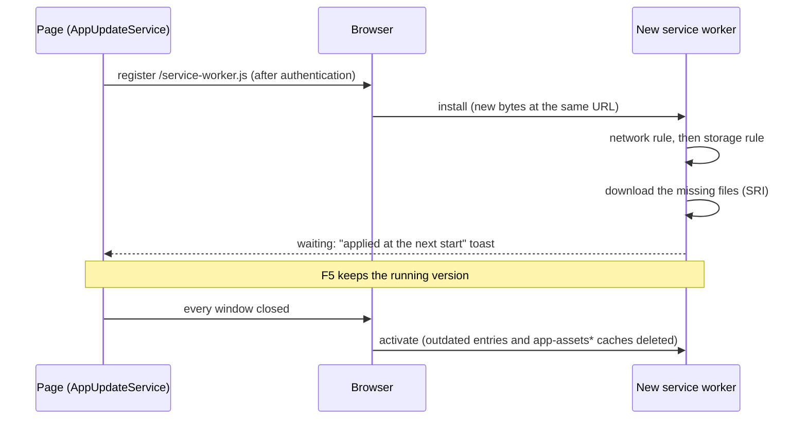

# Application Update Process

The application has to work offline: every application file is downloaded and cached on the user's device by a
service worker built with [Workbox](https://developer.chrome.com/docs/workbox). The application also updates itself
when a new version is deployed.

Catalog reference data (CSV/JSON files) is refreshed by a separate, independent
mechanism — see [Catalog Update Process](catalog_update.md).

## Principles

| Rule | Behaviour |
|---|---|
| No update during work | A downloaded version waits. It only becomes active once **every window** of the application has been closed and the application reopened. A reload (F5) keeps the running version. |
| Background download on a fast enough network only | A download only starts when `navigator.connection.downlink` reaches 5 Mbit/s. Below the threshold, or when the value is unknown, nothing is downloaded and the check is retried later. |
| Integrity of every file | Every precached file carries a SHA-256 `integrity` computed on the final bytes of `dist/`. A file that does not match, a redirect (expired session) or a non-OK response fails the installation; the active version is untouched. |
| User told about the next start | A toast says the update will be applied the next time the application starts. No dialog, no button. |
| Authentication untouched | The service worker never intercepts `/auth/**` and `AuthService` is unchanged. The first download only starts for an authenticated user. |

## Life cycle



1. `initializeApp` (`src/app/app.config.ts`) starts `AppUpdateService.start()` without awaiting it, in production
   builds only (`APP_UPDATE_ENABLED` token, `!isDevMode()`): the service worker is never registered by `ng serve`.
2. Without an existing registration, the service waits for an authenticated user (`AuthService.currentUser()`, read
   only) before registering `/service-worker.js` with `workbox-window`. Otherwise the existing registration is reused.
3. The browser looks for a new `/service-worker.js` on navigations. `AppUpdateService.checkForUpdate()` also asks for
   a check when `navigator.connection` changes, when the browser comes back online and every 30 minutes
   (`UPDATE_CHECK_INTERVAL_MS`), provided the network and storage rules allow it. The admin page has a
   "Check for updates" button.
4. A new version is identified by its bytes: the service worker embeds the precache manifest (URL, revision,
   integrity, size). Two builds of the same commit produce identical files (see Build below): redeploying the same
   commit, e.g. the daily dev deployment, downloads nothing and shows nothing.
5. On `install`, the service worker applies the network rule, then the storage rule, then downloads only the files
   whose revision changed. A refusal happens before any download and is sent to the pages (`SW_INSTALL_REFUSED`).
6. The installed version waits: `skipWaiting()` is never called. `AppUpdateService` moves to `update-waiting` and
   shows the toast once per start, including when a version was already waiting at startup.
7. Once every window is closed, the browser activates the new version: outdated precache entries are deleted, as
   well as the caches of the previous update system (`app-assets*`). `clients.claim()` only matters for the first
   installation (no page is controlled yet).

## Rules checked before any download

### Network rule

`evaluateBackgroundDownload()` (`src/app/core/services/app-update/network-rule.helpers.ts`) is shared by the page
and the service worker:

| `navigator.connection` | Result (`reason`) |
|---|---|
| API unavailable (e.g. Firefox, Safari) | refused (`api-unavailable`) |
| `saveData: true` | refused (`save-data`) |
| `downlink` unknown | refused (`downlink-unknown`) |
| `downlink` below the threshold | refused (`downlink-below-threshold`) |
| `downlink` at or above the threshold | allowed |

The threshold is `BACKGROUND_DOWNLOAD_MIN_DOWNLINK_MBPS` (5 Mbit/s) in `network-rule.constantes.ts`. Chrome and Edge
cap `downlink` at 10 Mbit/s: keep the threshold at or below 10.

### Storage rule

`evaluateStorageForInstall()` (`storage-rule.helpers.ts`) allows the installation when
`quota - usage >= missing bytes + reserve`:

- the missing bytes are the sum of the `sizeBytes` of the manifest entries absent from the precache (only the delta,
  including versions already waiting);
- the reserve, `USER_DATA_STORAGE_RESERVE_BYTES` (100 MB, `storage-rule.constantes.ts`), protects the user data:
  the quota is shared with IndexedDB (studies, catalogs);
- when `navigator.storage.estimate()` is unavailable, the installation is allowed.

If the quota is exceeded anyway (`QuotaExceededError`), the entries written during the attempt are deleted to give
the space back. The page shows "Not enough storage space" once per start.

## User interface

- Top bar indicator (`data-testid="offline-status-indicator"`): ready offline, preparing, waiting for a fast enough
  network, not enough storage, unavailable. A waiting update keeps "ready offline": the active version still works
  offline.
- Home page "News" card: shows the "applied at the next start" message while a version waits.
- Admin page: running version and its build date (read from `/version.json`, network only), offline state, measured
  downlink and threshold, storage usage and quota, last refusal, "Check for updates" button. "Reset application"
  unregisters the service worker and deletes the application caches; IndexedDB is kept.

## What the service worker serves

| Request | Handling |
|---|---|
| Precached file | From the precache (`workbox-precache-v2-*`) |
| Navigation (root and deep links) | The cached `/index.html` shell, without waiting for the network. Without a cached shell: the network, and a raw `401`/`403` is redirected to `/auth/relogin` (see the authentication page) |
| Navigation to `/auth/**`, `/docs/**`, `/data/**`, `/assets/config/**`, `/assets_list.json`, `/catalog-manifest.json`, `/version.json` | Not intercepted (`NAVIGATION_DENYLIST`) |
| Versioned catalog `/data/<file>?v=<sha>` | Cache first, `stellar-catalogs-v1` cache (see [Catalog Update Process](catalog_update.md)) |
| Anything else (API, `/auth/**`, `/version.json`, `/catalog-manifest.json`...) | Not intercepted: network |

Source files:

| File | Role |
|---|---|
| `src/sw/service-worker.ts` | Wiring of the service worker |
| `src/sw/service-worker.helpers.ts` | Installation guard, activation, refusal of redirected or non-OK responses, navigation handler, logger |
| `src/sw/catalogs.ts` | Catalog route and prefetch |
| `src/app/core/services/app-update/` | `AppUpdateService`, network and storage rules, service worker message contract |
| `scripts/build-service-worker.mjs`, `scripts/check-sw-manifest.mjs` | Generation and check of the service worker |
| `ops/kill-switch/service-worker.js` | Emergency kill-switch (not part of `dist/`) |

## Build

`npm run build` runs, in this order:

1. `ng build --configuration=production`;
2. `npm run set-env-variables`: injects the version and the `git_hash` into the JS and writes `dist/version.json`
   (`git_hash`, `version`, `build_datetime_utc`). The build date is **not** injected into the JS, so two builds of
   the same commit produce identical files. The build fails when the git hash is not a commit SHA: the pipeline must
   provide `CI_COMMIT_SHA` or build from a git checkout;
3. `npm run build:sw` (`scripts/build-service-worker.mjs`): bundles `src/sw/service-worker.ts` with esbuild, then
   `workbox-build` (`injectManifest`) lists every file of `dist/` with its revision, `integrity` (SHA-256) and
   `sizeBytes`, computed on the final bytes. Excluded: `version.json`, `assets_list.json`, `catalog-manifest.json`,
   `assets/config/**`, `data/**`, `docs/**`, `*.map`. The size limit is raised to 100 MB so that Pyodide is never
   silently left out;
4. `npm run create-assets-list-for-service-worker`: writes `catalog-manifest.json` (`app_version`, `data_hashes`)
   and `assets_list.json`, kept for the workstations still on the previous update system.

`npm run check:sw-manifest` recomputes the integrity and size of every entry independently, and checks that
Pyodide and every Python wheel are listed and that no excluded file is.

Pyodide and the Python wheels (`public/pyodide/`) are prepared by `npm run set-up-mechaphlowers` before the build;
they are precached like any other file.

## Logs and diagnostics

- Page console (`LoggerService`): `[AppUpdate] ...`. The service worker messages are relayed to the page as
  `[AppUpdate][sw] ...`: `Installation refused (<reason>)`, `Installation complete (<n> bytes downloaded)`,
  `Installation failed: ...`, `Storage quota exceeded during installation, <n> entries removed`,
  `Legacy caches deleted: ...`, `Catalog prefetch ...`.
- `chrome://serviceworker-internals`, or DevTools > Application > Service workers: active and waiting versions,
  "Update" and "Unregister" buttons, console of the service worker.
- DevTools > Application > Cache storage: `workbox-precache-v2-<origin>` and `stellar-catalogs-v1`. A remaining
  `app-assets*` cache means the Workbox version has not been activated yet on this workstation.
- DevTools > Application > Storage: usage and quota.
- Admin page: see User interface above.

## Operations

### Transition from the previous update system

On a workstation still running the previous system:

1. its `UpdateService` detects the new version through `assets_list.json` and shows its dialog (previous mechanism,
   it cannot be changed on deployed workstations);
2. after the click, the new code runs under the previous service worker;
3. the browser installs the Workbox service worker (same URL; one more full download, subject to the network rule),
   which waits;
4. once every window is closed, it activates and deletes the `app-assets*` caches. IndexedDB is kept.

`assets_list.json` must stay deployed until no workstation requests it any more.

### Kill-switch

In an emergency, deploy `ops/kill-switch/service-worker.js` in place of `dist/service-worker.js`. At the next update
check of each workstation (navigation, or within 30 minutes), it activates at once, deletes every Cache Storage entry
and unregisters itself. Open pages are **not** reloaded and IndexedDB (studies, catalogs) is untouched: no work is
lost. The application then works online only. To leave this state, deploy a normal build again: the service worker
is registered at the next start and the application downloaded again.

### Rollback by redeployment

Redeploy the `dist/` of the previous commit. It is installed like any other version: downloaded in the background
(network rule) and applied at the next start. Use the kill-switch when the faulty version must stop at once.
Rolling back to the previous update system (before Workbox): its service worker takes over at once (`skipWaiting`);
the Workbox precache stays on disk, unused, and is reused if Workbox is deployed again.

```{warning}
A rollback is impossible when the rolled-back version upgraded the Dexie schema
(`src/app/infrastructure/database/app-database.versions.ts`): the older code cannot open a newer database
(`VersionError`). Ship a fix forward instead, and review every schema migration with this risk in mind.
```

### Changing the threshold or the reserve

Edit `BACKGROUND_DOWNLOAD_MIN_DOWNLINK_MBPS` (`network-rule.constantes.ts`) or `USER_DATA_STORAGE_RESERVE_BYTES`
(`storage-rule.constantes.ts`), then build and deploy: the page and the service worker share these constants.

## Known differences with the previous system

- No per-file timeout: a file that never answers keeps the installation pending until the browser gives up. The
  active version stays intact and the next check retries.
- Deleting the caches alone, without unregistering the service worker, does not rebuild the whole precache: files
  are only cached again when requested. Clearing the site data (or "Reset application" on the admin page) reinstalls
  everything at the next start.
- No previous version is kept locally for a rollback, and there is no button to force an update.

## Testing locally

The service worker is not registered under `ng serve`: test on a production build served by the simulation server.

```bash
npm run build
npm run update:sim   # serves dist/ on http://localhost:4310 (E2E_PORT to change it)
```

Control endpoints (`POST`, query string):

| Endpoint | Effect |
|---|---|
| `/__e2e/scenario?v=v2` | Publishes another version: `v1`, `v2`, `v3`, `v2-broken` (one file answers 404), `v2-badhash` (wrong catalog hash), `v1-rebuild` (same commit rebuilt), `v2-slow` (300 ms per file), `v2-big` (30 MB file) |
| `/__e2e/network?downlink=1` | Downlink seen by the service worker, in Mbit/s |
| `/__e2e/auth?authenticated=false` | Simulates an expired session |
| `/__e2e/service-worker?mode=legacy` | Script served at `/service-worker.js`: `workbox` (default), `legacy` (stand-in for the previous system), `kill-switch` |
| `/__e2e/faults?...` | Fault injection, see below |

| Fault parameter | Effect |
|---|---|
| `latencyMs=N` | Delays every application file by N ms |
| `stall=/path` | The file never answers (connection left open) |
| `fail=/path&status=502&count=2` | The next `count` requests of the file fail with `status` |
| `redirectAfter=N` | Answers 302 to `/auth/login` once more than N application files were requested |
| `tamper=/path` | Answers 200 with other bytes than the manifest (integrity check) |
| `navigationStatus=401` | Answers every page navigation outside `/auth/` with this status (stale session) |
| `reset=true` | Removes every fault and clears the request log |

`GET /__e2e/requests` returns the application files requested since the last reset.

Automated tests (run `npm run build` first):

- `npm run e2e:update`: life cycle, first installation, catalogs, network rule, offline, expired session, storage,
  transition from the previous system, kill-switch and rollback;
- `npm run e2e:update-faults`: transient 502, cleared site data.
