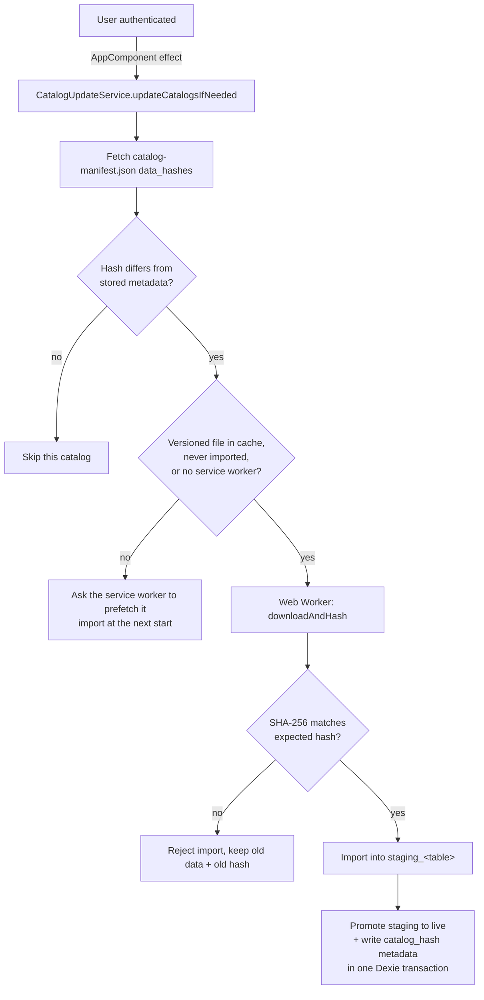

# Catalog Update Process

Catalog reference data (cables, chains, attachments, lines, maintenance teams,
obstacle configuration) is stored offline in Dexie/IndexedDB and refreshed by a
mechanism that is **independent from the application update** described in
[Application Update Process](application_update.md). Catalogs keep refreshing
while an application version is waiting for the next start, so nobody is stuck
on stale reference data.

## Overview

Source files:

- `stellar/src/app/shared/catalog/services/catalog-update.service.ts` — orchestrator.
- `stellar/src/app/shared/catalog/csv-import/internal/verified-download.helpers.ts` — download + SHA-256 hashing.
- `stellar/src/app/shared/catalog/csv-import/internal/run-worker-import.helpers.ts` — staging import + atomic promotion.
- `stellar/src/app/infrastructure/database/app-database.versions.ts` — staging table schema (`STAGING_TABLE_PREFIX`).
- `stellar/src/sw/catalogs.ts` — service worker route and prefetch of the versioned catalog files.
- `stellar/scripts/create_assets_list_for_service_worker.py` — generates `data_hashes` in `catalog-manifest.json`
  (and in `assets_list.json`, kept for the previous update system).

Catalog data files live in `stellar/public/data/*.csv` and
`stellar/public/data/obstacle_configuration.json`. They are excluded from the
service worker precache (see [Application Update Process](application_update.md))
and instead get a per-file SHA-256 entry under `data_hashes` in
`catalog-manifest.json`, always read from the network (`cache: 'no-store'`,
10 s timeout).

## Update mechanism

### 1. Trigger — after authentication only

`CatalogUpdateService.updateCatalogsIfNeeded()` is triggered once by
`AppComponent`, as soon as `AuthService.currentUser()` becomes truthy. It is a
strict no-op (no network call, no import) while the user is not authenticated,
and when `catalog-manifest.json` is unreachable (the catalogs already imported
keep working offline).

### 2. Hash comparison — only changed catalogs are downloaded

For each of the six catalogs (`maintenance-teams.csv`, `lines.csv`,
`cables.csv`, `chains.csv`, `attachments.csv`, `obstacle_configuration.json`),
the service compares the hash from `catalog-manifest.json`'s `data_hashes`
against `metadata.get('catalog_hash:<filename>')` already stored in Dexie. A
catalog is only downloaded and imported when the hash is missing or different.

### 3. Import at the next start

A catalog file is downloaded from an immutable, versioned URL:
`/data/<file>?v=<sha256>`. The service worker serves these URLs cache first
(`stellar-catalogs-v1` cache, at most 12 entries: 6 catalogs x 2 versions), so
a catalog never changes while the user is working:

- the new version is already in the cache: it is imported right away, without
  any network request;
- the catalog was never imported (first start), or no service worker controls
  the page: it is downloaded and imported right away, whatever the network —
  the application is unusable without it;
- otherwise the page asks the service worker to prefetch it in the background
  (`PREFETCH_CATALOGS` message, one file at a time, subject to the network rule
  and to the storage reserve), and it is imported at the next start.

A cached copy that fails the verification below is deleted from the cache and
downloaded once more from the network.

### 4. Verified download — one fetch, incremental SHA-256

`downloadAndHash()` fetches the catalog exactly once, feeding an incremental
SHA-256 hasher (`hash-wasm`) chunk by chunk as the body streams in, and returns
both the raw `Blob` and the resulting hex digest. If `expectedHash` is provided
and does not match, the import is rejected **before** anything is written to
Dexie — the previous catalog data and its recorded hash are left untouched.

### 5. Staging import, then atomic promotion

The verified content is parsed (PapaParse for CSV, `JSON.parse` for the
obstacle configuration) and written only into `staging_<table>` tables — never
directly into the live tables. Once staging is fully populated,
`promoteStagingToLive()` copies staging into the live table(s) in bounded
batches and writes `catalog_hash:<filename>` to `metadata`, all inside a
**single Dexie transaction**. A catalog's data and its recorded hash therefore
always change together, or not at all; a failed/interrupted import leaves the
previous catalog data fully usable offline.

### 6. Per-catalog isolation

A failure on one catalog (network error, hash mismatch, parse error) is logged
via `LoggerService` and surfaced to the user via `NotificationService`, but
never blocks the other catalogs from updating.

## Related documentation

- [Application Update Process](application_update.md) — service worker,
  network rule and update life cycle.
- [Offline Database](offline_database.md) — Dexie/`StorageService` conventions.
