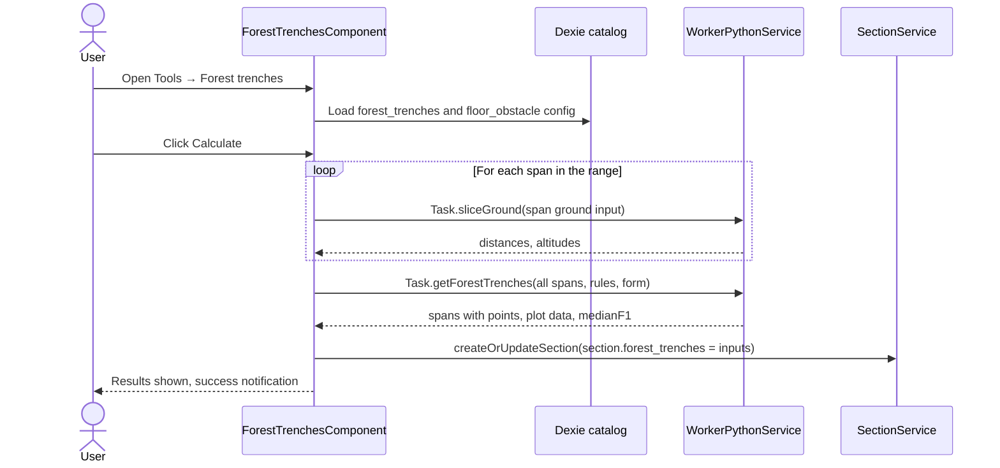

# Forest trenches — technical design

This page describes how the **Forest trenches** Studio tool is built: the catalog configuration, the
calculation pipeline between the Angular dialog, the worker and the Python engine, the persisted data,
and the tests. For the user-facing behaviour, see {doc}`../../user_guide/forest_trenches`.

The tool reuses the conformity machinery (climatic states, rule distances, scenarios and the multi-state
runner) described in {doc}`../conformity` and {doc}`../configure_conformity`. The ground profile comes
from the floor obstacle of the section, see {doc}`obstacles_floors_and_distances`.

---

## Key files at a glance

| Layer | File | Role |
|---|---|---|
| Toolbar | `features/studio/core/presentation/components/top-toolbar/top-toolbar.component.ts` | Adds the **Tools** menu entry, which calls `ToolbarDialogService.openTool('forest-trenches')`. |
| Dialog registry | `features/studio/toolbar/presentation/services/toolbar-dialog.service.ts` | Maps `'forest-trenches'` to `ForestTrenchesComponent`. |
| Dialog | `features/studio/forest-trenches/presentation/components/forest-trenches/forest-trenches.component.ts` (`.html`, `.scss`) | Form, catalog loading, calculation, results, plot lifecycle (`ResizeObserver`, purge on destroy). |
| Helpers | `…/forest-trenches/…/forest-trenches.helpers.ts` | `getForestTrenchesConfig()`, `spansInInterval()`, `toSliceGroundInput()`, `fractionLabel()`, `forestTrenchesXTickLabels()`, `buildForestTrenchesRows()`, `createForestTrenchesPlot()` (`Plotly.react`), `resizeForestTrenchesPlot()`, `purgeForestTrenchesPlot()`. |
| Constants | `…/forest-trenches/…/forest-trenches.constantes.ts` | `FOREST_TRENCHES_PLOT_ID`, axis colour, axis point marker (`x-thin`, size 7). |
| Interfaces | `…/forest-trenches/…/forest-trenches.interfaces.ts` | `ForestTrenchesConfig`, `ForestTrenchesChart`, `ForestTrenchesTableRow`, `ForestTrenchesPlotOptions`. |
| Persisted inputs | `shared/domain/models/forest-trenches.model.ts` | `ForestTrenchesInputs`. |
| Section | `shared/domain/models/section.model.ts` | `forest_trenches?: ForestTrenchesInputs \| null`. |
| Catalog import | `shared/catalog/csv-import/configs/obstacles.config.helpers.ts` | `assertForestTrenchesConfig()`, `assertForestTrenchesFloorObstacle()`, `buildConformityConfig()`. |
| Storage | `infrastructure/database/entities/catalog-obstacle-conformity-config.entity.ts` | `forest_trenches_*` and `floor_obstacle_*` columns. |
| Plot styles | `shared/constants/plotly-styles.constantes.ts` | `PLOTLY_MARKER_SYMBOLS`, `PLOTLY_LINE_DASHES` (allowed style names). |
| Worker types | `core/services/worker_python/tasks/types.ts` | `Task.sliceGround`, `Task.getForestTrenches` and their input/output types. |
| Worker dispatch | `core/services/worker_python/tasks/handle-task.ts` | Maps the tasks to `slice_ground` and `get_forest_trenches`. |
| Python API | `core/services/worker_python/tasks/python-scripts/api.py` | `slice_ground(js_inputs)`, `get_forest_trenches(js_inputs)`. |
| Engine | `stellar-engine/src/stellar_engine/core/conformity/ground.py` | `slice_ground()`. |
| Engine | `stellar-engine/src/stellar_engine/core/conformity/forest_trench.py` | `run()`. |
| Engine | `stellar-engine/src/stellar_engine/core/conformity/request.py` | `ForestTrenchRequest`, `ForestTrenchSpanInput`. |
| Engine | `stellar-engine/src/stellar_engine/core/conformity/runner.py` | `SpanPointsProjector`, `MultiStateRunner`. |
| Engine | `stellar-engine/src/stellar_engine/core/conformity/strategies.py` | `ConformityPlot.FOREST_TRENCHES`, mapped to `OverhangStrategy` (used only to build scenarios). |
| Catalog data | `public/data/obstacle_configuration.json` | `forest_trenches` and `floor_obstacle` blocks. |

---

## Overview



Calculation is driven by the component. The worker is only used for the two Python tasks. Results are kept
in a signal and are never persisted. Only the form inputs are saved on the section.

---

## Catalog configuration

The obstacle catalog file `public/data/obstacle_configuration.json` has two blocks that the tool reads:

```json
"forest_trenches": {
  "ground_n_slicing_points_choices": [5, 9, 17],
  "overhang_rules_selected": ["RULE_1"],
  "lateral_rules_selected": ["RULE_1", "RULE_2"],
  "chart": {
    "cable": { "marker": "circle", "line": "solid" },
    "limit": { "marker": "square-open", "line": "dash" },
    "overhang_color": "#0000FF"
  }
},
"floor_obstacle": {
  "obstacleType": "floor",
  "obstacleName": "floor",
  "details": "",
  "redZone": true,
  "conformity": "forest_trenches",
  "distances": [
    { "ruleType": "RULE_1", "active": true, "overhang": { "63": 2.0 }, "lateral": { "63": 3.0 } }
  ]
}
```

On import, `assertForestTrenchesConfig()` and `assertForestTrenchesFloorObstacle()` validate the file. Errors
are prefixed with `Obstacle configuration:`:

- `ground_n_slicing_points_choices` is a non-empty array of integers, each at least 2;
- `overhang_rules_selected` and `lateral_rules_selected` are arrays of strings;
- `chart.cable` and `chart.limit` are objects. Their `marker` must be a key of `PLOTLY_MARKER_SYMBOLS`, and
  their `line` a key of `PLOTLY_LINE_DASHES`;
- `chart.overhang_color` is a string or `null`;
- `floor_obstacle.obstacleType`, `obstacleName` and `details` are strings, `redZone` is a boolean, and
  `conformity` must be `"forest_trenches"`;
- `floor_obstacle.distances` is validated like the distances of the other obstacles.

`buildConformityConfig()` stores the result in the singleton conformity-config row:
`forest_trenches_n_points_choices`, `forest_trenches_overhang_rules`, `forest_trenches_lateral_rules`,
`forest_trenches_chart`, `floor_obstacle_red_zone` and `floor_obstacle_distances` (`rule_type`, `active`,
`overhang`, `lateral`). `obstacleType`, `obstacleName` and `details` are validated but not stored.

The distances used by the tool are those of `floor_obstacle`, not those of the `obstacles[]` entries.

`getForestTrenchesConfig()` returns `null` when any of these fields is missing or malformed, for example a
row imported before they existed. The component then sets `isConfigMissing`, logs a warning once through
`LoggerService`, and shows the missing-configuration error in the dialog.

---

## Data model

The inputs saved on the section, from `shared/domain/models/forest-trenches.model.ts`:

```typescript
export interface ForestTrenchesInputs {
  firstSupportUuid: string;
  lastSupportUuid: string;
  nPoints: number;
  windZone: string;
  windMinus: boolean;
  redZonePresence: boolean;
  repartitionTemperature: number;
  lateralDistanceTemperature: number;
  selectedRules: string[];
}
```

`section.model.ts` declares `forest_trenches?: ForestTrenchesInputs | null` ("Last successfully calculated
forest-trenches form inputs"). Results are not part of the section.

---

## Calculation pipeline

`ForestTrenchesComponent.calculate()` runs these steps:

1. **Rules.** Builds `rulesClimaticConditions` from the catalog rule definitions (`lateral_point`,
   `overhang_point`) and `rulesDistances` from `floor_obstacle_distances` for each selected rule. It throws
   `Missing climatic definition for rule …` or `Missing floor-obstacle distance for rule …` when one is
   missing.
2. **Span range.** `spansInInterval(supports, first, last)` returns the span indices `[firstIndex, lastIndex)`.
   It throws a `RangeError` when a support is missing or when the last support is not after the first one.
3. **Ground, per span.** The floor is the section floor whose `supportUuid` is the left support of the span.
   `toSliceGroundInput(floor, spanIndex, nPoints)` builds the input (`referenceSupport` defaults to `'LEFT'`,
   floor points are `{ distance: distanceToRefSupport, altitude }`). `Task.sliceGround` runs once per span,
   sequentially.
4. **Calculation.** `Task.getForestTrenches` receives:
   - `electricTension` (the section voltage) and the `form`: `windZone`, `windPressure` (normal or red-zone
     pressure from the wind zone), `windMinus`, `redZonePresence`, `repartitionTemperature`,
     `lateralDistanceTemperature`, `selectedConformityRules`, `conformity`, `conformityPlot: 'forest_trenches'`
     and `intermediatePoints: []`;
   - `rulesClimaticConditions`, `rulesDistances`;
   - `overhangRules` (configured overhang rules intersected with the selected ones) and `lateralRules`
     (configured lateral rules intersected with the selected ones);
   - `spans: [{ spanIndex, distances, altitudes }]`.
5. **Success.** The component sets `section.forest_trenches` to the `ForestTrenchesInputs`, calls
   `SectionService.createOrUpdateSection()`, updates `spanService.section`, keeps the results in a signal, and
   shows the success notification. An empty result is treated as an error.
6. **Failure.** `WorkerPythonService.runTask` resolves `{ result, error }`. The component throws on error, then
   catches the exception: it calls `LoggerService.error`, sets the `calculationError` signal, and calls
   `NotificationService.error`. Nothing is saved.

The form effect runs when the section changes. It resets the form from `section.forest_trenches` when the saved
value is valid, and from the defaults otherwise:

- `firstSupportUuid` and `lastSupportUuid`: first and last support of the section;
- `nPoints`: first catalog choice;
- `windZone`: the catalog default wind zone;
- `repartitionTemperature` and `lateralDistanceTemperature`: catalog defaults, or the temperature of the lateral
  rule;
- `redZonePresence`: `floor_obstacle_red_zone`;
- `selectedRules`: active floor distances among the offered rules.

Results are cleared when the section changes.

---

## Tasks

| Task | Python function | Input | Output |
|---|---|---|---|
| `Task.sliceGround` | `slice_ground` | `SliceGroundInput` | `SliceGroundOutput`: `distances`, `altitudes`, `length` |
| `Task.getForestTrenches` | `get_forest_trenches` | `ForestTrenchesTaskInput` | `ForestTrenchesTaskOutput`: `spans` (`ForestTrenchesSpanOutput`) and `ForestTrenchesPointOutput` per point, plus `ForestTrenchesPlotOutput` |

The types are in `core/services/worker_python/tasks/types.ts`. The mapping is in `handle-task.ts`, and the Python
entry points are in `python-scripts/api.py`.

---

## Engine side

### Ground slicing: `slice_ground()`

`slice_ground(python_inputs, study)` in `ground.py`:

- validates `spanIndex` (integer), `nPoints` (integer, at least 2), `referenceSupport` (`'LEFT'` or `'RIGHT'`) and
  `floorPoints` (an array). It raises `ConformityInputError` otherwise, and `SupportOutOfRangeError` when
  `spanIndex` is out of range;
- computes the span length as the horizontal distance between the ground points of the two supports
  (`position_engine.get_group_points().supports.coords[:, 0, :]`);
- builds `distances = np.linspace(0, length, nPoints)`;
- skips floor points whose distance or altitude is `null`, converts a `RIGHT` reference to a distance from the
  left support (`length − d`), and sorts the points;
- interpolates with `np.interp`. Values beyond the first or last floor point keep the altitude of that end point.
  With no floor points, the altitudes are linear between the two support ground altitudes.

It returns `{ distances, altitudes, length }`.

### Forest trenches: `run()`

`run(python_inputs, study)` in `forest_trench.py`:

1. `ForestTrenchRequest.from_dict` (`request.py`) validates the input. `conformityPlot` must be
   `'forest_trenches'`, `overhangRules` and `lateralRules` are lists of strings, and `spans` is non-empty with unique
   `spanIndex` values. The `distances` and `altitudes` of each span have the same length (at least 2) and contain finite
   numbers.
2. Works on a deep copy of the study, so the caller's study is unchanged.
3. For each span, adds a temporary floor obstacle with `add_single_obstacle`: UUID `forest-trench-<spanIndex>`, absolute
   altitudes, `SPAN_AXIS` lateral reference, `LEFT` reference, `y = 0`. `find_obstacle_point` resolves its points in the
   changed frame.
4. Builds a `SpanPointsProjector` (`runner.py`). It places one vertical plane perpendicular to the span axis through each
   point.
5. `ScenarioBuilder`, with the `forest_trenches` strategy, builds the rule scenarios. The overwrite rules are the same as
   for conformity: the rule temperature if it has one, otherwise the form temperature. `windMinus` negates the lateral
   pressure, and the inverse lateral case uses the opposite pressure. For each lateral rule the run keeps `LATERAL` and
   `LATERAL_INVERSE`. For each overhang rule it keeps `OVERHANG`. A missing scenario raises `ConformityInputError`.
6. `MultiStateRunner` solves each unique (wind pressure, temperature) state once, then measures every span's points. The
   first and last points use the cable attachment points. The intermediate points use `DistanceEngine.plane_distance`. If
   no intersection is found, the nearest cable attachment point is used.
7. Projected values are the signed lateral distance in the plane from the span axis, and the altitude. A state hook collects
   the sag of each requested span. `medianF1` is the sag in the state of the first overhang scenario, since all overhang
   scenarios share the repartition temperature and have no wind. It is `null` when there is no overhang rule.

Output per point:

- `lateral[rule]` and `lateralInverse[rule]`: `{ axisDistance, elevation, limitAxisDistance }`. `limitAxisDistance` is
  `axisDistance − lateralDistance` for the lateral case, and `axisDistance + lateralDistance` for the inverse case;
- `overhang[rule]`: `{ elevation, heightAboveGround, complianceLimitHeightAboveGround }`, where `heightAboveGround =
  elevation − groundElevation` and `complianceLimitHeightAboveGround = heightAboveGround − overhangDistance`.

A missing lateral or overhang distance for a selected rule raises `ConformityInputError`.

Output per span: `spanIndex`, `length`, `medianF1`, `axis` (`[{x: 0, y: 0}, {x: length, y: 0}]`), and `plot`:
`lateral` and `lateralInverse` with `cable[]` and `limit[]` series, and `overhang` with `cable[]`. Each series point is
`{ x: distance, y: lateral }`.

Specific engine errors map to error codes, see {doc}`how_to_add_error_codes`.

The application loads the stellar-engine as a wheel. After changing Python files, rebuild it with
`npm run set-up-mechaphlowers:engine-only`, as described in {doc}`../installation/setup-mechaphlowers-guide`.

---

## The dialog

- **Hosting.** The dialog is opened by `ToolbarDialogService` under the `forest-trenches` key. Its width is 86.5625rem,
  with a maximum of 90%. The header shows the `forest` icon and the title.
- **Form.** The fields are the first and last supports, the number of ground slicing points (choices from the catalog),
  the electric tension (read only), the wind zone, the wind inversion, the red-zone presence, the two temperatures, and the
  rules (a multiselect over the union of the configured overhang and lateral rules).
- **Results.** A span selector, the plan-view graph, the median F1 (when an overhang rule is selected), and a table.
  `buildForestTrenchesRows()` builds the table rows in a fixed order: distance to left support, ground elevation, cable
  altitude per overhang rule, cable altitude per lateral rule, cable height per overhang rule, compliance limit height per
  overhang rule, span axis to cable per lateral rule, span axis to lateral limit per lateral rule. Temperatures in the labels
  are resolved as in the engine.
- **Plot.** `createForestTrenchesPlot()` calls `Plotly.react`. The layout is built fresh on every call by
  `getPlotlyBaseLayout()`. The y axis is reversed with `scaleanchor: 'x'` and a ratio of 1. The X ticks are at
  `distanceToLeftSupport`, with labels from `forestTrenchesXTickLabels()`, which reduces fractions with the GCD. The legend
  is shown only when the view is enlarged. A `ResizeObserver` calls `resizeForestTrenchesPlot()`, and `purgeForestTrenchesPlot()`
  runs on destroy.

---

## Tests

- `features/studio/forest-trenches/…/forest-trenches.component.spec.ts`
- `features/studio/forest-trenches/…/forest-trenches.helpers.spec.ts`
- `shared/catalog/csv-import/configs/obstacles.config.spec.ts`
- `stellar-engine/test/core/conformity/test_forest_trench.py`
- `stellar-engine/test/core/conformity/test_forest_trench_ground.py`

---

## Related documentation

- {doc}`../conformity`: the conformity model and the rules.
- {doc}`../configure_conformity`: how the conformity catalog is configured.
- {doc}`obstacles_floors_and_distances`: floor obstacles and their distances.
- {doc}`engine_worker`: the Python worker.
- {doc}`../../user_guide/forest_trenches`: the user guide for this tool.
