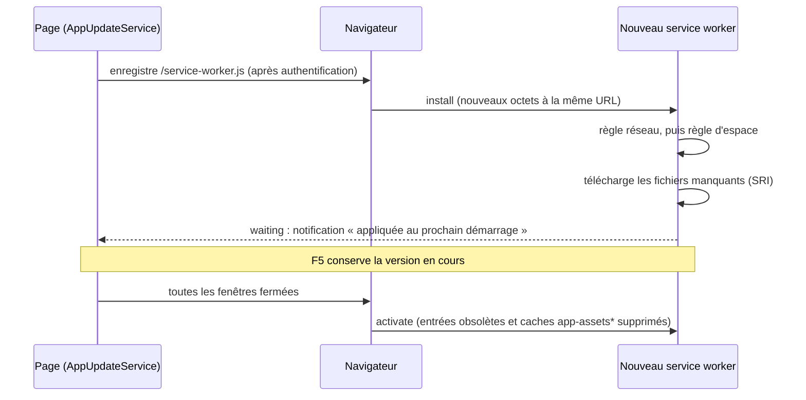

# Processus de mise à jour de l'application

L'application doit fonctionner hors ligne : tous les fichiers de l'application sont téléchargés et mis en cache sur
l'appareil de l'utilisateur par un service worker construit avec [Workbox](https://developer.chrome.com/docs/workbox).
L'application se met aussi à jour d'elle-même lorsqu'une nouvelle version est déployée.

Les données de référence du catalogue (fichiers CSV/JSON) sont actualisées par un mécanisme
séparé et indépendant — voir [Processus de mise à jour du catalogue](catalog_update.md).

## Principes

| Règle | Comportement |
|---|---|
| Pas de mise à jour pendant le travail | Une version téléchargée attend. Elle ne devient active qu'une fois **toutes les fenêtres** de l'application fermées puis l'application rouverte. Un rechargement (F5) conserve la version en cours. |
| Téléchargement en arrière-plan sur un réseau suffisant uniquement | Un téléchargement ne démarre que lorsque `navigator.connection.downlink` atteint 5 Mbit/s. Sous le seuil, ou quand la valeur est inconnue, rien n'est téléchargé et la vérification est relancée plus tard. |
| Intégrité de chaque fichier | Chaque fichier précaché porte une `integrity` SHA-256 calculée sur les octets finaux de `dist/`. Un fichier qui ne correspond pas, une redirection (session expirée) ou une réponse non OK fait échouer l'installation ; la version active n'est pas touchée. |
| Utilisateur prévenu pour le prochain démarrage | Une notification indique que la mise à jour sera appliquée au prochain démarrage de l'application. Ni fenêtre modale, ni bouton. |
| Authentification inchangée | Le service worker n'intercepte jamais `/auth/**` et `AuthService` n'est pas modifié. Le premier téléchargement ne démarre que pour un utilisateur authentifié. |

## Cycle de vie



1. `initializeApp` (`src/app/app.config.ts`) démarre `AppUpdateService.start()` sans l'attendre, dans les builds de
   production uniquement (jeton `APP_UPDATE_ENABLED`, `!isDevMode()`) : le service worker n'est jamais enregistré par
   `ng serve`.
2. Sans enregistrement existant, le service attend un utilisateur authentifié (`AuthService.currentUser()`, en
   lecture seule) avant d'enregistrer `/service-worker.js` avec `workbox-window`. Sinon l'enregistrement existant est
   réutilisé.
3. Le navigateur cherche un nouveau `/service-worker.js` lors des navigations. `AppUpdateService.checkForUpdate()`
   demande aussi une vérification quand `navigator.connection` change, quand le navigateur revient en ligne et toutes
   les 30 minutes (`UPDATE_CHECK_INTERVAL_MS`), si les règles réseau et d'espace l'autorisent. La page admin propose
   un bouton « Vérifier les mises à jour ».
4. Une nouvelle version est identifiée par ses octets : le service worker embarque le manifeste de précache (URL,
   révision, intégrité, taille). Deux builds du même commit produisent des fichiers identiques (voir Build
   ci-dessous) : redéployer le même commit, par exemple lors du déploiement quotidien de dev, ne télécharge rien et
   n'affiche rien.
5. À l'événement `install`, le service worker applique la règle réseau, puis la règle d'espace, puis ne télécharge
   que les fichiers dont la révision a changé. Un refus a lieu avant tout téléchargement et est envoyé aux pages
   (`SW_INSTALL_REFUSED`).
6. La version installée attend : `skipWaiting()` n'est jamais appelé. `AppUpdateService` passe à l'état
   `update-waiting` et affiche la notification une fois par démarrage, y compris quand une version attendait déjà au
   démarrage.
7. Une fois toutes les fenêtres fermées, le navigateur active la nouvelle version : les entrées obsolètes du précache
   sont supprimées, ainsi que les caches de l'ancien système de mise à jour (`app-assets*`). `clients.claim()` ne
   sert qu'à la première installation (aucune page n'est encore contrôlée).

## Règles vérifiées avant tout téléchargement

### Règle réseau

`evaluateBackgroundDownload()` (`src/app/core/services/app-update/network-rule.helpers.ts`) est partagée par la page
et le service worker :

| `navigator.connection` | Résultat (`reason`) |
|---|---|
| API indisponible (par exemple Firefox, Safari) | refusé (`api-unavailable`) |
| `saveData: true` | refusé (`save-data`) |
| `downlink` inconnu | refusé (`downlink-unknown`) |
| `downlink` sous le seuil | refusé (`downlink-below-threshold`) |
| `downlink` au moins égal au seuil | autorisé |

Le seuil est `BACKGROUND_DOWNLOAD_MIN_DOWNLINK_MBPS` (5 Mbit/s) dans `network-rule.constantes.ts`. Chrome et Edge
plafonnent `downlink` à 10 Mbit/s : gardez le seuil inférieur ou égal à 10.

### Règle d'espace de stockage

`evaluateStorageForInstall()` (`storage-rule.helpers.ts`) autorise l'installation quand
`quota - usage >= octets manquants + réserve` :

- les octets manquants sont la somme des `sizeBytes` des entrées du manifeste absentes du précache (seulement le
  delta, versions déjà en attente comprises) ;
- la réserve, `USER_DATA_STORAGE_RESERVE_BYTES` (100 Mo, `storage-rule.constantes.ts`), protège les données de
  l'utilisateur : le quota est partagé avec IndexedDB (études, catalogues) ;
- quand `navigator.storage.estimate()` est indisponible, l'installation est autorisée.

Si le quota est malgré tout dépassé (`QuotaExceededError`), les entrées écrites pendant la tentative sont supprimées
pour rendre l'espace. La page affiche « Espace de stockage insuffisant » une fois par démarrage.

## Interface utilisateur

- Indicateur de la barre du haut (`data-testid="offline-status-indicator"`) : prêt hors ligne, en préparation, en
  attente d'un réseau suffisant, espace insuffisant, indisponible. Une mise à jour en attente laisse « prêt hors
  ligne » : la version active fonctionne toujours hors ligne.
- Carte « Actualités » de l'accueil : affiche le message « appliquée au prochain démarrage » tant qu'une version
  attend.
- Page admin : version en cours et sa date de build (lue dans `/version.json`, réseau uniquement), état hors ligne,
  débit mesuré et seuil, usage et quota de stockage, dernier refus, bouton « Vérifier les mises à jour ».
  « Réinitialiser l'application » désenregistre le service worker et supprime les caches de l'application ;
  IndexedDB est conservée.

## Ce que sert le service worker

| Requête | Traitement |
|---|---|
| Fichier précaché | Depuis le précache (`workbox-precache-v2-*`) |
| Navigation (racine et liens profonds) | Le shell `/index.html` en cache, sans attendre le réseau. Sans shell en cache : le réseau, et un `401`/`403` brut est redirigé vers `/auth/relogin` (voir la page sur l'authentification) |
| Navigation vers `/auth/**`, `/docs/**`, `/data/**`, `/assets/config/**`, `/assets_list.json`, `/catalog-manifest.json`, `/version.json` | Non interceptée (`NAVIGATION_DENYLIST`) |
| Catalogue versionné `/data/<fichier>?v=<sha>` | Cache d'abord, cache `stellar-catalogs-v1` (voir [Processus de mise à jour du catalogue](catalog_update.md)) |
| Tout le reste (API, `/auth/**`, `/version.json`, `/catalog-manifest.json`...) | Non intercepté : réseau |

Fichiers sources :

| Fichier | Rôle |
|---|---|
| `src/sw/service-worker.ts` | Câblage du service worker |
| `src/sw/service-worker.helpers.ts` | Garde à l'installation, activation, refus des réponses redirigées ou non OK, gestionnaire de navigation, logger |
| `src/sw/catalogs.ts` | Route et préchargement des catalogues |
| `src/app/core/services/app-update/` | `AppUpdateService`, règles réseau et d'espace, contrat des messages du service worker |
| `scripts/build-service-worker.mjs`, `scripts/check-sw-manifest.mjs` | Génération et contrôle du service worker |
| `ops/kill-switch/service-worker.js` | Kill-switch d'urgence (hors de `dist/`) |

## Build

`npm run build` exécute, dans cet ordre :

1. `ng build --configuration=production` ;
2. `npm run set-env-variables` : injecte la version et le `git_hash` dans le JS et écrit `dist/version.json`
   (`git_hash`, `version`, `build_datetime_utc`). La date de build n'est **pas** injectée dans le JS, donc deux builds
   du même commit produisent des fichiers identiques. Le build échoue lorsque le hash git n'est pas un SHA de commit :
   le pipeline doit fournir `CI_COMMIT_SHA` ou builder depuis un dépôt git ;
3. `npm run build:sw` (`scripts/build-service-worker.mjs`) : bundle `src/sw/service-worker.ts` avec esbuild, puis
   `workbox-build` (`injectManifest`) liste chaque fichier de `dist/` avec sa révision, son `integrity` (SHA-256) et
   ses `sizeBytes`, calculés sur les octets finaux. Exclus : `version.json`, `assets_list.json`,
   `catalog-manifest.json`, `assets/config/**`, `data/**`, `docs/**`, `*.map`. La taille maximale est relevée à
   100 Mo pour que Pyodide ne soit jamais exclu en silence ;
4. `npm run create-assets-list-for-service-worker` : écrit `catalog-manifest.json` (`app_version`, `data_hashes`) et
   `assets_list.json`, conservé pour les postes encore sur l'ancien système de mise à jour.

`npm run check:sw-manifest` recalcule indépendamment l'intégrité et la taille de chaque entrée, et vérifie que
Pyodide et toutes les wheels Python sont listés et qu'aucun fichier exclu ne l'est.

Pyodide et les wheels Python (`public/pyodide/`) sont préparés par `npm run set-up-mechaphlowers` avant le build ;
ils sont précachés comme n'importe quel autre fichier.

## Journaux et diagnostic

- Console de la page (`LoggerService`) : `[AppUpdate] ...`. Les messages du service worker sont relayés à la page
  sous la forme `[AppUpdate][sw] ...` : `Installation refused (<reason>)`,
  `Installation complete (<n> bytes downloaded)`, `Installation failed: ...`,
  `Storage quota exceeded during installation, <n> entries removed`, `Legacy caches deleted: ...`,
  `Catalog prefetch ...`.
- `chrome://serviceworker-internals`, ou DevTools > Application > Service workers : versions active et en attente,
  boutons « Update » et « Unregister », console du service worker.
- DevTools > Application > Cache storage : `workbox-precache-v2-<origine>` et `stellar-catalogs-v1`. Un cache
  `app-assets*` restant signifie que la version Workbox n'est pas encore activée sur ce poste.
- DevTools > Application > Storage : usage et quota.
- Page admin : voir Interface utilisateur ci-dessus.

## Exploitation

### Transition depuis l'ancien système de mise à jour

Sur un poste qui exécute encore l'ancien système :

1. son `UpdateService` détecte la nouvelle version via `assets_list.json` et affiche sa fenêtre (ancien mécanisme,
   il ne peut pas être modifié sur les postes déjà déployés) ;
2. après le clic, le nouveau code s'exécute sous l'ancien service worker ;
3. le navigateur installe le service worker Workbox (même URL ; un téléchargement complet de plus, soumis à la règle
   réseau), qui attend ;
4. une fois toutes les fenêtres fermées, il s'active et supprime les caches `app-assets*`. IndexedDB est conservée.

`assets_list.json` doit rester déployé tant qu'un poste le demande encore.

### Kill-switch

En cas d'urgence, déployez `ops/kill-switch/service-worker.js` à la place de `dist/service-worker.js`. À la
prochaine vérification de mise à jour de chaque poste (navigation, ou sous 30 minutes), il s'active immédiatement,
supprime toutes les entrées du Cache Storage et se désenregistre. Les pages ouvertes ne sont **pas** rechargées et
IndexedDB (études, catalogues) n'est pas touchée : aucun travail n'est perdu. L'application ne fonctionne alors plus
qu'en ligne. Pour sortir de cet état, redéployez un build normal : le service worker est enregistré au prochain
démarrage et l'application téléchargée de nouveau.

### Retour arrière par redéploiement

Redéployez le `dist/` du commit précédent. Il est installé comme n'importe quelle autre version : téléchargé en
arrière-plan (règle réseau) et appliqué au prochain démarrage. Utilisez le kill-switch quand la version défectueuse
doit s'arrêter immédiatement. Retour à l'ancien système de mise à jour (avant Workbox) : son service worker reprend
la main immédiatement (`skipWaiting`) ; le précache Workbox reste sur le disque, inutilisé, et il est réutilisé si
Workbox est redéployé.

```{warning}
Un retour arrière est impossible quand la version annulée a fait évoluer le schéma Dexie
(`src/app/infrastructure/database/app-database.versions.ts`) : l'ancien code ne sait pas ouvrir une base plus récente
(`VersionError`). Livrez plutôt un correctif vers l'avant, et relisez chaque migration de schéma avec ce risque en
tête.
```

### Changer le seuil ou la réserve

Modifiez `BACKGROUND_DOWNLOAD_MIN_DOWNLINK_MBPS` (`network-rule.constantes.ts`) ou `USER_DATA_STORAGE_RESERVE_BYTES`
(`storage-rule.constantes.ts`), puis buildez et déployez : la page et le service worker partagent ces constantes.

## Différences connues avec l'ancien système

- Pas de délai par fichier : un fichier qui ne répond jamais laisse l'installation en attente jusqu'à ce que le
  navigateur abandonne. La version active reste intacte et la vérification suivante réessaie.
- Supprimer seulement les caches, sans désenregistrer le service worker, ne reconstruit pas tout le précache : les
  fichiers ne sont remis en cache que lorsqu'ils sont demandés. Effacer les données du site (ou « Réinitialiser
  l'application » dans la page admin) réinstalle tout au prochain démarrage.
- Aucune version précédente n'est conservée localement pour un retour arrière, et aucun bouton ne force une mise à
  jour.

## Tester en local

Le service worker n'est pas enregistré sous `ng serve` : testez sur un build de production servi par le serveur de
simulation.

```bash
npm run build
npm run update:sim   # sert dist/ sur http://localhost:4310 (E2E_PORT pour le changer)
```

Endpoints de contrôle (`POST`, query string) :

| Endpoint | Effet |
|---|---|
| `/__e2e/scenario?v=v2` | Publie une autre version : `v1`, `v2`, `v3`, `v2-broken` (un fichier renvoie 404), `v2-badhash` (mauvais hash de catalogue), `v1-rebuild` (même commit rebuildé), `v2-slow` (300 ms par fichier), `v2-big` (fichier de 30 Mo) |
| `/__e2e/network?downlink=1` | Débit vu par le service worker, en Mbit/s |
| `/__e2e/auth?authenticated=false` | Simule une session expirée |
| `/__e2e/service-worker?mode=legacy` | Script servi à `/service-worker.js` : `workbox` (par défaut), `legacy` (substitut de l'ancien système), `kill-switch` |
| `/__e2e/faults?...` | Injection de pannes, voir ci-dessous |

| Paramètre de panne | Effet |
|---|---|
| `latencyMs=N` | Retarde chaque fichier de l'application de N ms |
| `stall=/path` | Le fichier ne répond jamais (connexion laissée ouverte) |
| `fail=/path&status=502&count=2` | Les `count` prochaines requêtes du fichier échouent avec `status` |
| `redirectAfter=N` | Répond 302 vers `/auth/login` une fois plus de N fichiers de l'application demandés |
| `tamper=/path` | Répond 200 avec d'autres octets que le manifeste (contrôle d'intégrité) |
| `navigationStatus=401` | Répond ce statut à chaque navigation de page hors `/auth/` (session obsolète) |
| `reset=true` | Supprime toutes les pannes et vide le journal des requêtes |

`GET /__e2e/requests` renvoie les fichiers de l'application demandés depuis la dernière réinitialisation.

Tests automatisés (lancez d'abord `npm run build`) :

- `npm run e2e:update` : cycle de vie, première installation, catalogues, règle réseau, hors ligne, session expirée,
  espace de stockage, transition depuis l'ancien système, kill-switch et retour arrière ;
- `npm run e2e:update-faults` : 502 passagère, données du site effacées.

