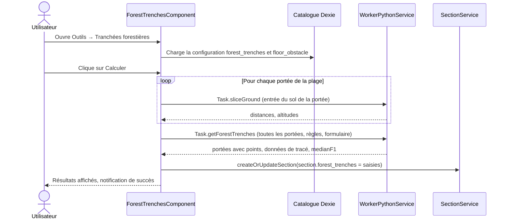

# Tranchées forestières — conception technique

Cette page décrit la construction de l'outil Studio **Tranchées forestières** : la configuration du catalogue,
le pipeline de calcul entre la boîte de dialogue Angular, le worker et le moteur Python, les données persistées
et les tests. Pour le comportement vu par l'utilisateur, voir {doc}`../../user_guide/forest_trenches`.

L'outil réutilise la mécanique de conformité (états climatiques, distances des règles, scénarios et
l'exécuteur multi-états) décrite dans {doc}`../conformity` et {doc}`../configure_conformity`. Le profil du sol
provient de l'obstacle « sol » de la section, voir {doc}`obstacles_floors_and_distances`.

---

## Fichiers clés

| Couche | Fichier | Rôle |
|---|---|---|
| Barre d'outils | `features/studio/core/presentation/components/top-toolbar/top-toolbar.component.ts` | Ajoute l'entrée du menu **Outils**, qui appelle `ToolbarDialogService.openTool('forest-trenches')`. |
| Registre des dialogues | `features/studio/toolbar/presentation/services/toolbar-dialog.service.ts` | Associe `'forest-trenches'` à `ForestTrenchesComponent`. |
| Dialogue | `features/studio/forest-trenches/presentation/components/forest-trenches/forest-trenches.component.ts` (`.html`, `.scss`) | Formulaire, chargement du catalogue, calcul, résultats, cycle de vie du graphique (`ResizeObserver`, purge à la destruction). |
| Helpers | `…/forest-trenches/…/forest-trenches.helpers.ts` | `getForestTrenchesConfig()`, `spansInInterval()`, `toSliceGroundInput()`, `fractionLabel()`, `forestTrenchesXTickLabels()`, `buildForestTrenchesRows()`, `createForestTrenchesPlot()` (`Plotly.react`), `resizeForestTrenchesPlot()`, `purgeForestTrenchesPlot()`. |
| Constantes | `…/forest-trenches/…/forest-trenches.constantes.ts` | `FOREST_TRENCHES_PLOT_ID`, couleur des axes, marqueur des points de l'axe (`x-thin`, taille 7). |
| Interfaces | `…/forest-trenches/…/forest-trenches.interfaces.ts` | `ForestTrenchesConfig`, `ForestTrenchesChart`, `ForestTrenchesTableRow`, `ForestTrenchesPlotOptions`. |
| Saisies persistées | `shared/domain/models/forest-trenches.model.ts` | `ForestTrenchesInputs`. |
| Section | `shared/domain/models/section.model.ts` | `forest_trenches?: ForestTrenchesInputs \| null`. |
| Import du catalogue | `shared/catalog/csv-import/configs/obstacles.config.helpers.ts` | `assertForestTrenchesConfig()`, `assertForestTrenchesFloorObstacle()`, `buildConformityConfig()`. |
| Stockage | `infrastructure/database/entities/catalog-obstacle-conformity-config.entity.ts` | Colonnes `forest_trenches_*` et `floor_obstacle_*`. |
| Styles de tracé | `shared/constants/plotly-styles.constantes.ts` | `PLOTLY_MARKER_SYMBOLS`, `PLOTLY_LINE_DASHES` (noms de styles autorisés). |
| Types du worker | `core/services/worker_python/tasks/types.ts` | `Task.sliceGround`, `Task.getForestTrenches` et leurs types d'entrée et de sortie. |
| Aiguillage du worker | `core/services/worker_python/tasks/handle-task.ts` | Associe les tâches aux fonctions `slice_ground` et `get_forest_trenches`. |
| API Python | `core/services/worker_python/tasks/python-scripts/api.py` | `slice_ground(js_inputs)`, `get_forest_trenches(js_inputs)`. |
| Moteur | `stellar-engine/src/stellar_engine/core/conformity/ground.py` | `slice_ground()`. |
| Moteur | `stellar-engine/src/stellar_engine/core/conformity/forest_trench.py` | `run()`. |
| Moteur | `stellar-engine/src/stellar_engine/core/conformity/request.py` | `ForestTrenchRequest`, `ForestTrenchSpanInput`. |
| Moteur | `stellar-engine/src/stellar_engine/core/conformity/runner.py` | `SpanPointsProjector`, `MultiStateRunner`. |
| Moteur | `stellar-engine/src/stellar_engine/core/conformity/strategies.py` | `ConformityPlot.FOREST_TRENCHES`, associé à `OverhangStrategy` (utilisé uniquement pour construire les scénarios). |
| Données du catalogue | `public/data/obstacle_configuration.json` | Blocs `forest_trenches` et `floor_obstacle`. |

---

## Vue d'ensemble



Le calcul est piloté par le composant. Le worker n'est utilisé que pour les deux tâches Python. Les résultats sont
conservés dans un signal et ne sont jamais persistés. Seules les saisies du formulaire sont enregistrées sur la section.

---

## Configuration du catalogue

Le fichier de catalogue des obstacles `public/data/obstacle_configuration.json` contient deux blocs lus par l'outil :

```json
"forest_trenches": {
  "ground_n_slicing_points_choices": [5, 9, 17],
  "overhang_rules_selected": ["RULE_1"],
  "lateral_rules_selected": ["RULE_1", "RULE_2"],
  "chart": {
    "cable": { "marker": "circle", "line": "solid" },
    "limit": { "marker": "square-open", "line": "dash" },
    "overhang_color": "#0000FF"
  }
},
"floor_obstacle": {
  "obstacleType": "floor",
  "obstacleName": "floor",
  "details": "",
  "redZone": true,
  "conformity": "forest_trenches",
  "distances": [
    { "ruleType": "RULE_1", "active": true, "overhang": { "63": 2.0 }, "lateral": { "63": 3.0 } }
  ]
}
```

À l'import, `assertForestTrenchesConfig()` et `assertForestTrenchesFloorObstacle()` valident le fichier. Les erreurs
sont préfixées par `Obstacle configuration:` :

- `ground_n_slicing_points_choices` est un tableau non vide d'entiers, chacun au moins égal à 2 ;
- `overhang_rules_selected` et `lateral_rules_selected` sont des tableaux de chaînes ;
- `chart.cable` et `chart.limit` sont des objets. Leur `marker` doit être une clé de `PLOTLY_MARKER_SYMBOLS`, et leur
  `line` une clé de `PLOTLY_LINE_DASHES` ;
- `chart.overhang_color` est une chaîne ou `null` ;
- `floor_obstacle.obstacleType`, `obstacleName` et `details` sont des chaînes, `redZone` est un booléen, et
  `conformity` doit valoir `"forest_trenches"` ;
- `floor_obstacle.distances` est validé comme les distances des autres obstacles.

`buildConformityConfig()` range le résultat dans la ligne singleton de la configuration de conformité :
`forest_trenches_n_points_choices`, `forest_trenches_overhang_rules`, `forest_trenches_lateral_rules`,
`forest_trenches_chart`, `floor_obstacle_red_zone` et `floor_obstacle_distances` (`rule_type`, `active`, `overhang`,
`lateral`). `obstacleType`, `obstacleName` et `details` sont validés mais ne sont pas stockés.

Les distances utilisées par l'outil sont celles de `floor_obstacle`, et non celles des entrées `obstacles[]`.

`getForestTrenchesConfig()` renvoie `null` lorsqu'un de ces champs est absent ou mal formé, par exemple pour une ligne
importée avant leur existence. Le composant positionne alors `isConfigMissing`, journalise un avertissement une seule fois
via `LoggerService`, et affiche le message de configuration manquante dans le dialogue.

---

## Modèle de données

Les saisies enregistrées sur la section, issues de `shared/domain/models/forest-trenches.model.ts` :

```typescript
export interface ForestTrenchesInputs {
  firstSupportUuid: string;
  lastSupportUuid: string;
  nPoints: number;
  windZone: string;
  windMinus: boolean;
  redZonePresence: boolean;
  repartitionTemperature: number;
  lateralDistanceTemperature: number;
  selectedRules: string[];
}
```

`section.model.ts` déclare `forest_trenches?: ForestTrenchesInputs | null` (« Dernières saisies du formulaire des
tranchées forestières calculées avec succès »). Les résultats ne font pas partie de la section.

---

## Pipeline de calcul

`ForestTrenchesComponent.calculate()` exécute ces étapes :

1. **Règles.** Construit `rulesClimaticConditions` à partir des définitions de règles du catalogue (`lateral_point`,
   `overhang_point`) et `rulesDistances` à partir de `floor_obstacle_distances` pour chaque règle sélectionnée. Il lève
   `Missing climatic definition for rule …` ou `Missing floor-obstacle distance for rule …` si une donnée manque.
2. **Plage de supports.** `spansInInterval(supports, first, last)` renvoie les indices de portées `[firstIndex, lastIndex)`.
   Il lève une `RangeError` si un support est absent ou si le dernier support n'est pas après le premier.
3. **Sol, par portée.** Le sol est le sol de la section dont `supportUuid` est le support de gauche de la portée.
   `toSliceGroundInput(floor, spanIndex, nPoints)` construit l'entrée (`referenceSupport` vaut `'LEFT'` par défaut, les points
   du sol sont `{ distance: distanceToRefSupport, altitude }`). `Task.sliceGround` est exécuté une fois par portée, en séquence.
4. **Calcul.** `Task.getForestTrenches` reçoit :
   - `electricTension` (la tension de la section) et le `form` : `windZone`, `windPressure` (pression normale ou de zone rouge
     selon la zone de vent), `windMinus`, `redZonePresence`, `repartitionTemperature`, `lateralDistanceTemperature`,
     `selectedConformityRules`, `conformity`, `conformityPlot: 'forest_trenches'` et `intermediatePoints: []` ;
   - `rulesClimaticConditions`, `rulesDistances` ;
   - `overhangRules` (règles de surplomb configurées, intersectées avec les règles sélectionnées) et `lateralRules` (règles
     latérales configurées, intersectées avec les règles sélectionnées) ;
   - `spans: [{ spanIndex, distances, altitudes }]`.
5. **Succès.** Le composant affecte `section.forest_trenches` avec les `ForestTrenchesInputs`, appelle
   `SectionService.createOrUpdateSection()`, met à jour `spanService.section`, conserve les résultats dans un signal, et
   affiche la notification de succès. Un résultat vide est traité comme une erreur.
6. **Échec.** `WorkerPythonService.runTask` renvoie `{ result, error }`. Le composant lève une exception en cas d'erreur,
   puis la capture : il appelle `LoggerService.error`, positionne le signal `calculationError`, et appelle
   `NotificationService.error`. Rien n'est enregistré.

L'effet du formulaire s'exécute lorsque la section change. Il réinitialise le formulaire à partir de `section.forest_trenches`
si la valeur enregistrée est valide, et à partir des valeurs par défaut sinon :

- `firstSupportUuid` et `lastSupportUuid` : premier et dernier support de la section ;
- `nPoints` : premier choix du catalogue ;
- `windZone` : la zone de vent par défaut du catalogue ;
- `repartitionTemperature` et `lateralDistanceTemperature` : valeurs par défaut du catalogue, ou la température de la règle
  latérale ;
- `redZonePresence` : `floor_obstacle_red_zone` ;
- `selectedRules` : règles actives du sol parmi les règles proposées.

Les résultats sont effacés lorsque la section change.

---

## Tâches

| Tâche | Fonction Python | Entrée | Sortie |
|---|---|---|---|
| `Task.sliceGround` | `slice_ground` | `SliceGroundInput` | `SliceGroundOutput` : `distances`, `altitudes`, `length` |
| `Task.getForestTrenches` | `get_forest_trenches` | `ForestTrenchesTaskInput` | `ForestTrenchesTaskOutput` : `spans` (`ForestTrenchesSpanOutput`) et `ForestTrenchesPointOutput` par point, plus `ForestTrenchesPlotOutput` |

Les types se trouvent dans `core/services/worker_python/tasks/types.ts`. La correspondance est dans `handle-task.ts`, et les
points d'entrée Python dans `python-scripts/api.py`.

---

## Côté moteur

### Découpage du sol : `slice_ground()`

`slice_ground(python_inputs, study)` dans `ground.py` :

- valide `spanIndex` (entier), `nPoints` (entier, au moins 2), `referenceSupport` (`'LEFT'` ou `'RIGHT'`) et `floorPoints`
  (un tableau). Il lève `ConformityInputError` sinon, et `SupportOutOfRangeError` lorsque `spanIndex` est hors plage ;
- calcule la longueur de la portée comme la distance horizontale entre les points du sol des deux supports
  (`position_engine.get_group_points().supports.coords[:, 0, :]`) ;
- construit `distances = np.linspace(0, length, nPoints)` ;
- ignore les points du sol dont la distance ou l'altitude vaut `null`, convertit une référence `RIGHT` en distance depuis le
  support de gauche (`length − d`), et trie les points ;
- interpole avec `np.interp`. Les valeurs au-delà du premier ou du dernier point du sol conservent l'altitude de ce point
  extrême. Sans point de sol, les altitudes sont linéaires entre les altitudes du sol des deux supports.

Elle renvoie `{ distances, altitudes, length }`.

### Tranchées forestières : `run()`

`run(python_inputs, study)` dans `forest_trench.py` :

1. `ForestTrenchRequest.from_dict` (`request.py`) valide l'entrée. `conformityPlot` doit valoir `'forest_trenches'`,
   `overhangRules` et `lateralRules` sont des listes de chaînes, et `spans` est non vide avec des `spanIndex` uniques.
   Les `distances` et `altitudes` de chaque portée ont la même longueur (au moins 2) et ne contiennent que des nombres finis.
2. Travaille sur une copie profonde de l'étude, de sorte que l'étude de l'appelant reste inchangée.
3. Pour chaque portée, ajoute un obstacle « sol » temporaire avec `add_single_obstacle` : UUID `forest-trench-<spanIndex>`,
   altitudes absolues, référence latérale `SPAN_AXIS`, référence `LEFT`, `y = 0`. `find_obstacle_point` résout ses points
   dans le repère modifié.
4. Construit un `SpanPointsProjector` (`runner.py`). Il place un plan vertical perpendiculaire à l'axe de la portée, passant
   par chaque point.
5. `ScenarioBuilder`, avec la stratégie de `forest_trenches`, construit les scénarios des règles. Les règles de remplacement
   sont les mêmes que pour la conformité : la température de la règle si elle en a une, sinon la température du formulaire.
   `windMinus` inverse la pression latérale, et le cas latéral inverse utilise la pression opposée. Pour chaque règle latérale,
   l'exécution conserve `LATERAL` et `LATERAL_INVERSE`. Pour chaque règle de surplomb, elle conserve `OVERHANG`. Un scénario
   manquant lève `ConformityInputError`.
6. `MultiStateRunner` résout une seule fois chaque état unique (pression de vent, température), puis mesure les points de
   chaque portée. Le premier et le dernier point utilisent les points d'attache du câble. Les points intermédiaires utilisent
   `DistanceEngine.plane_distance`. Si aucune intersection n'est trouvée, le point d'attache du câble le plus proche est utilisé.
7. Les valeurs projetées sont la distance latérale signée, dans le plan, par rapport à l'axe de la portée, et l'altitude. Un
   hook d'état collecte la flèche de chaque portée demandée. `medianF1` est la flèche dans l'état du premier scénario de
   surplomb, car tous les scénarios de surplomb partagent la température de répartition et n'ont pas de vent. Elle vaut `null`
   s'il n'y a aucune règle de surplomb.

Sortie par point :

- `lateral[rule]` et `lateralInverse[rule]` : `{ axisDistance, elevation, limitAxisDistance }`. `limitAxisDistance` vaut
  `axisDistance − lateralDistance` pour le cas latéral, et `axisDistance + lateralDistance` pour le cas inverse ;
- `overhang[rule]` : `{ elevation, heightAboveGround, complianceLimitHeightAboveGround }`, où `heightAboveGround =
  elevation − groundElevation` et `complianceLimitHeightAboveGround = heightAboveGround − overhangDistance`.

Une distance latérale ou de surplomb manquante pour une règle sélectionnée lève `ConformityInputError`.

Sortie par portée : `spanIndex`, `length`, `medianF1`, `axis` (`[{x: 0, y: 0}, {x: length, y: 0}]`), et `plot` : `lateral` et
`lateralInverse` avec les séries `cable[]` et `limit[]`, et `overhang` avec `cable[]`. Chaque point de série est
`{ x: distance, y: lateral }`.

Les erreurs spécifiques du moteur correspondent à des codes d'erreur, voir {doc}`how_to_add_error_codes`.

L'application charge le moteur stellar-engine sous forme de wheel. Après une modification des fichiers Python, reconstruisez-le
avec `npm run set-up-mechaphlowers:engine-only`, comme décrit dans {doc}`../installation/setup-mechaphlowers-guide`.

---

## La boîte de dialogue

- **Hébergement.** La boîte de dialogue est ouverte par `ToolbarDialogService` sous la clé `forest-trenches`. Sa largeur est de
  86.5625rem, avec un maximum de 90 %. L'en-tête affiche l'icône `forest` et le titre.
- **Formulaire.** Les champs sont le premier et le dernier support, le nombre de points de découpage du sol (choix issus du
  catalogue), la tension électrique (lecture seule), la zone de vent, l'inversion du vent, la présence de zone rouge, les deux
  températures, et les règles (liste à choix multiples sur l'union des règles de surplomb et latérales configurées).
- **Résultats.** Un sélecteur de portée, le graphique en vue en plan, le « F1 médian » (lorsqu'une règle de surplomb est
  sélectionnée), et un tableau. `buildForestTrenchesRows()` construit les lignes du tableau dans un ordre fixe : distance au
  support de gauche, altitude du sol, altitude du câble par règle de surplomb, altitude du câble par règle latérale, hauteur du
  câble par règle de surplomb, hauteur limite de conformité par règle de surplomb, axe de la portée au câble par règle latérale,
  axe de la portée à la limite latérale par règle latérale. Les températures figurant dans les libellés sont résolues comme dans
  le moteur.
- **Graphique.** `createForestTrenchesPlot()` appelle `Plotly.react`. La mise en page est reconstruite à chaque appel par
  `getPlotlyBaseLayout()`. L'axe y est inversé avec `scaleanchor: 'x'` et un ratio de 1. Les graduations de l'axe x sont placées
  à `distanceToLeftSupport`, avec des libellés issus de `forestTrenchesXTickLabels()`, qui réduit les fractions par le PGCD. La
  légende n'est affichée que lorsque la vue est agrandie. Un `ResizeObserver` appelle `resizeForestTrenchesPlot()`, et
  `purgeForestTrenchesPlot()` est exécuté à la destruction.

---

## Tests

- `features/studio/forest-trenches/…/forest-trenches.component.spec.ts`
- `features/studio/forest-trenches/…/forest-trenches.helpers.spec.ts`
- `shared/catalog/csv-import/configs/obstacles.config.spec.ts`
- `stellar-engine/test/core/conformity/test_forest_trench.py`
- `stellar-engine/test/core/conformity/test_forest_trench_ground.py`

---

## Documentation associée

- {doc}`../conformity` : le modèle de conformité et les règles.
- {doc}`../configure_conformity` : la configuration du catalogue de conformité.
- {doc}`obstacles_floors_and_distances` : les obstacles « sol » et leurs distances.
- {doc}`engine_worker` : le worker Python.
- {doc}`../../user_guide/forest_trenches` : le guide utilisateur de cet outil.
