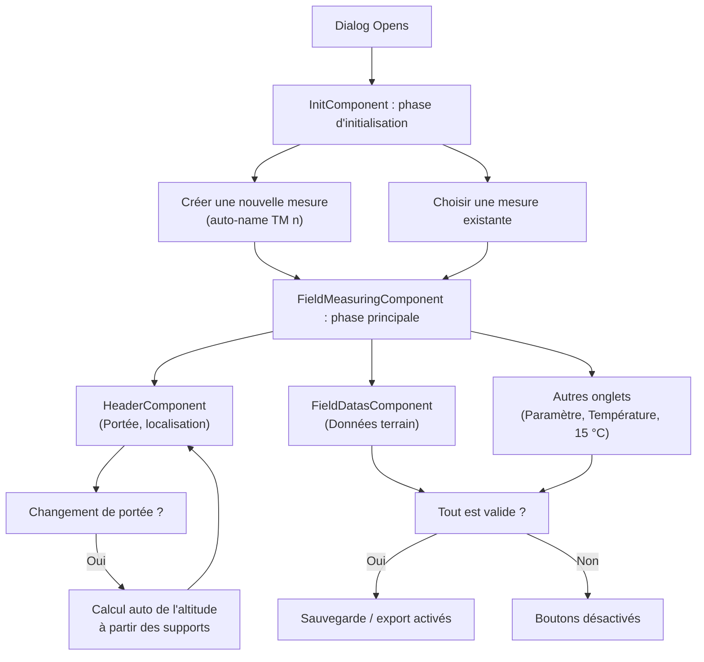

# Onglet Données terrain

## Objectif

L'onglet **Données terrain** collecte les données environnementales et de localisation enregistrées au cours d'une session de mesure sur site. Il fait partie de l'outil **Mesure de terrain**, qui calcule le paramètre de base et les propriétés thermiques associées à partir des observations sur site.

## Arborescence des composants et fichiers

L'onglet Données terrain est implémenté par les composants et fichiers suivants (chemins relatifs depuis `src/app/features/studio/field-measuring/`) :

- **Boîte de dialogue principale** : `presentation/components/field-measuring/field-measuring.component.ts` (onglets, validation, sauvegarde/export)
- **Onglet Données terrain** : `presentation/components/field-datas/field-datas.component.ts` et `.html`
- **En-tête partagé** (au-dessus de tous les onglets) : `presentation/components/header/header.component.ts` et `.html`
- **Écran d'initialisation** (créer/sélectionner une mesure) : `presentation/components/init/init.component.ts` et `.html`
- **Modèle de domaine** : `domain/types.ts` (exporte l'interface `FieldMeasure`)
- **Helpers** : `presentation/helpers.ts` (par exemple `createInitialMeasureData`, `buildTimeModeOptions`, générateurs d'options)
- **Constantes** : `presentation/constants.ts` (bornes, clés d'options, correspondances d'export)
- **Helpers d'export** : `presentation/field-measure-export.helpers.ts` (structure JSON d'export)
- **Rapport PDF** : `presentation/services/field-measure-report/` (`*.helpers.ts` pour les données et le dessin, `*.service.ts` pour la génération)

## Flux de travail

1. **Phase d'initialisation** : l'utilisateur ouvre l'outil de mesure de terrain. `InitComponent` permet de créer une nouvelle mesure (avec un nom généré automatiquement) ou de sélectionner une mesure existante.
2. **Phase principale** : une fois une mesure sélectionnée ou créée, `FieldMeasuringComponent` affiche une boîte de dialogue avec quatre onglets. L'onglet **Données terrain** est affiché par défaut.
3. **Saisie des données** : l'utilisateur remplit les champs de localisation et environnementaux via `HeaderComponent` (partagé) et `FieldDatasComponent` (spécifique à l'onglet).
4. **Validation** : `FieldMeasuringComponent` calcule `isGlobalFormValid` (nom et en-tête) et `isTerrainDataValid` (onglet Données terrain) en contrôlant les champs obligatoires et leurs bornes.
5. **Sauvegarde** : appelle `PlotService.modifySection()` pour enregistrer la mesure dans le tableau `field_measures` de la section.
6. **Export** : `onExport()` appelle `buildFieldMeasureExportJson()` sur la dernière version enregistrée (`lastSavedMeasureData`), dès que `canReportOrExport()` est vrai (formulaire global valide, onglet affiché valide, aucune modification non enregistrée), puis enregistre le fichier (voir la section Export ci-dessous).
7. **Rapport** : appelle `buildFieldMeasureReportData()` puis `FieldMeasureReportService.generateReport()` pour générer un rapport PDF de la mesure enregistrée (même condition d'activation que l'export).

## Modèle de données

Les données de la mesure sont typées comme `FieldMeasure` (depuis `domain/types.ts`), qui inclut :

- **UUID** : identifiant unique (généré automatiquement via `uuidv4()`).
- **Nom** : nom saisi par l'utilisateur ; doit être unique dans la section.
- **Métadonnées** (lecture seule venant de la section) : `link`, `voltage`, `spanType`, `phaseNumber`, `numberOfConductors`.
- **Données terrain** (onglet Données terrain) :
  - `date` (Date) : date de mesure
  - `time` (Date) : heure de mesure
  - `season` ('summer' | 'winter') : déduit de l'heure d'été
  - `ambientTemperature` (number, °C) : plage -50 à 99
  - `windSpeed` (number) : plage 0 à 50
  - `windSpeedUnit` ('kmh' | 'ms') : km/h ou m/s
  - `windDirection` (string) : un des 16 points de la rose des vents (Nord, Nord-Nord-Est, Nord-Est, …)
  - `skyCover` (enum SkyCover N0–N8) : échelle de nébulosité
- **Données de localisation** (en-tête partagé) :
  - `span` (number[] | null) : `[leftSupportIndex, rightSupportIndex]`
  - `longitude` (number, degrés) : plage -180 à 180
  - `latitude` (number, degrés) : plage -90 à 90
  - `altitude` (number, m) : plage -100 à 9000 ; calculée automatiquement à partir des hauteurs des supports de la portée
  - `azimuth` (number, degrés) : plage -180 à 180
- **Sorties** (calculées) : `papoto` (PapotoResult | null), `cableTemperature` (TemperatureCalculationResult | null), `parameter15C` (Parameter15CResult | null), `tangentAimingSupport` / `tangentAimingExterior` / `tangentAimingInterior` (TangentAimingSupportResult | null, voir {doc}`tangent_aiming`)

D'autres champs existent pour les autres onglets (calcul du paramètre, température, paramètre à 15 °C) ; voir le modèle complet pour le détail.

## Liaisons de champs et événements

### HeaderComponent

**Entrées :**
- `measureData: InputSignal<FieldMeasure>` – données courantes de la mesure
- `fieldChange: OutputSignal<{ field: keyof FieldMeasure; value: any }>` – émis lorsque l'utilisateur modifie un champ

**Comportement :**
- Affiche les informations non modifiables : Liaison, Tension, Type de portée, Numéro de phase, Nombre de câbles.
- Liste déroulante de la portée : préremplie à partir des supports de la section ; sélectionne automatiquement la première portée à l'ouverture de la boîte de dialogue (si aucune n'est sélectionnée).
- Lorsqu'une portée change : l'altitude est recalculée comme moyenne des hauteurs d'attache des deux supports.
- Longitude / Latitude / Altitude / Azimut : champs numériques avec badges obligatoires et validation de plage.
- Lorsqu'une portée ou un support de référence change, le composant tente aussi de préremplir la longitude / latitude / azimut à partir de la localisation de l'étude pour cette portée.

**Résolution automatique de localisation :**
- La logique est dans `HeaderComponent.fillLocalization()` et utilise `GeopositioningService.resolveLocalization()` : le GPS de pied / `spanAzimut` stockés des supports, ou un `Task.computeLocalization` à la volée (à partir du GPS de pied du premier support, de `start_azimuth` et des `spanLength` / `spanAngle` de chaque support) s'ils ne sont pas stockés.
- `getSpanLocalization()` sélectionne la localisation correspondante du support résolu, en privilégiant le support de référence sélectionné puis le support gauche à défaut.
- Si aucune valeur finie n'est disponible, l'application affiche le message d'information traduit `field-measuring.header.localization-not-available` (texte : « Localization not available in study »).

### FieldDatasComponent

**Entrées :**
- `measureData: InputSignal<FieldMeasure>` – données courantes de la mesure
- `isNameAlreadyTaken: InputSignal<boolean>` – signale une erreur de nom en double

**Sorties :**
- `fieldChange: OutputSignal<{ field: keyof FieldMeasure; value: any }>` – émis lors d'un changement de champ

**Champs :**
- **Nom de la mesure** : champ texte ; unicité validée au niveau parent.
- **Date** : sélecteur de date (format jj/mm/aa).
- **Heure / Saison** : bascule de saison (Été / Hiver) + sélecteur d'heure (format 24 h).
- **Température ambiante** : champ numérique (°C), plage -50 à 99.
- **Vitesse du vent** : champ numérique (0–50) + bascule d'unité (km/h ou m/s).
- **Direction du vent** : liste déroulante (16 points de la rose des vents).
- **Couverture nuageuse** : liste déroulante (échelle N0–N8 de nébulosité).

Tous les champs affichent un message de champ obligatoire (`field-measuring.field-datas.mandatory-msg`).

### InitComponent

**Objectif :** Créer une nouvelle mesure ou sélectionner une mesure existante avant d'entrer dans la boîte de dialogue principale.

**Flux :**
1. **Créer** : saisir un nom (prérempli comme « TM n+1 » où n = nombre de mesures) → cliquer sur « Créer une nouvelle mesure » → passer à la phase principale.
2. **Choisir** : sélectionner dans la liste déroulante une mesure existante → cliquer sur « Choisir » → passer à la phase principale.

**Validation :**
- Le nom doit être fourni et unique (contrôlé par rapport aux mesures existantes).
- Les noms dupliqués affichent le message d'erreur : `field-measuring.shared.measure-name-unique-error`.

## Règles de validation

### Bornes des champs (`FieldMeasuringComponent.isGlobalFormValid` / `isTerrainDataValid`)

Tous les champs sont obligatoires et sont contrôlés pour leurs plages :
- `name` : non vide, unique
- `span` : doit être défini
- `longitude` : -180 à 180
- `latitude` : -90 à 90
- `altitude` : -100 à 9000
- `azimuth` : -180 à 180
- `windSpeed` : 0 à 50
- `ambientTemperature` : -50 à 99
- `windDirection`, `skyCover` : requis
- `transit` (champ optionnel dans d'autres onglets) : si présent, 0–4000 ampères

**Export et rapport** : les deux boutons ne sont activés que lorsque `canReportOrExport()` est vrai : le formulaire global (`isGlobalFormValid` : nom, tronçon, longitude, latitude, altitude, azimut) valide, l'onglet affiché valide (`isTerrainDataValid`, `isParameterCalculationValid`, `isTemperatureCalculationValid` ou `isParameter15CValid`, les autres onglets sont ignorés) et aucune modification non enregistrée (`isSaved` : même méthode de calcul que la dernière version enregistrée et aucune saisie modifiée, voir `hasEditedInputs`).

- `isParameterCalculationValid` délègue à `TANGENT_AIMING_MODES[method].isDataValid` pour les trois variantes de visées tangentes, à `isPapotoDataValid` pour PAPOTO, et vaut toujours vrai pour l'espace réservé PEP.
- `isParameter15CValid` vaut toujours vrai en mode `auto` (l'onglet n'a aucune saisie modifiable) et utilise `isManual15CDataValid` en mode `manual`.
- Tant que les boutons sont désactivés, `reportExportBlockedReason()` calcule le message affiché dans le pied de la boîte de dialogue (`data-testid="report-export-blocked-reason"`), construit à partir des clés `field-measuring.report.blocked-invalid-global`, `blocked-invalid-tabs` et `blocked-unsaved`.

**Boutons Calculer** : chaque onglet désactive son propre bouton tant que ses saisies ne sont pas valides : `isPapotoDataValid` (PAPOTO), `canCalculate()` de `TangentAimingFormBase` (formulaire valide, type de calcul `tangente`, aucun calcul en cours), `isTemperatureDataValid` (température) et `isFormValid()` (15 °C : en mode `auto`, un paramètre, son incertitude, une température du câble et son incertitude doivent exister dans `outputs` ; en mode `manual`, `isManual15CDataValid`). Le bouton **Estimer** de l'onglet température exige aussi que le worker soit prêt (`canEstimateSkyCover`).

**Contrôle d'unicité** : la propriété calculée `isNameAlreadyTaken` vérifie si `measureData().name` correspond à une mesure existante (en excluant l'élément courant par UUID).

## Sauvegarde et export

### Sauvegarde

- **Gestionnaire** : `FieldMeasuringComponent.onSave()`
- **Condition** : activé lorsque `canSave()` : nom non vide et unique, et `hasEditedInputs()` (toute saisie modifiée, quel que soit l'onglet ; la validité des champs n'est pas exigée)
- **Action** : appelle `PlotService.modifySection({ field_measures: [...updated...] })` pour enregistrer
- **Instantané** : `lastSavedMeasureData` est mis à jour ; `hasUnsavedChanges` est recalculé

### Export

- **Gestionnaire** : `FieldMeasuringComponent.onExport()`
- **Condition** : activé lorsque `canReportOrExport()`
- **Source** : `lastSavedMeasureData()` (la version enregistrée), avec le canton courant (`SpanService`), l'étude et `litData` (`PlotService`)
- **Sortie** : fichier JSON (via `buildFieldMeasureExportJson()`) contenant les métadonnées de l'étude / section et les données de mesure
- **Enregistrement** : `saveExportFile()` utilise `showSaveFilePicker` lorsqu'il est disponible (typé dans `field-measure-export.window.d.ts` ; une annulation par l'utilisateur, `AbortError`, est ignorée silencieusement ; les autres erreurs sont consignées via `LoggerService` puis basculent sur le téléchargement), sinon télécharge le fichier via un lien `<a download>` temporaire
- **Nom du fichier** : `Export Mesure de terrain_<measure name>_<section name>_<date>.json` (`buildFieldMeasureExportFilename()`)
- **Structure** : `{ groundMeasurement: [ { general, measure, span, temperatureCalculation, parameterCalculation, zeroWindCalculation } ] }`, typée dans `field-measure-export.interfaces.ts`
- **`measure`** : `season` est traduit (`ETE`/`HIVER` en français, `SUMMER`/`WINTER` en anglais, clés `field-measuring.export-labels.season.*`) ; `time` contient les secondes et le décalage horaire (`HH:mm:ss.SSS±HH:MM`), comme `general.date`
- **`parameterCalculation`** : seul le bloc de la méthode retenue est présent dans `method`.
  - `leftSupport` est le libellé affiché par le formulaire PAPOTO (index du support + 1, voir `formatLeftSupportLabel()`), pour PAPOTO et les visées tangentes.
  - Les visées tangentes exportent `methodName: "VISEES_TANGENTES"` et `subMethodName` `SUPPORT` / `EXTERIEUR` / `INTERIEUR`. Le bloc `tangentialSights` lit les champs de la variante retenue via `TANGENT_AIMING_REPORT_CONFIGS`. Pour la variante Support, la distance saisie est exportée dans `leftSupportMeasures.verticalDistance` (pas d'angle vertical gauche) ; les autres variantes exportent `horizontalDistance` et `verticalAngle`.
  - `calculatedParameter.criterion` vaut `{ threshold, unit: "%", status }`, avec `threshold` = `0.5` pour PAPOTO et `1` pour les visées tangentes (`PAPOTO_VALIDITY_CRITERION_PERCENT`, `TANGENT_AIMING_VALIDITY_CRITERION_PERCENT`). Il est absent tant que la méthode n'est pas calculée.
  - Le bloc PEP reste un emplacement réservé.

### Rapport

- **Gestionnaire** : `FieldMeasuringComponent.onReport()`
- **Condition** : activé lorsque `canReportOrExport()` (toutes les méthodes de calcul, y compris les visées tangentes)
- **Sortie** : PDF A4 portrait (jsPDF, police Nunito) : cartouche étude / canton puis un paragraphe par onglet. Seules la méthode (et sous-méthode) de calcul du paramètre et les valeurs du mode « Mise à jour des valeurs » retenus sont reportés ; les données conditionnelles (n° de phase, paramètre ou angle tangent) ne sont présentes que si la condition est remplie
- **Unités** : celles de l'US.MES.RAP (angles de visée en `gr`, vitesse du vent en m/s, etc.), définies dans `field-measure-report.constantes.ts`
- **Nom du fichier** : `Rapport Mesure de terrain_<measure name>_<section name>_<date et heure de génération>.pdf`

## Diagramme Mermaid : flux de travail

## Tests

Les fichiers de spécification suivants couvrent la fonctionnalité des données terrain :

- `presentation/components/field-datas/field-datas.component.spec.ts` – onglet Données terrain
- `presentation/components/header/header.component.spec.ts` – en-tête (localisation et portée)
- `presentation/components/init/init.component.spec.ts` – écran d'initialisation (créer/sélectionner)
- `presentation/components/field-measuring/field-measuring.component.spec.ts` – boîte de dialogue, validation, sauvegarde/export
- `presentation/field-measure-export.helpers.spec.ts` – structure de l'export JSON
- `presentation/helpers.spec.ts` – helpers partagés (validité, `formatLeftSupportLabel`, nom de fichier)
- `presentation/components/temperature-calculation/temperature-calculation.component.spec.ts` – onglet lié
- `presentation/components/parameter-calculation-15-without-wind/parameter-calculation-15-without-wind.component.spec.ts` – onglet lié
- `presentation/components/calculus-setting/calculus-setting.component.spec.ts` – onglet lié
